# Resharding and alternatives

**Owning question:** How can ownership move without accepting conflicting writes or unnecessary distribution?

This page belongs to [V05/C05 — Partitioning, sharding and rebalancing](README.md). Use the integrated walkthrough for the surrounding decision; the sections below own this narrower mechanism and its limits.

<!-- tycho-question-source:tycho.page.0d34dd26886340b89fd4f1499d790a81:4 -->
## 4. Resharding is a multi-state data transition

A correct target topology is insufficient: clients, source stores, replica/backfill state, transaction changes and destination ownership must remain consistent **during** migration.

```mermaid
stateDiagram-v2
    [*] --> Existing
    Existing --> Prepare: Version target routing and compatibility
    Prepare --> Copy: Copy historical data to target ownership
    Copy --> CatchUp: Replay ongoing committed changes
    CatchUp --> Verify: Compare counts, identities and invariant state
    Verify --> Switch: Freeze/route/fence source writes and cut over
    Verify --> Repair: Divergence detected
    Repair --> CatchUp: Correct and revalidate
    Switch --> Observe: Route requests, compare errors and lag
    Observe --> Final: Retirement after rollback window
    Observe --> Repair: Unexpected issue; assess forward repair
    Final --> [*]
```

Text alternative: prepare compatible routing, copy source data, catch up in-flight changes, verify exact business invariants, fence conflicting writers and switch ownership before retiring old storage. If a mismatch is found, reconcile rather than declaring success. This is a **synthetic safe-transition outline**, not a real Vitess command sequence.

The current Vitess 24.0 resharding guide includes an online workflow and staged cutover, but its described behavior depends on exact source/target configuration. It must not be copied as a generic, zero-downtime promise for any datastore. [E01]

### Migration validation checklist

1. Identify shard authority and data ownership for each key; record old/new mapping epoch.
2. Test read/write compatibility while old and new clients coexist.
3. Design snapshot/backfill with source change capture and a determinate resume position; prevent loss/double-application.
4. Verify counts **and domain invariants**; equal row counts alone do not prove referential correctness.
5. Fence stale writers and stale mapping caches at cutover.
6. Observe hot-key traffic, transaction retry rate, tail latency and replication lag before and after.
7. Define a *forward repair* if new writes cannot be safely read by old shard ownership; do not promise reversible rollback after irreversible changes.

### Original migration trace: moving a hot tenant while writes continue

A **fictional** catalog stores bookings by tenant and item ID. Tenant A has become hot, and engineers propose moving its records from shard S1 to S2. The authoritative reservation invariant is **one successful booking per physical item and interval**, including during rebalancing. Merely copying equal row counts does not enforce it.

| Stage | Allowed writer / routing | Acceptance gate | Crash and recovery response |
|---|---|---|---|
| S0 baseline | S1 alone owns the tenant; fixed routing revision | Snapshot identifiers, committed-operation IDs and skew are measured | Remain on S1 |
| S1 shadow | S1 alone accepts writes; copy and ordered catch-up populate S2 | Key/tenant ownership, deletes and late updates reconcile | Resume bounded copy/checkpoint, do not expose S2 as an independent writer |
| S2 fenced handover | New routing epoch authorizes a *single* writer only after previous epoch is fenced | Concurrent client retries and stale routers cannot commit on both shards | Freeze new writes or return to S1 **only if** no S2-only effects occurred |
| S3 stable | S2 is authoritative; S1 is read-only/retired according to a documented compatibility horizon | Bookings, access policies, delayed messages and restore path verified | Forward-repair/reconcile if old epoch later reappears |
| S4 retire | Old data and routing removed only after replay/restore requirements pass | No unsupported historical reader remains | No image-only rollback across incompatible new state |

A dangerous counterexample occurs when an old client caches the S1 routing epoch and commits after another client has switched to S2. Even a perfect initial data copy cannot prevent two writers without an authority/fencing protocol. Another failure is a delete followed by a delayed old-version update that resurrects a record in S2. Stable event identity and source ordering must be specified before exposing the new owner.

The [Vitess 24 resharding workflow documentation](https://vitess.io/docs/24.0/user-guides/configuration-advanced/resharding/) and its [versioned MoveTables reference](https://vitess.io/docs/24.0/reference/vreplication/movetables/) describe copy, verification, traffic switch and, with suitable preconditions, reverse traffic. These are examples of product-specific mechanisms; **reverse routing is not a universal promise that a business write can always be undone**, and a destructive completion step is not an ordinary rollback. The fictional stages above are a design-level synthesis, not a tested Vitess sequence.

**Alternative:** repair a hot query, introduce a bounded per-tenant work queue, cache genuinely immutable reads, or isolate a high-traffic tenant without general sharding if the real bottleneck supports it. **Proposed, not run:** inject stale routing, interrupted copy, duplicate retry, deletion replay and two simultaneous writers; refuse cutover unless the single-authority invariant and recoverability can be demonstrated. The [semantic-migration owner](../c06-schema-evolution-data-migration-and-retention/schema-lifecycle-and-semantic-migration.md) covers domain identity; this chapter owns physical ownership transfer and key skew.

<!-- /tycho-question-source -->

> **Pattern atlas:**
> [Consistent Hashing](../../v11-pattern-atlas/c06-database-storage/README.md#consistent-hashing) — decision conditions and contraindications.

<!-- tycho-question-source:tycho.page.0d34dd26886340b89fd4f1499d790a81:5 -->
## 5. Alternatives before sharding

Database query/index optimization, bounded connection pools, increasing storage/CPU, read replicas, caching suitable immutable/read-mostly data and removing unnecessary cross-domain locks can delay or remove the need for sharding. These tools address different bottlenecks; read replicas usually do not expand single-authority write serialization capacity.

**Insufficient evidence:** "The database has 500 million records; we must shard by user ID into 64 clusters." Cannot determine. Need growth, actual key and query distributions, hot tuples, disk and index IO, transactional ownership, compliance constraints, restore objectives, operational support and a measured comparison of simpler improvements.

<!-- /tycho-question-source -->

## Navigation, prerequisites and source scope

| Route | Destination |
|---|---|
| Parent and source ledger | [Chapter introduction and exact source rows](README.md#chapter-source-ledger) |
| Previous / prerequisite | [Read preceding context](shard-strategies.md) |
| Next | [Continue the reasoning](README.md) |
| Integrated question | [Original scenario and limits](shard-keys-hotspots-and-resharding.md) |

The source material keeps its original published/inferred/synthetic/unverified distinctions. Chapter-wide citations are shared reference context, not proof that every cited source supports every sentence on this page. Freshly inspected text is identified explicitly; absent dates and unknowns are retained.

## Bounded pattern ownership notes

These notes define the decision boundary for atlas cards whose mechanism is not the main subject of
this page. They are synthetic design guidance, not measured evidence, and they do not create a new
source claim.

### Consistent Hashing

**Mechanism — a hash ring with virtual nodes (Tycho summary, source-bound).** A consistent hash
function maps keys and nodes into one circular space. A key belongs to the first node encountered
clockwise from its hash position, and each physical node normally claims many small positions,
called tokens or virtual nodes, rather than one large arc. Karger et al. describe the construction
as giving each bucket multiple points in the unit interval and assigning each item to the closest
point. Dynamo says the output range of a hash function is treated as a fixed circular space or
"ring" and that each node gets multiple points, called virtual nodes. Cassandra says it "maps every
node to one or more tokens on a continuous hash ring" and walks the ring in one direction. Riak
computes a 160-bit hash per bucket/key pair, maps it to an ordered ring, and gives each vnode one
partition. The ring, clockwise ownership and token model are source-bound; the ownership-epoch rule
below is Tycho.

**Invariant — a membership change moves only the affected share (Tycho rule, source-bound
premise).** With K keys spread over N equal-share nodes, adding or removing one node should move
about K/N keys: the joining or leaving node's share, not the whole keyspace. Karger et al. state
that the expected fraction moved is "the minimum needed to maintain a balanced load"; Dynamo says
departure or arrival "only affects its immediate neighbors"; Cassandra says consistent hashing
"only has to move a small fraction of the keys"; Riak says each node is normally responsible for
"1/(number of nodes) of the ring." Tycho's rule is stricter than any single source: measure the
actual moved fraction, because random tokens, unequal vnode counts and hot keys can exceed the
ideal share. The ~1/N figure is an expectation under balance, not a guarantee.

**Failure and recovery — hotspots, node loss and repair (Tycho runbook, source-bound mechanics).**
Hotspots are the failure the original paper targets: its title names "Relieving Hot Spots," and it
notes that hot spots occur when many clients access one server. Uneven token ranges produce uneven
request load, and Cassandra warns that each token adds failure combinations and raises outage
probability. Node loss is handled by moving the lost node's ranges and load: Dynamo disperses an
unavailable node's load across remaining nodes and sends missed replicas to a hinted node; when the
node recovers, hinted replicas are delivered and anti-entropy repairs permanent divergence. Riak
documents removing an irrecoverable crashed node from another node and transferring its partitions.
Tycho's runbook: detect hot token ranges and hot keys, bound token counts against repair and outage
cost, record the ownership epoch at every membership change, and treat hinted handoff as temporary
protection rather than repair. A ring without epoch fencing can still route one key to two owners
during a change.

**Alternative — modulo, ranges and rendezvous (Tycho choice rule, source-bound modulo contrast).**
Modulo hashing assigns a key to hash(key) mod N. Cassandra says adding one node "might invalidate
almost all of the mappings"; Karger et al. describe the same central-redistribution problem for
classical hash functions when machines join. Explicit range assignment instead gives an operator
direct control over hot ranges and split points, at the cost of manual planning. Rendezvous
(highest-random-weight) hashing scores each key against every node and picks the winner, so no ring
or shared token map is required. Tycho's choice rule: use consistent hashing when membership changes
often and per-key movement must be bounded; use explicit ranges when range locality and operator
control dominate; use modulo only when N is fixed; use rendezvous when a shared ring is
unacceptable. Reverse the choice when ring operations and virtual-node tuning cost more than the
movement they save. Only the modulo contrast is source-bound here; the range and rendezvous
comparisons are Tycho synthesis.

**Source boundary.** Public sources accessed 2026-10-31; all are papers or living documentation,
not benchmarks or executed cluster tests. Quotes are short excerpts. Line breaks are editorial;
Karger PDF line-end hyphenation is joined, and Cassandra extraction spacing before punctuation is
normalized. Tycho-labelled sentences are synthesis, not source claims. Proposed records (not yet in
the shared ledger):

- Karger, Lehman, Leighton, Panigrahy, Levine and Lewin, "Consistent Hashing and Random Trees:
  Distributed Caching Protocols for Relieving Hot Spots on the World Wide Web," STOC '97,
  pp. 654-663, DOI 10.1145/258533.258660; public PDF SHA-256
  `0ccf4b8b1b4a1d4b7e5a411c98d1a1c890e863f71cccdddaf9cdc272015262d2`; extracted text SHA-256
  `cdaf06a423a62b790cea18bc0adc50fbc71a4c17682f7e08b098c13c0d8fe6c4`; record
  `read.karger-consistent-hashing.2026-10-31` (proposed).
- DeCandia et al., "Dynamo: Amazon's Highly Available Key-value Store," SOSP 2007, sections
  4.2, 4.3, 4.6, 4.7 and 4.9; PDF SHA-256
  `5cacd624cd7bfd37e3d22e04d8c2e347a49579d2927dbb06f40a89c0bcd40bd4`; extracted text SHA-256
  `2da247073d091ba83236b71dd9c5c56a19516f9f7b2e29258a0e3b5c4d4fb140`; record
  `read.dynamo-consistent-hashing.2026-10-31` (proposed).
- Apache Cassandra 5.0, "Dynamo," sections "Consistent Hashing using a Token Ring" and "Multiple
  Tokens per Physical Node (vnodes)"; raw HTML SHA-256
  `6392972302ba65e62eab354d4b754003847ce869a464979ba894f4daf0514a65`; article text SHA-256
  `b613129d96ffae22bf20f43807093b18973b75d5e1b79c1b43aa2ffad4b45f39`; record
  `read.cassandra-dynamo-consistent-hashing.2026-10-31` (proposed).
- Riak KV 2.2.3, "Vnodes," "Clusters" and "Adding / Removing Nodes," pinned to `basho_docs`
  commit `6409dd9c93b08f0a6e959a1874b5568c88172f3a`; page SHA-256 values
  `3fe623f7bbe206b9b289894607b0ff08748414a65060c6229a274ef7d986c204`,
  `ea246f176b17e21a6225d4fb9f5ba7a60fe90958ed07ef5da07efff05afbdfc5` and
  `67d14c75a3edb078f0d49591eea02d0b60cd5d7b4ebbfd49e632ec60705fe23f`; records proposed.
- The existing `read.batch3-cassandra-arch.2026-10-21` record remains a scope limit: it
  explicitly does not support a token ring. The existing Dynamo and Riak records remain valid
  for their narrower sections and are not stretched to cover these claims.
