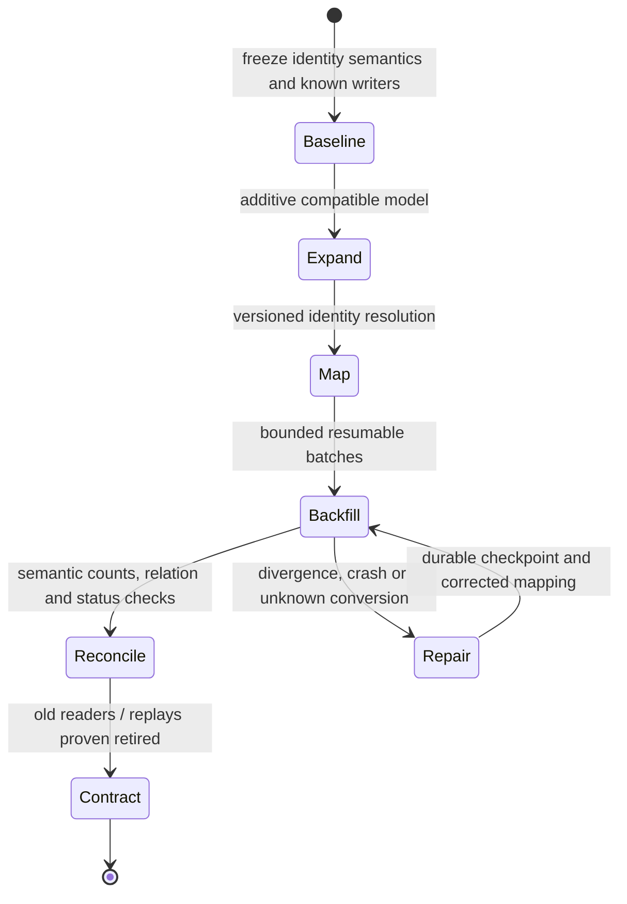

# Migration stages, retention and no-return points

**Owning question:** Which authority and validation gates permit old data or contracts to be retired?

This page belongs to [V05/C06 — Schema evolution, data migration and retention](README.md). Use the integrated walkthrough for the surrounding decision; the sections below own this narrower mechanism and its limits.

<!-- tycho-question-source:tycho.page.357c2d162bd44f3aa06a995a1e691551:3 -->
## 3. Expand, migrate, contract as gated lifecycle

[Danilo Sato's Parallel Change](https://martinfowler.com/bliki/ParallelChange.html) describes an expand/migrate/contract approach for interfaces. Applying it to a database requires **additional explicit transactional/data requirements** not established by that method alone.

**Text alternative:** begin with versioned authoritative identities, expand without removing old contract, resolve semantic mappings, backfill in resumable batches and reconcile *meaning* and references. Retire old data only after readers/replay paths are proved gone. Any divergent or uncertain mapping holds the transition.

### Backfill acceptance is more than row totals

A job that copies 10,000 source rows and produces 10,000 target rows can still corrupt meanings. Check:
- stable source/target identity and tenant scope;
- field-level semantic equivalence and unknown mappings;
- concurrent writes, deletes and timestamps;
- checkpoint durability on crash/retry;
- event/CDC offset and replay horizon;
- history, authorization and referential integrity;
- exact source snapshot and migration code version.

If backfill takes hours, it may read records while new writes occur. A design needs an authoritative writer and a change-capture/reconciliation plan. Two independent writers are not automatically atomic just because the schema includes both fields.

### Worked original migration: resolve meaning before transferring authority

For the fictional equipment catalogue, suppose an old `asset_code = "DRILL-A"` refers to a **model** in one business area but to **a specific physical unit** in another. The target model requires `model_id` and `unit_id`. A naive string rename preserves equal row counts while silently making a model look like one reservable unit. The following is a *proposed* migration protocol, not an executed database script.

| Transition | Single-writer rule | Falsifiable gate | Recovery when the gate fails |
|---|---|---|---|
| S0 — Snapshot | Legacy database remains the only writer | Snapshot/replay start offset and schema version are recorded | Abort before deploying new semantics |
| S1 — Expand | Legacy writer emits old representation plus a durable versioned change signal | Old binaries and consumers still read/write without change | Revert additive reader path; keep source authoritative |
| S2 — Resolve | Versioned mapping `(tenant, old_id, mapping_revision) → (model_id, unit_id or UNKNOWN)` is reviewed | No two authoritative physical identities map to one unit without an approved merge rule | Quarantine ambiguous records; never invent an ID |
| S3 — Backfill + catch-up | New tables are **projections**, not independently writable authorities | Per-tenant unique identities, history relations and post-snapshot updates reconcile | Resume from durable checkpoint; recompute affected projections |
| S4 — Guarded authority transfer | A fenced cutover authorizes precisely one writer; old writes are rejected or routed to it | Mixed-version reads, old event replay, authorization and reservation invariants pass | Route reads back while source remains compatible; otherwise hold and forward-repair |
| S5 — Contract | Retirement requires a verified replay horizon and explicit no-return approval | Historical restoration and retention obligations remain satisfiable | Preserve old decoders/archive or stop the deletion |

A useful **negative example** is a delete-and-recreate event arriving while S3 processes an older snapshot. Applying events by receipt order can resurrect a deleted unit. A design must use a source-authoritative version/checkpoint ordering rule or reconcile the full identity history before S4. Hash totals alone would miss that semantic corruption. A second negative case is two writers accepting the same reservation on opposite sides of the cutover; without fencing, a green source/target comparison at T0 proves nothing about T1.

**Choice and evidence boundary:** smaller changes may retain the existing schema and add an explicit mapping layer instead of migrating authority. The reversible point ends when new-only writes or deletion break old-reader expectations. The [deployment-compatibility owner](../../v08-delivery-deployment-and-recovery/c05-backward-compatible-database-change/mixed-version-database-compatibility-and-online-ddl.md) covers mixed binaries and DDL locks; [transition architecture](../../v10-decision-support-and-modernization/c05-target-architecture-versus-transition-states/target-and-transition-architecture-states.md) covers global go/no-go and fallback authorization. The protocol and all identifiers above are **synthetic**; Sato's Parallel Change and PostgreSQL's ALTER TABLE reference do **not** establish its safety.

<!-- /tycho-question-source -->

> **Pattern atlas:**
> [Expand-and-Contract Schema](../../v11-pattern-atlas/c06-database-storage/README.md#expand-and-contract-schema) — decision conditions and contraindications.
> [Online Data Migration](../../v11-pattern-atlas/c06-database-storage/README.md#online-data-migration) — decision conditions and contraindications.

<!-- tycho-question-source:tycho.page.357c2d162bd44f3aa06a995a1e691551:4 -->
## 4. Data retirement has a no-return point

Deleting a column, archived identifier or legacy event decoder may destroy an old client's ability to read history or replay effects. Contract is safe only after recording:
1. all active and required historical readers/writers;
2. migration completeness and an approved residual-unknown policy;
3. verified state restoration and event replay;
4. supported old/new binary plans and deprecation period;
5. data retention and deletion obligations, including backups and projections;
6. authorized acceptance of an irreversible change.

[PostgreSQL 17 ALTER TABLE](https://www.postgresql.org/docs/17/sql-altertable.html) documents that DDL operations differ in lock needs and that ACCESS EXCLUSIVE is the default unless otherwise noted. Database syntax does not certify that a lifecycle change preserves every domain invariant.

<!-- /tycho-question-source -->
<!-- tycho-question-source:tycho.page.357c2d162bd44f3aa06a995a1e691551:5 -->
## 5. Alternatives and failure conditions

| Option | Appropriate when | Counterexample |
|---|---|---|
| Simple local migration | Small bounded dataset and well-understood downtime | Long unknown consumers or expensive state copy |
| Additive schema with backfill | Old/new readers must overlap and mapping can be validated | New required field meaning cannot be derived |
| New normalized authority with adapter | Old model inconsistent and gradual cutover needed | Two writers make independent conflicting commitments |
| Immutable new-version records | Audit/history needs preservation across changes | Readers cannot resolve old/new entity identity |
| Retain old representation longer | Cost acceptable while source semantics are uncertain | Deletion/retention obligations forbid indefinite duplication |

A migration may legitimately stop on an **unresolvable identity** or unknown source meaning. Such a hold is a correct outcome, not failure to finish a technical change.

<!-- /tycho-question-source -->
<!-- tycho-question-source:tycho.page.357c2d162bd44f3aa06a995a1e691551:6 -->
## 6. Proposed negative tests and evidence limits

No tests were executed. A future fixture should insert ambiguous identifiers, backfill concurrently with writes, crash between data commit and checkpoint persist, replay an old event after cutover, test old clients, inject an unauthorized cross-tenant reference, and restore a historical backup. Every scenario must verify intended business identity, not only SQL success.

<!-- /tycho-question-source -->

## Deletion across derived state and restored backups

**Enrichment contract:** explain what an application deletion completes, which copies remain, and how recovery avoids republishing retired data. This is an engineering lifecycle model, not a legal retention determination.

Begin with a copy inventory: authoritative rows and blobs; read replicas; change logs and outbox entries; search/vector projections; caches; exports; operational logs; and historical backups. Define the allowed retained content and access for each owner. Removing one database row cannot itself prove removal of all copies.

### Original retirement protocol

A fictional catalogue retires document D at source revision 108. A durable retirement record names D, its scope and revision. Consumers remove or hide older representations and preserve enough retirement knowledge to reject older replay. A consumer processing revision 103 after 108 must not recreate the visible document.

~~~mermaid
flowchart TD
    R["Authoritative retirement at revision 108"] --> L["Durable retirement knowledge"]
    L --> I["Indexes and caches suppress older content"]
    L --> O["Objects and exports follow deletion policy"]
    B["Restore of revision 90 backup"] --> Q["Isolated restore boundary"]
    L --> Q
    Q --> V["Reapply retirement and validate access before exposure"]
~~~

Text alternative: restoring an older snapshot goes through an isolated reconciliation gate informed by retirement knowledge that survived independently. The sketch is an original proposed protocol, not evidence of physical erasure.

The retirement ledger itself must have an appropriate retention, access and minimization policy. Keeping sensitive content forever inside a deletion record defeats the purpose. Keep the minimal durable identity/version evidence needed to prevent resurrection. If that knowledge is lost with the same backup, the architecture cannot claim restored data respects later retirements.

### Completion is multidimensional

| State | What can be asserted |
|---|---|
| New reads denied | Current application exposure is blocked under the tested access paths |
| Derived owners acknowledge removal | Named projections processed a particular retirement revision |
| Historical copies retained but isolated | Recovery/access policy still permits physical retention; not an erasure claim |
| Provider removal completed | Only what the selected provider's documented scope and evidence establish |
| Restored service reconciled | Restored content and authorization were checked against later retirements before reopening |

Google Cloud's deletion description distinguishes active and backup storage stages and scopes its description to a particular published design. Use it as an example of why deletion has stages, not as a guarantee for arbitrary services or a current universal completion deadline.

### Failure and recovery

A lagging consumer needs a catch-up or rebuild procedure that includes retirement knowledge. A tombstone discarded before every possible replay horizon can allow old data to return. Coordinate tombstone retention with backup age, offline-consumer windows, log retention and source rebuild policy. If all those horizons cannot be bounded, retain another authoritative exclusion mechanism or accept an explicit unresolved requirement.

Cryptographic erasure needs proof that all usable key copies and relevant plaintext copies are covered. Destroying one shared encryption key may also destroy unrelated retained data. See [key lifecycle](../../v09-observability-security-and-operations/c05-identity-authorization-and-threat-modeling/object-credentials.md#key-rotation-revocation-and-unavailable-authorities) and [object lifecycle](../c08-object-storage-large-transfers-and-publication/access-lifecycle.md).

Proposed acceptance: retire D, hold one consumer offline, restore a pre-retirement backup in isolation, replay older events, and require no forbidden read through UI, direct object access, cache, search or export. No deletion or restore exercise was executed.

Selected evidence inspected 2026-10-20: [Data deletion](https://docs.cloud.google.com/docs/security/deletion) for staged active/backup deletion; all revision numbers and the retirement protocol are original synthetic reasoning. Exact physical-removal guarantees remain provider-specific and require separately reviewed evidence. The frontmatter evidence_scope is inherited from the decomposition baseline and records no source-specific inspection; this paragraph is the page-level provenance.

## Navigation, prerequisites and source scope

| Route | Destination |
|---|---|
| Parent and source ledger | [Chapter introduction and exact source rows](README.md#chapter-source-ledger) |
| Previous / prerequisite | [Read preceding context](semantic-compatibility.md) |
| Next | [Continue the reasoning](README.md) |
| Integrated question | [Original scenario and limits](schema-lifecycle-and-semantic-migration.md) |

The source material keeps its original published/inferred/synthetic/unverified distinctions. Chapter-wide citations are shared reference context, not proof that every cited source supports every sentence on this page. Freshly inspected text is identified explicitly; absent dates and unknowns are retained.

## Bounded pattern ownership notes

### Expand-and-Contract Schema

Expand-and-contract changes a schema in compatible phases: add the new representation, migrate
readers and writers, then remove the old one. The compatibility window is the safety mechanism, not
a delay to be skipped.

Begin with versioned authoritative identities, expand without removing old contract, resolve semantic
mappings, backfill in resumable batches and reconcile *meaning* and references. Retire old data only
after readers/replay paths are proved gone. Route reads back while source remains compatible;
otherwise hold and forward-repair. A contract step without a reader inventory is a breaking change.

Smaller changes may retain the existing schema and add an explicit mapping layer instead of migrating
authority. Expand-and-contract is a fit when the data must move and old and new readers coexist during
the transition.

### Online Data Migration

An online migration copies or transforms data while the source continues serving writes. If backfill
takes hours, it may read records while new writes occur. A design needs an authoritative writer and a
change-capture/reconciliation plan.

Two independent writers are not automatically atomic just because the schema includes both fields.
A crash can leave a checkpoint behind the last committed row; a changed mapping can strand a subset.
Record a resumable checkpoint, detect rows changed after the snapshot and reconcile them before
declaring the backfill complete.

A stop-the-world migration or a dual-write with reconciliation may be preferable when the write rate
is low or the changed-row set is small. Online migration is a fit when downtime is unacceptable and
the team can operate capture, checkpoint and reconciliation.
