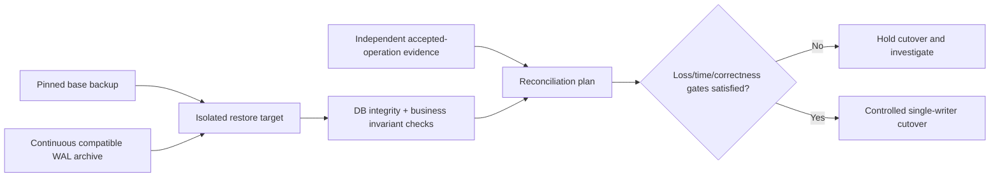

# User-level restore drills and alternatives

**Owning question:** What distinguishes a successful backup command from a demonstrated recovery?

This page belongs to [V05/C07 — Replication, backups and restore drills](README.md). Use the integrated walkthrough for the surrounding decision; the sections below own this narrower mechanism and its limits.

<!-- tycho-question-source:tycho.page.81efb7e6d72349768b6f202845cbe35e:3 -->
## 3. Original synthetic example: public equipment reservations

A fictional makerspace stores accepted reservations in PostgreSQL, plus a search index and an asynchronous notification service. A faulty software release accidentally deletes a day of reservation metadata while the database itself continues serving requests. A streaming standby receives those deletes.

**Bad recovery assumption:** “fail over to the replica” restores the lost reservations. If the standby already replayed the deletion, it is no better as a historical recovery source. Another bad assumption: returning to yesterday's backup is harmless; it may discard more recent legitimate reservations and create conflict with notifications that have already been delivered.

A safer **proposed** response:
1. Contain erroneous writers and prevent further destructive effects.
2. Record current authoritative state and suspected corruption interval without worsening it.
3. Select a known good physical base backup and available WAL archives or another supported recovery method.
4. Restore to a **separate isolated target** first; choose a point before the destructive transaction when evidence permits.
5. Verify logical reservation invariants, account/authorization ownership and selected recent accepted operation IDs.
6. Reconcile the difference between restored state and external accepted effects; identify irrecoverable outcomes.
7. Coordinate cutover, fencing of old writers and consumers, read-only validation and controlled re-enabling of writes.

**Text alternative:** a valid base and compatible WAL set restore an isolated target. Recovery is not accepted until integrity and business effect reconciliation pass. Only then can one correctly fenced authoritative writer resume operation. No diagram node represents a real executed restore.

<!-- /tycho-question-source -->
<!-- tycho-question-source:tycho.page.81efb7e6d72349768b6f202845cbe35e:5 -->
## 5. Rehearse user-level recovery, not a backup command

A reproducible drill should use safe isolated environments and synthetic/admitted data:

| Gate | Positive evidence | Negative failure to test |
|---|---|---|
| Discover | Identify exact backup chain and intended recovery point | Latest manifest missing or outdated |
| Retrieve | Read entire base/needed WAL and configuration with authorized access | Missing segment, wrong encryption key, inaccessible archive |
| Restore | Startup/replay finishes on compatible runtime | Corrupt backup, incompatible binaries, insufficient storage |
| Consistency | Database validates expected referential/data invariants | Inconsistent row versions or incomplete restoration |
| Business effects | Accepted reservation IDs and required authority states reconciled | Duplicate or missing acknowledged operations |
| Dependents | Projections/indexes and consumers rebuild from correct recovered truth | Stale index or replayed notification side effects |
| Availability | Exact user journey reaches acceptable correct outcomes in time | Service “healthy” while requests are semantically wrong |
| Governance | Cutover recorded; only authorized writer active | Old primary resumes writes and causes split-brain |

For each drill retain raw start/end timestamps, selected point, actual restored version, errors, accepted/rejected checks and deviations from the runbook. **A drill in one failure class cannot certify all disaster classes.** An untested production outage must not be created merely to validate this educational design.

### Worked restore paradox: a complete backup is not a usable booking state

**Original fictional drill:** a service has a PostgreSQL 17 base backup and archived WAL up to an intended time T. An accidental bulk deletion happens at T+1; customers create legitimate new bookings at T+2. Recovering to T may remove the deletion **and** erase valid post-T bookings. Simply starting a database from the backup is not equivalent to recovering a correct current business history.

| Restoration step | Evidence needed | Unsafe shortcut |
|---|---|---|
| Select restore point | Exact backup chain, WAL continuity, timestamp/timeline mapping | Assume latest archived file covers desired point |
| Recover into isolated environment | Compatible software/schema, keys and verified recovery logs | Overwrite live authority before inspecting restored state |
| Compare user outcomes | Deleted/restored records, operation IDs, valid post-point writes and their dependencies | Compare row counts alone |
| Reconcile legitimate later effects | Business-approved replay/mapping of post-T bookings; one authoritative writer | Blindly replay operations without idempotency or authorization |
| Return traffic | Correct booking journey, explicit loss interval and measured time | Declare RPO/RTO met when PostgreSQL process is merely healthy |

[PostgreSQL 17 continuous archiving](https://www.postgresql.org/docs/17/continuous-archiving.html) documents base backups, required WAL segments and recovery timelines; it does not prove that an operator has preserved an intact chain or can restore post-point business meaning. If valid operations cannot be reconciled, the correct result may be to keep the affected workflow paused and disclose the bounded loss, rather than assert full recovery.

**Proposed, not executed:** create known reservations before and after a synthetic destructive event, restore the earlier point in isolation, rebuild later accepted operations from an independent durable ledger and verify exclusive booking invariants. Use measured impact-to-correct-service time and committed-operation loss to evaluate RTO/RPO; neither a configured target nor an archived WAL name establishes an observed result. Region-level fencing and failover belong to [V08/C07](../../v08-delivery-deployment-and-recovery/c07-multi-region-recovery-and-data-reconciliation/disaster-recovery-and-recovery-objectives.md).

<!-- /tycho-question-source -->
<!-- tycho-question-source:tycho.page.81efb7e6d72349768b6f202845cbe35e:6 -->
## 6. Failure classes change the preferred architecture

- **Accidental deletion:** time-selective historical restore and reconciliation, not simply failover.
- **Host loss:** redundant instance/replica may reduce downtime, subject to actual data durability and fencing.
- **Region/archive loss:** failure-domain separation and independent backup accessibility become central.
- **Credential compromise:** backups, keys and restore authority must remain safe from the same compromised identity.
- **Data corruption discovered late:** backup retention and historical correctness window matter more than newest timestamp.
- **Schema-breaking migration:** old code image rollback may not read newer persisted data; forward recovery may be necessary.

A single "backup nightly" policy is therefore not enough for architecture selection. Recovery objective, data volume/change rate, tolerated loss, independent storage and team operating capacity are hard constraints.

<!-- /tycho-question-source -->
<!-- tycho-question-source:tycho.page.81efb7e6d72349768b6f202845cbe35e:7 -->
## 7. Decision and evidence limits

**Fictional decision state:** start with a verified physical-base/WAL archive PITR design only if its restore chain, access controls, costs and selected RPO/RTO can actually be tested. For small data and loose loss/time budgets, simpler logical backups may be a justified alternative. For stringent availability, replicas and failover can complement backups but never replace independent historical recovery.

**Falsifiable test (not run):** insert original synthetic accepted reservations; take a base backup; append known WAL; simulate deletion in an isolated copy; restore to a named point before deletion; prove exact business identifiers and absence of duplicates; measure restore time under a declared resource budget; compare with requested loss/time targets.

<!-- /tycho-question-source -->

## Navigation, prerequisites and source scope

| Route | Destination |
|---|---|
| Parent and source ledger | [Chapter introduction and exact source rows](README.md#chapter-source-ledger) |
| Previous / prerequisite | [Read preceding context](recovery-objects.md) |
| Next | [Continue the reasoning](README.md) |
| Integrated question | [Original scenario and limits](backup-restore-pitr-and-recovery-drills.md) |

The source material keeps its original published/inferred/synthetic/unverified distinctions. Chapter-wide citations are shared reference context, not proof that every cited source supports every sentence on this page. Freshly inspected text is identified explicitly; absent dates and unknowns are retained.
