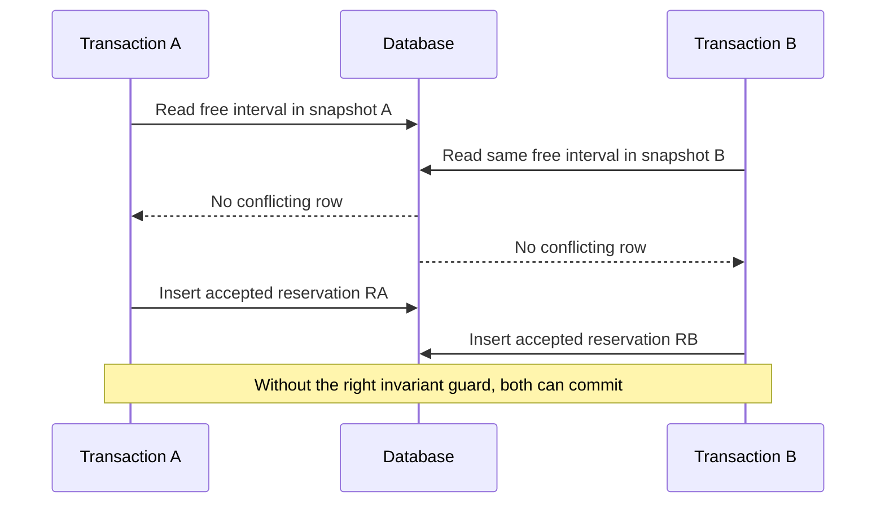

# Relational modeling, business constraints and transaction isolation

> **Tycho manuscript — proposed V05/C01**, 2026-10-19. Versioned primary evidence is PostgreSQL 17 chapters 5 and 13. All examples and decision tests are original and fictional, not production data. No PostgreSQL instance was started or tested and no independent technical/editorial acceptance was performed. The previously combined [MVCC and index research](../../../data/postgresql-mvcc-indexes-and-query-plans.md) remains for source mapping.

## Purpose and mission

A relational model defines identities and integrity, while a transaction isolation contract constrains which concurrent operations can produce a committed state. The schema must encode invariants where the database can enforce them and make explicitly visible which business requirements still need coordinated application logic.

This chapter owns *relational authority and correctness under concurrency*. [Indexes and query access paths](../c03/postgresql-indexes-statistics-and-query-plans.md) owns read performance and planner behavior; performance tuning must never silently weaken correctness.

## 1. Model business identities before tables

**Original fictional example:** a community workshop lends tools by time interval. The important entities are ToolUnit, Member and Reservation. A model name can describe many units; a physical unit has one stable identity and a series of reservation intervals.

A sound model distinguishes:
- immutable unit ID versus mutable display label;
- member identity from authorization to reserve a particular unit;
- one reservation ID and stable logical request ID across retries;
- accepted/cancelled states and their permitted transitions;
- time boundaries (inclusive/exclusive interval semantics and timezone);
- constraints on overlapping accepted intervals;
- ownership and deletion of data, plus retained history.

A foreign key can guarantee that a referenced member/tool identity exists within a chosen DB consistency boundary. It does not independently guarantee that a member is currently authorized to reserve this unit or that two time intervals do not overlap.

[PostgreSQL 17 Constraints, §5.5](https://www.postgresql.org/docs/17/ddl-constraints.html) explains primary keys, unique and foreign-key constraints, checks, and exclusion constraints. Exclusion constraints can support conflicts that cannot be expressed with a simple equality-based unique key; actual interval/index/operator design requires a versioned tested schema.

## 2. A snapshot is not an invariant

PostgreSQL uses MVCC (multiversion concurrency control) so readers can observe committed snapshots without treating every concurrent writer as a global reader-blocking lock. [PostgreSQL 17 MVCC Introduction, §13.1](https://www.postgresql.org/docs/17/mvcc-intro.html) describes snapshot visibility and concurrent reads/writes.

This improves concurrency properties but doesn't mean two transactions checking “no overlapping reservation exists” can safely both insert a reservation under an arbitrary isolation mode. A transaction boundary groups operations; its declared isolation rules determine which concurrent observations and updates remain possible.

| Isolation / mechanism | PostgreSQL 17 documented behavior | Decision risk |
|---|---|---|
| Read Committed (default) | Ordinary SELECT gets statement-level committed snapshot; successive queries may see different committed changes | Read-check-write logic can race and must be protected |
| Repeatable Read | Stable snapshot beginning at the first non-transaction-control statement, not necessarily at BEGIN; PostgreSQL disallows phantom reads at this level, but serialization anomalies remain possible | Snapshot stability is not proof of a serializable invariant |
| Serializable | Committed transactions behave as some serial execution if transactions handle serialization failures correctly | Application must retry the complete transaction safely |
| Uniqueness / exclusion constraint | DB enforces the declared key/overlap restriction for relevant writes | Restriction must encode the *actual* domain rule |
| Explicit locks / conditional update | Can coordinate selected rows/keys where appropriate | Locks may be missing for absent rows, cause deadlocks or bottlenecks |

The precise isolation table and retry notes are in [PostgreSQL 17 Transaction Isolation, §13.2](https://www.postgresql.org/docs/17/transaction-iso.html). PostgreSQL maps Read Uncommitted behavior to Read Committed, so do not assume four distinct implemented levels.

## 3. A synthetic two-transaction anomaly

Two concurrent clients attempt to reserve the same tool for an overlapping time. Suppose application logic performs “SELECT current reservations; if none, INSERT new reservation,” without a suitable DB-enforced overlap constraint or serializable predicate protection.



**Text alternative:** separate snapshots can both report an empty interval; subsequent inserts may violate an exclusivity requirement unless the complete business restriction is enforced at a valid transactional authority boundary. This example is a *proposed failure model*, not an executed PostgreSQL trace.

Mitigations depend on actual semantics: use a well-designed exclusion constraint, a serializable transaction with correct retries, or an explicit single-owner conditional state model. Simply introducing a mutex inside one application instance does not protect a deployment with multiple replicas.

### Source-scoped executable-looking SQL example: an exclusion invariant

PostgreSQL 17 provides range types and [exclusion constraints](https://www.postgresql.org/docs/17/ddl-constraints.html). The [range-types chapter, §8.17.10](https://www.postgresql.org/docs/17/rangetypes.html) shows how ranges can prevent time overlaps, and the supplied [\`btree_gist\` module, Appendix F.8](https://www.postgresql.org/docs/17/btree-gist.html) provides a GiST-compatible equality operator class for ordinary integer identities. **The following is an original teaching sketch, not SQL run or independently checked in a database.**

```sql
-- Assumes permission to install the public, bundled extension.
CREATE EXTENSION IF NOT EXISTS btree_gist;

CREATE TABLE tool_reservations (
    reservation_id bigint GENERATED ALWAYS AS IDENTITY PRIMARY KEY,
    tool_unit_id integer NOT NULL,
    reserved_during tstzrange NOT NULL,
    accepted boolean NOT NULL DEFAULT true,
    CHECK (NOT isempty(reserved_during)),
    EXCLUDE USING gist (
        tool_unit_id WITH =,
        reserved_during WITH &&
    ) WHERE (accepted)
);

-- Proposed behavioral check, not a recorded execution:
INSERT INTO tool_reservations (tool_unit_id, reserved_during)
VALUES (7, tstzrange('2026-01-01 10:00+00', '2026-01-01 11:00+00', '[)'));

-- Same unit with overlap: expect exclusion violation, not a second
-- accepted booking, provided this schema and configuration are valid.
INSERT INTO tool_reservations (tool_unit_id, reserved_during)
VALUES (7, tstzrange('2026-01-01 10:30+00', '2026-01-01 11:30+00', '[)'));
```

This **single-database guard** protects overlapping rows satisfying \`accepted\` under the schema's declared definition. It does not decide who is authorized, how two independent state authorities coordinate, whether delayed clients can retry safely, or whether a booking is actually accepted before notification. The half-open interval \`[)\` permits adjacent reservations to meet exactly at one endpoint; requirements might demand a turnover buffer instead. Empty ranges, null bounds, cancellation transitions and data retention need intentional tests.

A general \`CHECK\` constraint is **not** an appropriate substitute for a cross-row overlap invariant: PostgreSQL §5.5 warns that CHECK conditions referring to other rows cannot guarantee ongoing consistency. Neither an application-level SELECT nor a standalone non-unique GiST index automatically enforces the full restriction; the exclusion constraint expresses the rule at the database authority.


### Worked invariant: non-overlapping bookings are not guaranteed by a pre-insert read

**Synthetic transaction pair:** T1 and T2 each read a snapshot with no existing confirmed reservation for the same physical tool and overlapping time interval. They each insert a different reservation row. An application-level check that found no overlap before either insert does not enforce the cross-row invariant across concurrent writers.

Two mechanisms must be reviewed independently:

- **Exclusion at the data authority:** PostgreSQL 17 [constraints](https://www.postgresql.org/docs/17/ddl-constraints.html) and [range types](https://www.postgresql.org/docs/17/rangetypes.html) allow an appropriately specified exclusion constraint over tool identity and overlapping time ranges. The exact design still needs half-open boundary semantics, tenant scope, cancelled-record policy and an executable database test; simply mentioning GiST does not prove the required extension, operator classes or DDL exists.
- **Serializable transaction and retry:** the [PostgreSQL 17 isolation reference](https://www.postgresql.org/docs/17/transaction-iso.html) describes serialization conflicts and failures. A failed transaction must be retried from its complete read/decision state, not merely its final INSERT with stale assumptions. [PostgreSQL's application-level consistency guidance](https://www.postgresql.org/docs/17/applevel-consistency.html) also states that this protection does not automatically extend to hot-standby/logical-replica decisions.

| Boundary | Required behavior | Counterexample to reject |
|---|---|---|
| Overlapping concurrent writes | One valid authoritative outcome or a retryable conflict | Two accepted exclusive bookings from separate rows |
| Serialization abort | Restart decision from fresh state and a bounded retry policy | Reuse the original stale read and resend external effects |
| Committed booking, lost HTTP reply | Look up durable logical operation ID | Treat timeout as proof of no booking |
| Read replica lags | Authoritative writer enforces booking invariant | Replica snapshot alone authorizes conflicting new booking |

**Alternative:** a single-resource actor/serialized queue may simplify arbitration if its durability and recovery are proven, while an exclusion constraint may give a smaller change than distributed workflow extraction. Neither changes the need to reconcile a lost acknowledgment. All timestamps, actors and outcomes here are invented; no SQL transaction, extension installation or concurrency test was executed. The [idempotency owner](../../v04/c04/retries-idempotency-and-ambiguous-effects.md) owns retry intent, not this relational constraint.

## 4. Serializable still needs a retry protocol

PostgreSQL Serializable isolation can abort a transaction with a serialization failure to prevent a non-serializable committed outcome. A correct application should recognize that outcome and, where permitted, **retry the complete transaction from the beginning** with its stable logical operation identity. Blindly replaying external notifications or non-idempotent side effects during transaction retries can multiply effects.

A failed transaction is not an accepted business reservation. A committed transaction whose *network acknowledgment* was lost is a different condition: reconciling that effect requires a durable operation ID and a status query. [Retry semantics](../../v04/c04/retries-idempotency-and-ambiguous-effects.md) owns that distinction.

## 5. Correctness and query performance must be evaluated together

A unique or exclusion constraint may add write/index cost while protecting a mandatory invariant. Removing it to improve throughput is not equivalent to a valid architecture optimization. Adding an index can speed a predicate but does not generally enforce uniqueness/overlap unless the index/constraint is defined for it.

Correctness and performance acceptance should check:
- races from multiple independent callers;
- client retries after lost response;
- schema/state transition constraints;
- actual query plan and lock waits under representative load;
- deadlocks and serialization retries;
- stale replicas and search projections not being used as authoritative write guards;
- full backup/restore of accepted records and referential relationships.

## 6. Architecture alternatives and limits

For a limited self-contained application with an authoritative PostgreSQL store, in-DB constraints and local transactions may be a simpler and stronger choice than moving the reservation decision across services. Another store/consistency model may be appropriate if requirements demand it—but only after comparing which invariants each implementation demonstrably enforces and how it recovers.

A normalized relational schema is not always the optimal storage model for large analytics or document-oriented reads. That separate choice belongs to [data storage alternatives](../c04/storage-model-alternatives-and-workload-fit.md), not a presumption that transaction isolation itself picks the entire product architecture.

## 7. Public source ledger and nonclaims

| Primary reference | Narrow support | Still unverified |
|---|---|---|
| [PostgreSQL 17, §5.5 Constraints](https://www.postgresql.org/docs/17/ddl-constraints.html) | PK/FK, unique/check/exclusion constraint types | Exact domain overlap constraint and DDL execution |
| [PostgreSQL 17, §13.1 MVCC](https://www.postgresql.org/docs/17/mvcc-intro.html) | Snapshot visibility and read/write behavior | Benchmark performance or correctness under a real schema |
| [PostgreSQL 17, §8.17 Range Types](https://www.postgresql.org/docs/17/rangetypes.html) | Range boundaries, overlap operator and time interval modeling | Actual tested reservation schema |
| [PostgreSQL 17, Appendix F.8 `btree_gist`](https://www.postgresql.org/docs/17/btree-gist.html) | GiST-equivalent integer equality operators for multicolumn exclusion constraints | Actual installed extension/DDL success |
| [PostgreSQL 17, §13.2 Transaction Isolation](https://www.postgresql.org/docs/17/transaction-iso.html) | Read Committed/Repeatable Read/Serializable, anomaly and retry semantics | Executed isolation test or actual transaction outcome |
| [Tycho earlier combined source](../../../data/postgresql-mvcc-indexes-and-query-plans.md) | Previous version-scoped relational/index discussion | Independent final chapter review |

All domain names, operations, diagrams, failure modes and test plans are fictional. No database, workload generator, observed SQL result, architecture decision or publication-ready metadata has been produced.

## Navigation

Proposed owner **V05/C01** in the [planned 10-volume outline](../../../PROPOSED-STRUCTURE.md), [data landing](../../../data/README.md). Related [PostgreSQL indexes and plans](../c03/postgresql-indexes-statistics-and-query-plans.md), [transactions and sagas](../../v04/c03/transaction-isolation-and-sagas.md), [backup/PITR recovery](../c07/backup-restore-pitr-and-recovery-drills.md).

<!-- tycho-edition-navigation -->

## Edition navigation and evidence scope

| Route | Destination |
|---|---|
| Parent chapter | [Question, conclusions and reading route](README.md) |
| Parent volume | [Volume synthesis](../README.md) |
| Book | [Authoritative contents](../../../README.md) |
| Source versions and access scope | [Registered sources](../../../../sources/README.md) and the exact page-local citation ledger above |

The original manuscript was accepted under #213 at the recorded baseline. Earlier draft/review labels describe historical authoring events. Source access, versions, unexecuted experiments and nonclaims retain their original scope; assembly does not assert a new source read or benchmark. The chapter landing adds editorial synthesis and navigation.
