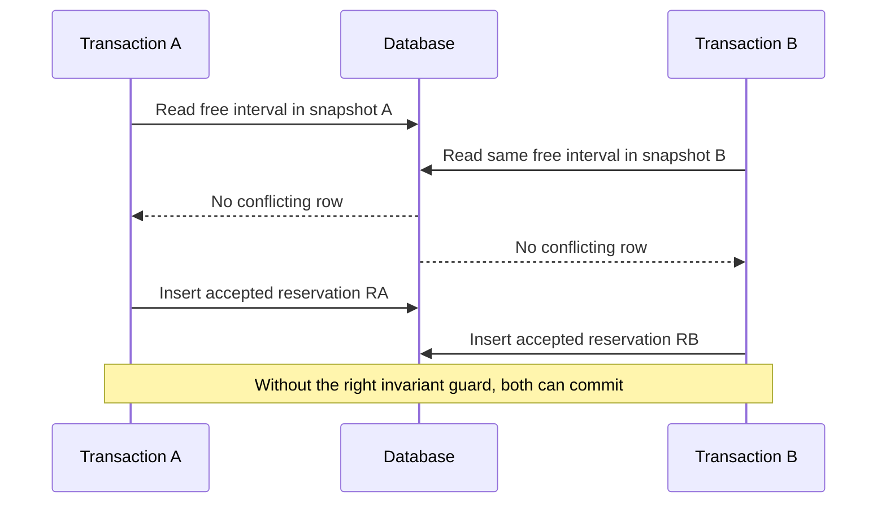

# Isolation anomalies, retries and workload trade-offs

**Owning question:** What does a serializable retry protocol need beyond an isolation setting?

This page belongs to [V05/C01 — Relational modeling and transaction isolation](README.md). Use the integrated walkthrough for the surrounding decision; the sections below own this narrower mechanism and its limits.

<!-- tycho-question-source:tycho.page.6b42723bd575413bb0d1b94d3e179b6a:3 -->
## 3. A synthetic two-transaction anomaly

Two concurrent clients attempt to reserve the same tool for an overlapping time. Suppose application logic performs “SELECT current reservations; if none, INSERT new reservation,” without a suitable DB-enforced overlap constraint or serializable predicate protection.



**Text alternative:** separate snapshots can both report an empty interval; subsequent inserts may violate an exclusivity requirement unless the complete business restriction is enforced at a valid transactional authority boundary. This example is a *proposed failure model*, not an executed PostgreSQL trace.

Mitigations depend on actual semantics: use a well-designed exclusion constraint, a serializable transaction with correct retries, or an explicit single-owner conditional state model. Simply introducing a mutex inside one application instance does not protect a deployment with multiple replicas.

### Source-scoped executable-looking SQL example: an exclusion invariant

PostgreSQL 17 provides range types and [exclusion constraints](https://www.postgresql.org/docs/17/ddl-constraints.html). The [range-types chapter, §8.17.10](https://www.postgresql.org/docs/17/rangetypes.html) shows how ranges can prevent time overlaps, and the supplied [\`btree_gist\` module, Appendix F.8](https://www.postgresql.org/docs/17/btree-gist.html) provides a GiST-compatible equality operator class for ordinary integer identities. **The following is an original teaching sketch, not SQL run or independently checked in a database.**

```sql
-- Assumes permission to install the public, bundled extension.
CREATE EXTENSION IF NOT EXISTS btree_gist;

CREATE TABLE tool_reservations (
    reservation_id bigint GENERATED ALWAYS AS IDENTITY PRIMARY KEY,
    tool_unit_id integer NOT NULL,
    reserved_during tstzrange NOT NULL,
    accepted boolean NOT NULL DEFAULT true,
    CHECK (NOT isempty(reserved_during)),
    EXCLUDE USING gist (
        tool_unit_id WITH =,
        reserved_during WITH &&
    ) WHERE (accepted)
);

-- Proposed behavioral check, not a recorded execution:
INSERT INTO tool_reservations (tool_unit_id, reserved_during)
VALUES (7, tstzrange('2026-01-01 10:00+00', '2026-01-01 11:00+00', '[)'));

-- Same unit with overlap: expect exclusion violation, not a second
-- accepted booking, provided this schema and configuration are valid.
INSERT INTO tool_reservations (tool_unit_id, reserved_during)
VALUES (7, tstzrange('2026-01-01 10:30+00', '2026-01-01 11:30+00', '[)'));
```

This **single-database guard** protects overlapping rows satisfying \`accepted\` under the schema's declared definition. It does not decide who is authorized, how two independent state authorities coordinate, whether delayed clients can retry safely, or whether a booking is actually accepted before notification. The half-open interval \`[)\` permits adjacent reservations to meet exactly at one endpoint; requirements might demand a turnover buffer instead. Empty ranges, null bounds, cancellation transitions and data retention need intentional tests.

A general \`CHECK\` constraint is **not** an appropriate substitute for a cross-row overlap invariant: PostgreSQL §5.5 warns that CHECK conditions referring to other rows cannot guarantee ongoing consistency. Neither an application-level SELECT nor a standalone non-unique GiST index automatically enforces the full restriction; the exclusion constraint expresses the rule at the database authority.


### Worked invariant: non-overlapping bookings are not guaranteed by a pre-insert read

**Synthetic transaction pair:** T1 and T2 each read a snapshot with no existing confirmed reservation for the same physical tool and overlapping time interval. They each insert a different reservation row. An application-level check that found no overlap before either insert does not enforce the cross-row invariant across concurrent writers.

Two mechanisms must be reviewed independently:

- **Exclusion at the data authority:** PostgreSQL 17 [constraints](https://www.postgresql.org/docs/17/ddl-constraints.html) and [range types](https://www.postgresql.org/docs/17/rangetypes.html) allow an appropriately specified exclusion constraint over tool identity and overlapping time ranges. The exact design still needs half-open boundary semantics, tenant scope, cancelled-record policy and an executable database test; simply mentioning GiST does not prove the required extension, operator classes or DDL exists.
- **Serializable transaction and retry:** the [PostgreSQL 17 isolation reference](https://www.postgresql.org/docs/17/transaction-iso.html) describes serialization conflicts and failures. A failed transaction must be retried from its complete read/decision state, not merely its final INSERT with stale assumptions. [PostgreSQL's application-level consistency guidance](https://www.postgresql.org/docs/17/applevel-consistency.html) also states that this protection does not automatically extend to hot-standby/logical-replica decisions.

| Boundary | Required behavior | Counterexample to reject |
|---|---|---|
| Overlapping concurrent writes | One valid authoritative outcome or a retryable conflict | Two accepted exclusive bookings from separate rows |
| Serialization abort | Restart decision from fresh state and a bounded retry policy | Reuse the original stale read and resend external effects |
| Committed booking, lost HTTP reply | Look up durable logical operation ID | Treat timeout as proof of no booking |
| Read replica lags | Authoritative writer enforces booking invariant | Replica snapshot alone authorizes conflicting new booking |

**Alternative:** a single-resource actor/serialized queue may simplify arbitration if its durability and recovery are proven, while an exclusion constraint may give a smaller change than distributed workflow extraction. Neither changes the need to reconcile a lost acknowledgment. All timestamps, actors and outcomes here are invented; no SQL transaction, extension installation or concurrency test was executed. The [idempotency owner](../../v04/c04/retries-idempotency-and-ambiguous-effects.md) owns retry intent, not this relational constraint.

<!-- /tycho-question-source -->
<!-- tycho-question-source:tycho.page.6b42723bd575413bb0d1b94d3e179b6a:4 -->
## 4. Serializable still needs a retry protocol

PostgreSQL Serializable isolation can abort a transaction with a serialization failure to prevent a non-serializable committed outcome. A correct application should recognize that outcome and, where permitted, **retry the complete transaction from the beginning** with its stable logical operation identity. Blindly replaying external notifications or non-idempotent side effects during transaction retries can multiply effects.

A failed transaction is not an accepted business reservation. A committed transaction whose *network acknowledgment* was lost is a different condition: reconciling that effect requires a durable operation ID and a status query. [Retry semantics](../../v04/c04/retries-idempotency-and-ambiguous-effects.md) owns that distinction.

<!-- /tycho-question-source -->
<!-- tycho-question-source:tycho.page.6b42723bd575413bb0d1b94d3e179b6a:5 -->
## 5. Correctness and query performance must be evaluated together

A unique or exclusion constraint may add write/index cost while protecting a mandatory invariant. Removing it to improve throughput is not equivalent to a valid architecture optimization. Adding an index can speed a predicate but does not generally enforce uniqueness/overlap unless the index/constraint is defined for it.

Correctness and performance acceptance should check:
- races from multiple independent callers;
- client retries after lost response;
- schema/state transition constraints;
- actual query plan and lock waits under representative load;
- deadlocks and serialization retries;
- stale replicas and search projections not being used as authoritative write guards;
- full backup/restore of accepted records and referential relationships.

<!-- /tycho-question-source -->
<!-- tycho-question-source:tycho.page.6b42723bd575413bb0d1b94d3e179b6a:6 -->
## 6. Architecture alternatives and limits

For a limited self-contained application with an authoritative PostgreSQL store, in-DB constraints and local transactions may be a simpler and stronger choice than moving the reservation decision across services. Another store/consistency model may be appropriate if requirements demand it—but only after comparing which invariants each implementation demonstrably enforces and how it recovers.

A normalized relational schema is not always the optimal storage model for large analytics or document-oriented reads. That separate choice belongs to [data storage alternatives](../c04/storage-model-alternatives-and-workload-fit.md), not a presumption that transaction isolation itself picks the entire product architecture.

<!-- /tycho-question-source -->

## Navigation, prerequisites and source scope

| Route | Destination |
|---|---|
| Parent and source ledger | [Chapter introduction and exact source rows](README.md#chapter-source-ledger) |
| Previous / prerequisite | [Read preceding context](relational-invariants.md) |
| Next | [Continue the reasoning](README.md) |
| Integrated question | [Original scenario and limits](relational-modeling-and-transaction-isolation.md) |

The source material keeps its original published/inferred/synthetic/unverified distinctions. Chapter-wide citations are shared reference context, not proof that every cited source supports every sentence on this page. Freshly inspected text is identified explicitly; absent dates and unknowns are retained.
