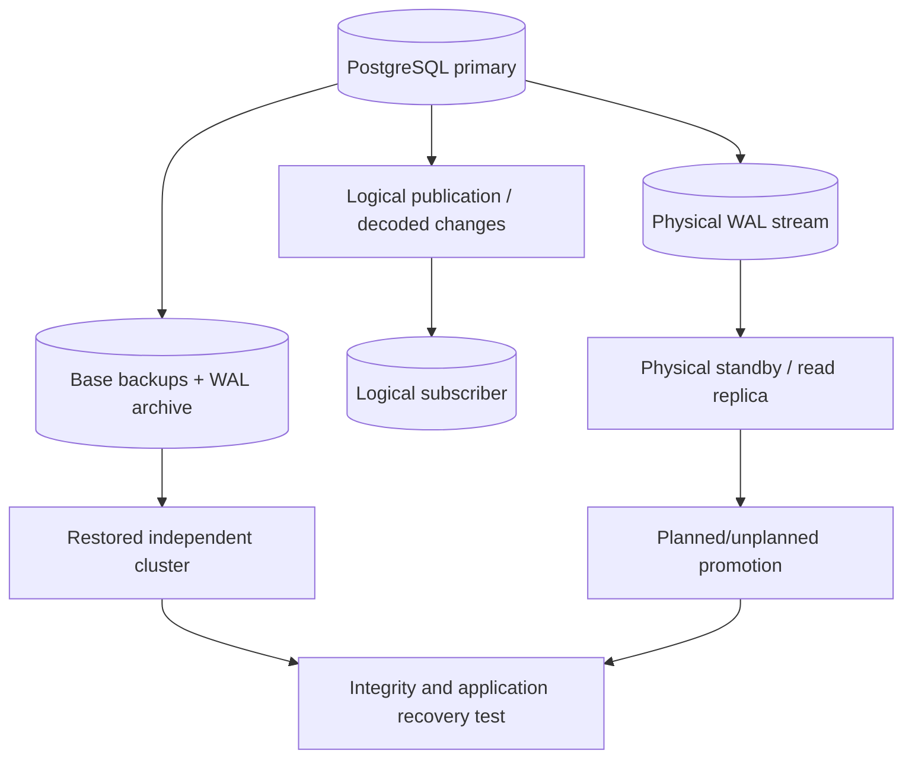

# Replication and restore boundaries

**Owning question:** How do physical and logical replication differ from recovering a consistent state?

This page belongs to [V05/C02 — PostgreSQL MVCC, WAL and recovery](README.md). Use the integrated walkthrough for the surrounding decision; the sections below own this narrower mechanism and its limits.

<!-- tycho-question-source:tycho.page.ddeff7f1556f44f18c67659b73e6e15f:2 -->
## 2. Physical streaming replication versus logical replication

| Mechanism | What is transferred | Common purpose | Applicability/recovery limit |
|---|---|---|---|
| Physical base backup + WAL archive | Consistent storage snapshot plus WAL history | Restore a cluster, point-in-time recovery | Restore only if base backup, timeline and WAL chain are complete and tested |
| Physical streaming replica | Physical WAL progression from one instance to another | Standby failover/read scaling under version/topology constraints | Lag and failover promotion matter; replica may inherit logical corruption/deletions |
| Synchronous replication configuration | Commit wait tied to configured replica acknowledgements | Strengthen selected failure class durability | Availability/latency may degrade if required standby cannot acknowledge |
| Logical replication/publication | Selected data changes via logical decoding/publication/subscription | Selective propagation, migration, independently modeled consumers | Schema/DDL/sequence behavior and conflict/replay need explicit compatibility plan |
| Application outbox + CDC relay | An application-specific committed event-intent record | Durable integration event publication | Does not automatically provide downstream exactly-once effects |

Logical replication is **not** the same as point-in-time cluster backup. PostgreSQL 17 Chapter 31 **Logical Replication** documents publication/subscription, initial data synchronization and normal subsequent change propagation; DDL and other replication limitations require evaluation. [E03] See [outbox](../../../distributed/transactional-outbox-and-idempotency.md) for a business-level event contract rather than duplicating connector details.

Text alternative: physical WAL can feed a standby, logical changes can feed a subscriber, and separate base-backup plus archived-WAL artifacts can restore an independent cluster. Promotion or restore is not complete until application-level integrity and user outcomes are checked. This drawing is an original overview and intentionally omits topology-specific tools.

<!-- /tycho-question-source -->
<!-- tycho-question-source:tycho.page.ddeff7f1556f44f18c67659b73e6e15f:4 -->
## 4. A synthetic failure and recovery timeline

Imagine a fictional registration service using one primary and one **asynchronous** standby. A command commits at time `t=0` on primary and the client receives success. The primary then becomes unrecoverable before the standby receives the last few WAL records. Promotion of the standby can restore service while excluding some acknowledged writes.

The correct business outcome must be investigated; merely issuing `pg_promote()` is not a demonstrated zero-loss failover. A separate reconciliation strategy may be required for outward notifications already delivered, retries after lost responses and authoritative registration counts.

```mermaid
stateDiagram-v2
    [*] --> Healthy
    Healthy --> PrimaryLost: Node or storage failure
    PrimaryLost --> Assess: Identify durable replica/WAL positions
    Assess --> Promote: Safe candidate and fencing verified
    Assess --> Restore: Need backup + archived WAL
    Promote --> Verify: Read/write, invariants and missing commits
    Restore --> Verify: Recover target point and application function
    Verify --> Healthy: Recovery accepted; rejoin policy applied
    Verify --> Repair: Invariants or data gap unresolved
    Repair --> Verify: Reconcile and retest
```

Text alternative: after losing a primary, compare durable replica/archive positions, choose a safe promoted standby or a verified restore path, then test business functionality and missing committed data. Failed integrity checks require reconciliation before declaring recovery complete.

The timeline is **synthetic**, not a real production incident. No exact seconds/bytes of data loss can be inferred without capturing actual commit, WAL positions, synchronous mode and replica lag.

<!-- /tycho-question-source -->
<!-- tycho-question-source:tycho.page.ddeff7f1556f44f18c67659b73e6e15f:5 -->
## 5. Backup integrity and recovery are independently testable

PostgreSQL 17 Chapter 25 **Backup and Restore** and §25.3 **Continuous Archiving and Point-in-Time Recovery** explain physical backup plus continuous WAL archiving. A credible recovery plan needs:

1. An independent recovery target and named disaster class (crash, data corruption, host loss, region loss, operator error).
2. Backup artifact provenance, encryption/keys, retention, WAL continuity and location outside the failed fault domain.
3. A restore procedure tested on an isolated host or environment without corrupting current production.
4. Replay/recovery point selection and integrity verification including application constraints, references and downstream effects.
5. Timed recovery drills measuring **actual** restored business capability and actual last recoverable commit, not dashboard green states.
6. A documented failback/fencing procedure and a reconciliation protocol for ambiguous client outcomes.

Backups protect different failure modes from replicas; a logical destructive command can be faithfully replicated to every standby while an older recoverable backup could still contain desired data. Neither mechanism is a substitute for the other without evidence.

<!-- /tycho-question-source -->

## Navigation, prerequisites and source scope

| Route | Destination |
|---|---|
| Parent and source ledger | [Chapter introduction and exact source rows](README.md#chapter-source-ledger) |
| Previous / prerequisite | [Read preceding context](wal-durability.md) |
| Next | [Continue the reasoning](storage-workload.md) |
| Integrated question | [Original scenario and limits](postgresql-wal-replication-and-recovery.md) |

The source material keeps its original published/inferred/synthetic/unverified distinctions. Chapter-wide citations are shared reference context, not proof that every cited source supports every sentence on this page. Freshly inspected text is identified explicitly; absent dates and unknowns are retained.
