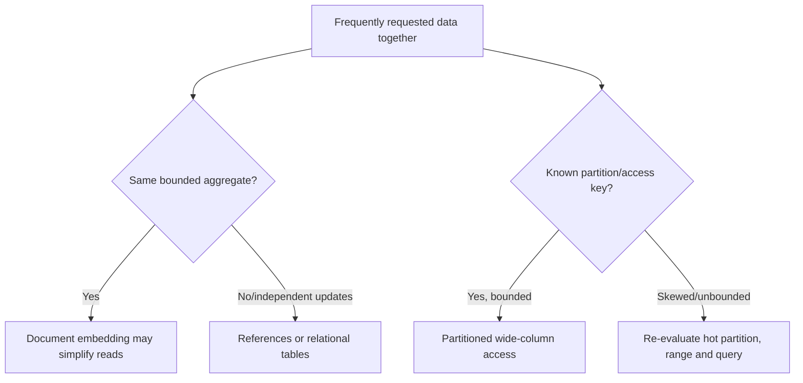
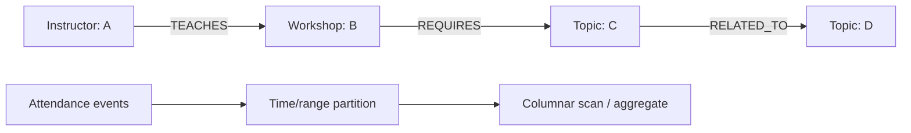

# Document, wide-column and analytical access

**Owning question:** Which access pattern justifies specialized modeling and what is lost?

This page belongs to [V05/C04 — Alternative data models and stores](README.md). Use the integrated walkthrough for the surrounding decision; the sections below own this narrower mechanism and its limits.

<!-- tycho-question-source:tycho.page.c75a11f9786442a5b5456f11c2412df4:4 -->
## 4. Document and wide-column data models

**MongoDB's official data modeling** documentation distinguishes embedding related subdocuments from referencing separate documents. Embedding can make related reads and atomic single-document updates simpler; high-cardinality or independently updated relations can make a referencing model more appropriate. The model's fit depends on access patterns and update frequency. [E04]

**Apache Cassandra 5.0** official overview describes distributed partitioned **wide-column** storage, with Dynamo-influenced replication and eventual consistency semantics. Data modeling depends heavily on partition keys, clustering order and query patterns. It should not be silently treated as a relational engine with arbitrary cross-partition joins/transactions. [E05]

Text alternative: document embedding depends on bounded co-read/co-update aggregate behavior; wide-column models depend on reliable partition/query planning. An uncontrolled growing collection or a hot partition can undermine the apparent simplicity. These are conceptual choices, not vendor-specific design recipes.

### Counterexample: the unbounded document/partition

A fictional workshop document embeds every registration ever made. It looks convenient for one read but can grow without bound, trigger large updates and mix unrelated lifecycle/retention patterns. Separating registration records may be safer; that does not require switching from MongoDB to SQL. Likewise, placing every user's activity in one Cassandra partition can create oversized/hot partitions; correct partitioning needs actual distribution and access traces.

<!-- /tycho-question-source -->
<!-- tycho-question-source:tycho.page.c75a11f9786442a5b5456f11c2412df4:5 -->
## 5. OLAP, time series and graph data

**ClickHouse MergeTree** official docs describe immutable sorted data parts, background merges, sparse primary index/data pruning and an `ORDER BY` sorting key. This architecture is especially relevant to high-volume analytical scans and aggregates, but it should not be assumed to support a transactional seat-allocation invariant with the same semantics as an OLTP database. [E06]

A **time-series model** emphasizes event timestamp, ingestion order, retention/downsampling and range aggregations. It can live in PostgreSQL or a columnar/TS-specialized system. "Time-series" describes the query and lifecycle problem, **not a unique storage consistency guarantee**. A comprehensive vendor-specific TSDB analysis is not completed in this bounded page.

**Neo4j's public property-graph concepts** model nodes, directed typed relationships and properties, with indexes/constraints available. This supports explicit multi-hop traversal queries; it does not prove such queries will always be faster or cheaper than a relational recursive query or precomputed adjacency structure. [E07]

Text alternative: a property graph records relationships between people, events and concepts as typed edges; event analytics can instead group high-volume observations by time for aggregations. Those workloads have different access paths and may justify separate **derived** storage only after actual evidence.

<!-- /tycho-question-source -->

## Navigation, prerequisites and source scope

| Route | Destination |
|---|---|
| Parent and source ledger | [Chapter introduction and exact source rows](README.md#chapter-source-ledger) |
| Previous / prerequisite | [Read preceding context](transactional-models.md) |
| Next | [Continue the reasoning](multi-store-selection.md) |
| Integrated question | [Original scenario and limits](storage-model-alternatives-and-workload-fit.md) |

The source material keeps its original published/inferred/synthetic/unverified distinctions. Chapter-wide citations are shared reference context, not proof that every cited source supports every sentence on this page. Freshly inspected text is identified explicitly; absent dates and unknowns are retained.
