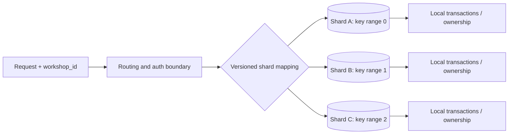
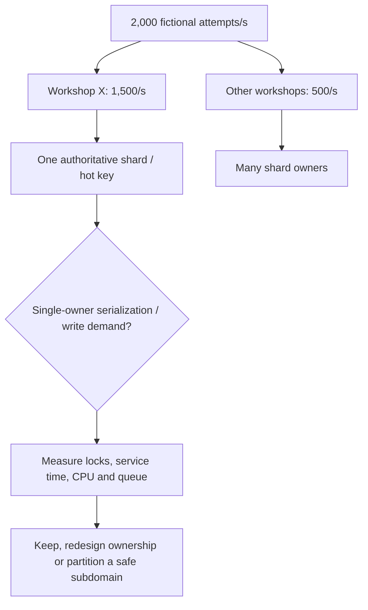

# Partition ownership, keys and skew

**Owning question:** Which key and routing policy distribute useful work rather than row counts?

This page belongs to [V05/C05 — Partitioning, sharding and rebalancing](README.md). Use the integrated walkthrough for the surrounding decision; the sections below own this narrower mechanism and its limits.

<!-- tycho-question-source:tycho.page.0d34dd26886340b89fd4f1499d790a81:1 -->
## 1. Distinguish physical partitions, logical ownership and replicas

| Term | What it controls | Does not guarantee |
|---|---|---|
| **Shard / partition** | A subset of an authoritative keyspace assigned to storage owners | Independent throughput for every hot key |
| **Shard key / routing function** | How an item maps to a keyspace ID/range and its owner | Stability through routing/hash algorithm changes |
| **Replica** | Additional copy under defined replication/failover semantics | New independent write capacity or global linearizability |
| **Co-location** | Related entities share one authority/transaction domain when intended | Arbitrarily distributed joins without cost |
| **Resharding** | Changes assignment of key ranges/ownership | Safe schema, key, consistency and protocol compatibility automatically |

Vitess's publicly versioned **24.0 Resharding** guide explicitly discusses primary vindexes, high-cardinality shard key choices, co-location for joins/transactions and reviewing real high-QPS WHERE clauses. It also explains source/target migration and cutover. Its mechanisms are implementation-specific, not universal sharding algorithms. [E01]

Text alternative: a request carries a declared partition identity, is authorized, then uses a versioned mapping to reach one authoritative shard. Transactions within each shard remain local; no cross-shard transaction guarantee is implied.

A sharding route must not be an authorization shortcut. Compute or verify the tenant/workshop identity against authenticated credentials; never let a caller select an arbitrary shard and bypass data access policy.

<!-- /tycho-question-source -->
<!-- tycho-question-source:tycho.page.0d34dd26886340b89fd4f1499d790a81:2 -->
## 2. Why shard-key selection cannot be made from average RPS

A candidate key should be evaluated against:

- **Cardinality and skew:** are most keys independent, or does one customer/workshop dominate writes?
- **Access-path fit:** can the main query identify its shard without scatter-gather across all owners?
- **Co-location:** which entities must share an atomic state transition, JOIN, deletion/retention or business invariant?
- **Growth:** what happens when a shard approaches storage, index or write contention limits?
- **Migration:** can an old and new routing scheme coexist during data copy and cutover?
- **Security/data residency:** may two tenants or countries share physical storage under the requirements?
- **Operational bounds:** team support, backups, failover and the cost of N independent storage owners.

Vitess **VSchema** distinguishes logical keyspace IDs, shard maps and primary vindexes. This indirection can permit resharding without redefining every application identity, but a primary vindex and its mapping must be checked for actual queries and versioned deployment behavior. [E02]

### Synthetic hot-key counterexample

Suppose a fictionally modeled system receives **2,000 write attempts/s** across 100 workshops. Ninety-nine workshops combined account for 500 attempts/s while one popular workshop accounts for **1,500 attempts/s**. If workshop ID is the chosen atomic shard key, the popular workshop remains a 1,500/s hot key even after adding more shards.

- Average across 100 workshops is 20 attempts/s but profoundly misrepresents the hottest owner.
- Even distribution of the other 500 attempts across shards does not split the 1,500/s single-owner workload.
- Hashing *requests* rather than workshop ownership across shards might spread CPU yet destroy a one-workshop seat-capacity invariant unless a new coordination protocol is introduced.
- A defensible alternative may optimize that owner's hot transaction/index/lock, introduce independently allocatable seat IDs, or separate nonauthoritative reads; none is proven by this arithmetic alone.

The figures are invented for illustrating skew, not capacity or a recommendation to run 2,000 RPS.

Text alternative: most operations target one workshop; distributing the rest of the keyspace cannot remove contention on that workshop's authoritative state. Measure where the bottleneck is before changing transaction ownership.

<!-- /tycho-question-source -->
<!-- tycho-question-source:tycho.page.0d34dd26886340b89fd4f1499d790a81:3 -->
## 3. Four partition strategies and their drawbacks

| Strategy | Strength under its assumptions | Failure/compatibility cost |
|---|---|---|
| Range by ordered key | Efficient range pruning/time-based lifecycle and data locality | Right-edge hotspot from sequential inserts, uneven key ranges, split planning |
| Hash of high-cardinality key | Usually reduces skew from otherwise uniformly distributed distinct keys | Single hot key still hot; cross-key queries scatter; remapping costs |
| Directory/lookup routing | Can deliberately place particular owners and manage hot tenants | Control-plane availability, routing cache freshness and split-brain mappings |
| Geographic/compliance partition | Residency or regional latency alignment | Cross-region transactions, failover jurisdiction, legal and recovery constraints |

An **application-shard label** and a **DB table partition** are not identical. PostgreSQL 17's table partitioning supports physical organization and pruning inside its server/database, but it does not by itself turn one database cluster into a set of independently coordinated distributed database systems. [E03]

Co-locate data **only as far as the business invariant requires**. Unnecessary co-location may make the largest key unshardable. Moving tightly coupled joins across shards can introduce network fan-out and retries.

<!-- /tycho-question-source -->

## Navigation, prerequisites and source scope

| Route | Destination |
|---|---|
| Parent and source ledger | [Chapter introduction and exact source rows](README.md#chapter-source-ledger) |
| Previous / prerequisite | [Read preceding context](shard-keys-hotspots-and-resharding.md) |
| Next | [Continue the reasoning](resharding-transition.md) |
| Integrated question | [Original scenario and limits](shard-keys-hotspots-and-resharding.md) |

The source material keeps its original published/inferred/synthetic/unverified distinctions. Chapter-wide citations are shared reference context, not proof that every cited source supports every sentence on this page. Freshly inspected text is identified explicitly; absent dates and unknowns are retained.
