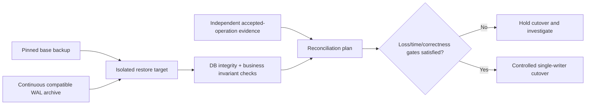

# Backup, restore and recovery drills: proving data recoverability

> **Tycho book draft V05/C07 (2026-10-19).** Scope: public PostgreSQL 17 backup, WAL, recovery and replication documentation, plus original synthetic examples. No database, backup set, disaster exercise, operational measurement or independent review was performed.

## Purpose and mission

Replicas, backups and restore procedures solve different failure problems. A replica may promptly copy an accidental deletion. An archive may be incomplete. A backup can exist yet fail to restore under missing WAL, incompatible configuration or damaged media. Therefore **“backups configured” is not the same as “this user-visible business state is recoverable within the required loss/time window.”**

This chapter owns selecting a **data recovery contract and testing it**. [PostgreSQL WAL and replication](../c02/postgresql-wal-replication-and-recovery.md) owns database-log mechanics; [multi-region disaster recovery](../../../deployment/multi-region-disaster-recovery-contracts.md) owns failure-domain placement, fencing and regional operations. The design must connect them without confusing process availability and durable user truth.

## 1. Recovery objectives have a named failure and clock

- **RPO (recovery point objective):** maximum acceptable loss of acknowledged business state, defined for a specified failure and measurement basis.
- **RTO (recovery time objective):** allowed time from a defined disruption/start marker until a tested user journey is restored, not just until a database process starts.
- **Integrity invariant:** what committed data and relationships must remain internally consistent after restore.
- **Reconciliation contract:** how operations accepted after the restored point are identified, replayed, rejected or recovered from other independent evidence.
- **Recovery authority:** who can authorize destructive restore, cutover, temporary read-only mode, and reopening writes.

RPO/RTO values are **requirements or observed drill results**, not inherent database settings. A page saying “RPO = zero” must specify the modeled failure class and commit acknowledgment boundary; an asynchronously replicated system cannot simply assume no data loss on primary loss.

## 2. Logical backup, physical backup and WAL replay differ

The [PostgreSQL 17 Backup and Restore guide](https://www.postgresql.org/docs/17/backup.html) distinguishes SQL dumps, file-system-level backup, and continuous archiving. The [PostgreSQL 17 continuous archiving/PITR section](https://www.postgresql.org/docs/17/continuous-archiving.html) explains how a valid base backup plus a continuous suitable WAL sequence supports point-in-time recovery; logical dumps are **not** physical base backups usable for WAL replay.

| Method | Useful when | Recovery limitation |
|---|---|---|
| Logical SQL dump | Portable export/import within supported format/version limits; selected objects | Import time; transaction/version/extensions and role/permission compatibility; not WAL-base PITR |
| Physical cluster backup | Reconstruct a compatible database cluster | Correct base backup contents, ownership, tablespaces and version compatibility needed |
| Physical backup + WAL archive | Restore to permitted point after base backup under continuous WAL coverage | Missing/corrupted segments, archive lag, storage and replay time |
| Streaming replica | Reduce outage for some instance/host failures | May mirror corruption/deletion; replica promotion/fencing and lag matter |
| Application-level export or journal | Recover particular business entities/effects | Must prove completeness, identity, ordering, privacy and reconciliation |

Do not call synchronous replication, standby promotion and PITR interchangeable. They differ on what they protect, which failure they survive and what state can be reconstructed.

## 3. Original synthetic example: public equipment reservations

A fictional makerspace stores accepted reservations in PostgreSQL, plus a search index and an asynchronous notification service. A faulty software release accidentally deletes a day of reservation metadata while the database itself continues serving requests. A streaming standby receives those deletes.

**Bad recovery assumption:** “fail over to the replica” restores the lost reservations. If the standby already replayed the deletion, it is no better as a historical recovery source. Another bad assumption: returning to yesterday's backup is harmless; it may discard more recent legitimate reservations and create conflict with notifications that have already been delivered.

A safer **proposed** response:
1. Contain erroneous writers and prevent further destructive effects.
2. Record current authoritative state and suspected corruption interval without worsening it.
3. Select a known good physical base backup and available WAL archives or another supported recovery method.
4. Restore to a **separate isolated target** first; choose a point before the destructive transaction when evidence permits.
5. Verify logical reservation invariants, account/authorization ownership and selected recent accepted operation IDs.
6. Reconcile the difference between restored state and external accepted effects; identify irrecoverable outcomes.
7. Coordinate cutover, fencing of old writers and consumers, read-only validation and controlled re-enabling of writes.

**Text alternative:** a valid base and compatible WAL set restore an isolated target. Recovery is not accepted until integrity and business effect reconciliation pass. Only then can one correctly fenced authoritative writer resume operation. No diagram node represents a real executed restore.

## 4. WAL gaps, timelines and version dependencies

PostgreSQL 17 documentation describes WAL archive segments, recovery targets, timeline histories, base backup requirements, and how incremental base backups depend on prior backups and WAL summaries. It notes that archive lag can increase potential data loss and create local WAL-disk pressure; configuration files are not automatically protected by WAL replay.

For a recoverability contract record:
- database major version, supported tooling/extension and archive/backup formats;
- source cluster/system ID, base-backup manifest and hash or verification evidence;
- tablespaces, external files, config, secrets and network/identity requirements;
- WAL sequence and archive completeness, timeline history and recovery stop point;
- incremental backup ancestry, which earlier backups cannot be deleted safely;
- restore location, target disk size, network/archive throughput and access permissions;
- expected replay duration and whether recent unarchived WAL is accessible;
- permitted return to service and which clients need revalidation after state rewind.

A restore target before the completion of the selected base backup is not automatically available using that base backup. Timeline and archive retention must permit the actual desired point. The PostgreSQL docs explain these constraints; only a **rehearsed restore of an admitted backup set** can show that the local implementation meets them.

## 5. Rehearse user-level recovery, not a backup command

A reproducible drill should use safe isolated environments and synthetic/admitted data:

| Gate | Positive evidence | Negative failure to test |
|---|---|---|
| Discover | Identify exact backup chain and intended recovery point | Latest manifest missing or outdated |
| Retrieve | Read entire base/needed WAL and configuration with authorized access | Missing segment, wrong encryption key, inaccessible archive |
| Restore | Startup/replay finishes on compatible runtime | Corrupt backup, incompatible binaries, insufficient storage |
| Consistency | Database validates expected referential/data invariants | Inconsistent row versions or incomplete restoration |
| Business effects | Accepted reservation IDs and required authority states reconciled | Duplicate or missing acknowledged operations |
| Dependents | Projections/indexes and consumers rebuild from correct recovered truth | Stale index or replayed notification side effects |
| Availability | Exact user journey reaches acceptable correct outcomes in time | Service “healthy” while requests are semantically wrong |
| Governance | Cutover recorded; only authorized writer active | Old primary resumes writes and causes split-brain |

For each drill retain raw start/end timestamps, selected point, actual restored version, errors, accepted/rejected checks and deviations from the runbook. **A drill in one failure class cannot certify all disaster classes.** An untested production outage must not be created merely to validate this educational design.

### Worked restore paradox: a complete backup is not a usable booking state

**Original fictional drill:** a service has a PostgreSQL 17 base backup and archived WAL up to an intended time T. An accidental bulk deletion happens at T+1; customers create legitimate new bookings at T+2. Recovering to T may remove the deletion **and** erase valid post-T bookings. Simply starting a database from the backup is not equivalent to recovering a correct current business history.

| Restoration step | Evidence needed | Unsafe shortcut |
|---|---|---|
| Select restore point | Exact backup chain, WAL continuity, timestamp/timeline mapping | Assume latest archived file covers desired point |
| Recover into isolated environment | Compatible software/schema, keys and verified recovery logs | Overwrite live authority before inspecting restored state |
| Compare user outcomes | Deleted/restored records, operation IDs, valid post-point writes and their dependencies | Compare row counts alone |
| Reconcile legitimate later effects | Business-approved replay/mapping of post-T bookings; one authoritative writer | Blindly replay operations without idempotency or authorization |
| Return traffic | Correct booking journey, explicit loss interval and measured time | Declare RPO/RTO met when PostgreSQL process is merely healthy |

[PostgreSQL 17 continuous archiving](https://www.postgresql.org/docs/17/continuous-archiving.html) documents base backups, required WAL segments and recovery timelines; it does not prove that an operator has preserved an intact chain or can restore post-point business meaning. If valid operations cannot be reconciled, the correct result may be to keep the affected workflow paused and disclose the bounded loss, rather than assert full recovery.

**Proposed, not executed:** create known reservations before and after a synthetic destructive event, restore the earlier point in isolation, rebuild later accepted operations from an independent durable ledger and verify exclusive booking invariants. Use measured impact-to-correct-service time and committed-operation loss to evaluate RTO/RPO; neither a configured target nor an archived WAL name establishes an observed result. Region-level fencing and failover belong to [V08/C07](../../v08/c07/disaster-recovery-and-recovery-objectives.md).

## 6. Failure classes change the preferred architecture

- **Accidental deletion:** time-selective historical restore and reconciliation, not simply failover.
- **Host loss:** redundant instance/replica may reduce downtime, subject to actual data durability and fencing.
- **Region/archive loss:** failure-domain separation and independent backup accessibility become central.
- **Credential compromise:** backups, keys and restore authority must remain safe from the same compromised identity.
- **Data corruption discovered late:** backup retention and historical correctness window matter more than newest timestamp.
- **Schema-breaking migration:** old code image rollback may not read newer persisted data; forward recovery may be necessary.

A single "backup nightly" policy is therefore not enough for architecture selection. Recovery objective, data volume/change rate, tolerated loss, independent storage and team operating capacity are hard constraints.

## 7. Decision and evidence limits

**Fictional decision state:** start with a verified physical-base/WAL archive PITR design only if its restore chain, access controls, costs and selected RPO/RTO can actually be tested. For small data and loose loss/time budgets, simpler logical backups may be a justified alternative. For stringent availability, replicas and failover can complement backups but never replace independent historical recovery.

**Falsifiable test (not run):** insert original synthetic accepted reservations; take a base backup; append known WAL; simulate deletion in an isolated copy; restore to a named point before deletion; prove exact business identifiers and absence of duplicates; measure restore time under a declared resource budget; compare with requested loss/time targets.

## 8. Public evidence ledger and unverified scope

| Inspected public source (PostgreSQL 17) | Supports | Does not prove |
|---|---|---|
| [Backup and Restore, Chapter 25](https://www.postgresql.org/docs/17/backup.html) | Logical, physical and archiving families | Any backup actually exists or is restorable |
| [Continuous Archiving and PITR, §25.3](https://www.postgresql.org/docs/17/continuous-archiving.html) | Base backup + WAL recovery, timelines, caveats and backup chain constraints | Achieved RPO/RTO in a production setup |
| [Log Shipping Standby, §26.2](https://www.postgresql.org/docs/17/warm-standby.html) | Replication, standby and archive behavior | Protection against all logical corruption and region failures |
| [Tycho WAL/replication chapter](../c02/postgresql-wal-replication-and-recovery.md) | Canonical technical mechanism explanations | A verified restore exercise |

All names, failure chronologies, target examples and outcomes are original teaching proposals. No runtime, WAL archive, system configuration, benchmark, restore drill or expert review was exercised in this task. Edition metadata/volume assembly and full source-to-claim validation remain pending.

## Navigation

- Planned **V05/C07** from [proposed outline](../../../PROPOSED-STRUCTURE.md), current [Data architecture landing](../../../data/README.md).
- Read before: [PostgreSQL WAL and replication](../c02/postgresql-wal-replication-and-recovery.md).
- Expand: [Multi-region disaster recovery](../../../deployment/multi-region-disaster-recovery-contracts.md), [Safe rollout](../../../delivery/safe-rollout-and-recovery.md), [Transactional outbox](../../../distributed/transactional-outbox-and-idempotency.md).

<!-- tycho-edition-navigation -->

## Edition navigation and evidence scope

| Route | Destination |
|---|---|
| Parent chapter | [Question, conclusions and reading route](README.md) |
| Parent volume | [Volume synthesis](../README.md) |
| Book | [Authoritative contents](../../../README.md) |
| Source versions and access scope | [Registered sources](../../../../sources/README.md) and the exact page-local citation ledger above |

The original manuscript was accepted under #213 at the recorded baseline. Earlier draft/review labels describe historical authoring events. Source access, versions, unexecuted experiments and nonclaims retain their original scope; assembly does not assert a new source read or benchmark. The chapter landing adds editorial synthesis and navigation.
