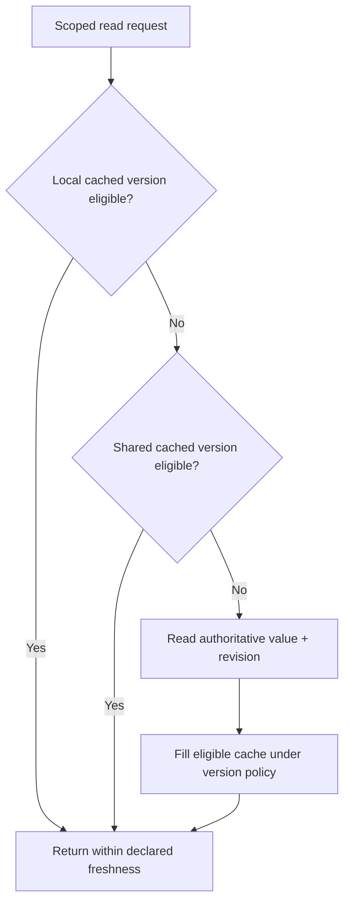

# Eviction, refresh and cache-aside races

**Owning question:** Which read/write interleaving invalidates a naive freshness promise?

This page belongs to [V06/C01 — Local and distributed caching](README.md). Use the integrated walkthrough for the surrounding decision; the sections below own this narrower mechanism and its limits.

<!-- tycho-question-source:tycho.page.33742c54f667446cbf57cb9f3696a533:3 -->
## 3. Local cache eviction and refresh are different actions

The [Caffeine Eviction wiki](https://github.com/ben-manes/caffeine/wiki/Eviction) documents size/weight and time-based eviction, including expire-after-write and expire-after-access. The [Caffeine Refresh wiki](https://github.com/ben-manes/caffeine/wiki/Refresh) distinguishes asynchronous refresh from eviction and notes that refresh-after-write eligibility generally triggers an actual reload only when a key is queried.

This difference is architectural:
- **expire-after-write:** after a defined lifetime, the entry can no longer be served as a normal valid hit;
- **expire-after-access:** frequently accessed values may remain resident longer (subject to other bounds);
- **refresh-after-write:** an old value may remain visible while a new load runs, with configured failure/expiration behavior;
- **size/weight eviction:** bounds memory and may remove useful hot entries, creating origin read bursts.

The installed Caffeine version and precise loader/executor policy must be checked before promising behavior. “Refreshes asynchronously” is not equal to “returns current authoritative state under every failure”.

<!-- /tycho-question-source -->

> **Pattern atlas:**
> [Cache-Aside / Lazy Loading](../../v11-pattern-atlas/c05-caching-retrieval/README.md#cache-aside--lazy-loading) — decision conditions and contraindications.
> [TTL-Based Expiration](../../v11-pattern-atlas/c05-caching-retrieval/ttl-based-expiration.md#ttl-based-expiration) — decision conditions and contraindications.

<!-- tycho-question-source:tycho.page.33742c54f667446cbf57cb9f3696a533:4 -->
## 4. Cache-aside is a sequence, not a consistency theorem

A cache-aside sequence reads the cache first, fetches the origin on a miss, writes a
TTL-bound value and invalidates on writes; stampede hazards follow from that sequence.

**Text alternative:** a read can reuse a local value, then a shared value, then the source, *only* when each value satisfies the required freshness and authorization. A source result may fill a cache if a competing update has not made it obsolete. The figure is original hypothetical topology, not evidence a version gate was implemented.

**The stale-fill race.** Reader R misses and reads V1; writer W commits V2 and invalidates
the key; R then writes V1 back with a fresh TTL, resurrecting stale data. A version gate on
fill — compare the source revision with the cached revision under the shared key — narrows
the window. An atomic compare-and-set or conditional write on that shared key closes the
check/write gap only when it compares the cached revision or tombstone. Absence fails the
compare only for a fill based on a previously observed revision; a cold key may write its
first value when no tombstone exists. Distinguish never-cached absence from a post-delete
tombstone with a durable tombstone or version record. A cache-key CAS cannot compare a source
revision, and a naive SET NX after DEL still resurrects V1. A non-atomic check-then-write
leaves the window open.
A short TTL plus retried invalidation bounds the damage; neither proves freshness when the
invalidation itself can be lost.

When the read budget allows, serving from the source or a shorter TTL with retried
invalidation is the alternative; reverse when fill and invalidation logic duplicates.

**Failure and recovery.** A write can commit while its delete fails. The invalidation intent
must be durable at commit time — an outbox row in the same local transaction — and then
retried; recording only after a failed delete can lose the intent in a crash. Without a TTL, a
lost invalidation is unbounded. Alert on repeated failures. Concurrent misses need
single-flight or a lease; a fallback authoritative read must stay bounded.

Even a cache with TTL may expose stale authorization or deleted content. Bypass caching or
require strict verification for revocation-sensitive operations. Data authorization must be
performed at an enforced boundary; a copied permission bit is not its own authority. Fill and
invalidation must share a version authority; a cache that cannot identify the source revision
cannot prove which value is newer.

<!-- /tycho-question-source -->

## Navigation, prerequisites and source scope

| Route | Destination |
|---|---|
| Parent and source ledger | [Chapter introduction and exact source rows](README.md#chapter-source-ledger) |
| Previous / prerequisite | [Read preceding context](cache-authority.md) |
| Next | [Continue the reasoning](cache-acceptance.md) |
| Integrated question | [Original scenario and limits](local-and-distributed-cache-design.md) |

The source material keeps its original published/inferred/synthetic/unverified distinctions. Chapter-wide citations are shared reference context, not proof that every cited source supports every sentence on this page. Freshly inspected text is identified explicitly; absent dates and unknowns are retained.

## Bounded pattern ownership notes

### TTL-Based Expiration

TTL-based expiration gives an entry a bounded valid lifetime. **expire-after-write:** after a defined
lifetime, the entry can no longer be served as a normal valid hit. The cached copy is not refreshed
merely because the clock passed; the next reader performs the load or waits for a refresh.

A TTL reduces the period during which data might be out of date. Size/weight eviction bounds
memory and may remove useful hot entries, creating origin read bursts. A TTL shorter than the source's change rate reduces staleness but increases load; a longer TTL
does the opposite. Jitter the expiry across keys to avoid synchronized bursts.

Explicit invalidation or versioned keys may be preferable when the source change must be visible
immediately. TTL is a fit when bounded staleness is acceptable and the origin can absorb the refill
rate.
