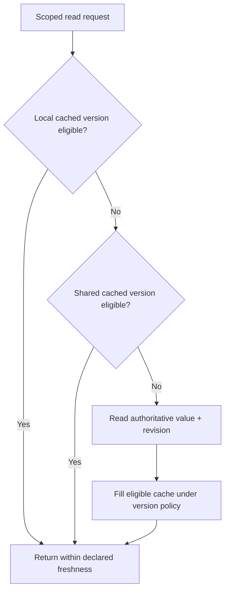

# Eviction, refresh and cache-aside races

**Owning question:** Which read/write interleaving invalidates a naive freshness promise?

This page belongs to [V06/C01 — Local and distributed caching](README.md). Use the integrated walkthrough for the surrounding decision; the sections below own this narrower mechanism and its limits.

<!-- tycho-question-source:tycho.page.33742c54f667446cbf57cb9f3696a533:3 -->
## 3. Local cache eviction and refresh are different actions

The [Caffeine Eviction wiki](https://github.com/ben-manes/caffeine/wiki/Eviction) documents size/weight and time-based eviction, including expire-after-write and expire-after-access. The [Caffeine Refresh wiki](https://github.com/ben-manes/caffeine/wiki/Refresh) distinguishes asynchronous refresh from eviction and notes that refresh-after-write eligibility generally triggers an actual reload only when a key is queried.

This difference is architectural:
- **expire-after-write:** after a defined lifetime, the entry can no longer be served as a normal valid hit;
- **expire-after-access:** frequently accessed values may remain resident longer (subject to other bounds);
- **refresh-after-write:** an old value may remain visible while a new load runs, with configured failure/expiration behavior;
- **size/weight eviction:** bounds memory by evicting entries not used recently or
  often when the cache exceeds its configured size or weight.

The installed Caffeine version and precise loader/executor policy must be checked before promising behavior. “Refreshes asynchronously” is not equal to “returns current authoritative state under every failure”.

<!-- /tycho-question-source -->

> **Pattern atlas:**
> [Cache-Aside / Lazy Loading](../../v11-pattern-atlas/c05-caching-retrieval/README.md#cache-aside--lazy-loading) — decision conditions and contraindications.
> [TTL-Based Expiration](../../v11-pattern-atlas/c05-caching-retrieval/ttl-based-expiration.md#ttl-based-expiration) — decision conditions and contraindications.

<!-- tycho-question-source:tycho.page.33742c54f667446cbf57cb9f3696a533:4 -->
## 4. Cache-aside is a sequence, not a consistency theorem

A cache-aside sequence reads the cache first, fetches the origin on a miss and fills the
cache. Azure and Redis also invalidate on writes; a TTL is an optional policy, not part of
the core sequence. The Azure Cache-Aside pattern states the same
order: the application "writes the change to the data store and then invalidates the
corresponding item in the cache"
([Cache-Aside pattern](https://learn.microsoft.com/en-us/azure/architecture/patterns/cache-aside)).
AWS lazy loading describes the miss path: "If the data doesn't exist in the cache or has
expired, your application requests the data from your data store", then writes the result
to the cache
([Caching strategies](https://docs.aws.amazon.com/AmazonElastiCache/latest/dg/Strategies.html)).
Redis says the application "falls back to the primary on a miss, and writes the result
back to Redis" and, on update, "writes the primary and invalidates the cache key"
([Redis cache-aside](https://redis.io/docs/latest/develop/use-cases/cache-aside/)).
Stampede hazards follow from that sequence.

**Text alternative:** a read can reuse a local value, then a shared value, then the source, *only* when each value satisfies the required freshness and authorization. A source result may fill a cache if a competing update has not made it obsolete. The figure is original hypothetical topology, not evidence a version gate was implemented.

**Invariant (Tycho synthesis).** None of the three descriptions claims consistency. Azure
states that the pattern "doesn't guarantee consistency between the data store and the
cache", and that "Between the write and the next read, a reader can experience a cache
miss or briefly see stale data". AWS says a miss-only fill leaves "no updates to the cache
when data is changed in the database", so "data in the cache can become stale"; a TTL
"doesn't guarantee that a value isn't stale" but "keeps data from getting too stale".
Redis bounds the same window with "a TTL that bounds how long stale data can be served".
A cache-aside read is a freshness claim bounded by the fill revision, the invalidation
path and the TTL, not a consistency theorem.

**The stale-fill race (Tycho synthesis).** Reader R misses and reads V1; writer W commits
V2 and invalidates the key; R then writes V1 back with a fresh TTL, resurrecting stale
data. Azure documents the invalidation-order form of the same hazard: update the data
store before removing the cached item, because deleting first leaves "a small window of
time when a client might fetch the item before the data store is updated", and "This
sequence leads to stale data in the cache". A version gate on fill — compare the source
revision with the cached revision under the shared key — narrows the window. An atomic
compare-and-set or conditional write on that shared key closes the check/write gap only
when it compares the cached revision or tombstone. Absence fails the compare only for a
fill based on a previously observed revision; a cold key may write its first value when no
tombstone exists. Distinguish never-cached absence from a post-delete tombstone with a
durable tombstone or version record. A cache-key CAS cannot compare a source revision, and
a naive SET NX after DEL still resurrects V1. A non-atomic check-then-write leaves the
window open. A short TTL plus retried invalidation bounds the damage; neither proves
freshness when the invalidation itself can be lost.

**Failure and recovery (Tycho synthesis).** Azure states: "If the cache malfunctions, the
workload can fall back to the origin data store." Azure also says: "In limited ways, it
can preserve the availability of frequently accessed data if the origin data store
becomes temporarily unavailable." AWS calls node failure survivable: "Node failures
aren't fatal for your application"; a replacement empty node continues to serve, "though
with increased latency", and each miss costs "three trips". Redis recommends an atomic
mutex or probabilistic early refresh so an expiring popular key does not stampede the
primary. Those rules bound the read path; they do not preserve the write path. **Tycho synthesis:** a
write can commit while its delete fails; the invalidation intent must be durable at commit
time and retried. An outbox row in the same local transaction is one way to record it; recording
only after a failed delete can lose the intent in a crash. Without a TTL, a lost
invalidation is unbounded. Alert on repeated failures, keep a fallback authoritative read
bounded, and use single-flight or a lease for concurrent misses.

Even a cache with TTL may expose stale authorization or deleted content. Azure's
contraindication is direct: for data that is "sensitive or security related", caching
"might be inappropriate", and such data should always be retrieved "from the primary
source". Tycho guidance: bypass caching or require strict verification for
revocation-sensitive operations. Data authorization must be performed at an enforced
boundary; a copied permission bit is not its own authority. Fill and invalidation must
share a version authority; a cache that cannot identify the source revision cannot prove
which value is newer.

**Alternative (Tycho comparison).** Read-through or write-through caches move the fill or
write path into the cache layer; disabling the cache is simpler when the latency budget
allows a direct source read. Azure recommends write-through when "read-heavy paths need
read-after-write freshness"; AWS names a write-through strategy for the stale miss-only
fill. A shorter TTL is a tuning parameter, not a different pattern. Reverse when fill and
invalidation logic duplicates; this selection rule is Tycho guidance.

<!-- /tycho-question-source -->

## Navigation, prerequisites and source scope

| Route | Destination |
|---|---|
| Parent and source ledger | [Chapter introduction and exact source rows](README.md#chapter-source-ledger) |
| Previous / prerequisite | [Read preceding context](cache-authority.md) |
| Next | [Continue the reasoning](cache-acceptance.md) |
| Integrated question | [Original scenario and limits](local-and-distributed-cache-design.md) |

The source material keeps its original published/inferred/synthetic/unverified distinctions. Chapter-wide citations are shared reference context, not proof that every cited source supports every sentence on this page. Freshly inspected text is identified explicitly; absent dates and unknowns are retained.

## Bounded pattern ownership notes

### TTL-Based Expiration

TTL-based expiration gives an entry a bounded valid lifetime. **expire-after-write:** after a
defined lifetime, the entry can no longer be served as a normal valid hit. The cached copy
is not refreshed merely because the clock passed; the next reader performs the load or
waits for a refresh.

A TTL reduces the period during which data might be out of date. Set the TTL from a
duration: the maximum acceptable stale window. The source says, "When you design your
caching strategy, decide how much staleness your application can tolerate and set
time-to-live (TTL) values accordingly." A TTL longer than that window fails the condition.

The source also warns about both ends of the range: "If you make it too short, objects
expire too quickly and you reduce the benefits of using the cache. If you make the period
too long, you risk the data becoming stale."

The source also describes forced eviction: "If you allow data to remain in the cache for a
long time, the cache might fill up. In this case, any requests to add new items to the
cache might cause the cache to forcibly remove some items in a process known as eviction."
It states no recovery action for eviction. Tycho guidance: monitor eviction and reload
traffic, and size or partition the cache for the workload.

For data that must be current, the source recommends an alternative: "For data that must
be current, use shorter TTLs or bypass the cache entirely and read from the source data
store." TTL is a fit when bounded staleness is acceptable. Tycho guidance: confirm the
origin can absorb the reload after expiry.
