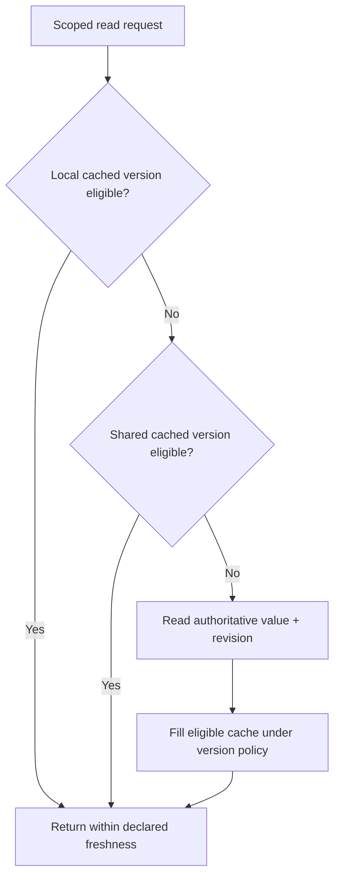

# Eviction, refresh and cache-aside races

**Owning question:** Which read/write interleaving invalidates a naive freshness promise?

This page belongs to [V06/C01 — Local and distributed caching](README.md). Use the integrated walkthrough for the surrounding decision; the sections below own this narrower mechanism and its limits.

<!-- tycho-question-source:tycho.page.33742c54f667446cbf57cb9f3696a533:3 -->
## 3. Local cache eviction and refresh are different actions

The [Caffeine Eviction wiki](https://github.com/ben-manes/caffeine/wiki/Eviction) documents size/weight and time-based eviction, including expire-after-write and expire-after-access. The [Caffeine Refresh wiki](https://github.com/ben-manes/caffeine/wiki/Refresh) distinguishes asynchronous refresh from eviction and notes that refresh-after-write eligibility generally triggers an actual reload only when a key is queried.

This difference is architectural:
- **expire-after-write:** after a defined lifetime, the entry can no longer be served as a normal valid hit;
- **expire-after-access:** frequently accessed values may remain resident longer (subject to other bounds);
- **refresh-after-write:** an old value may remain visible while a new load runs, with configured failure/expiration behavior;
- **size/weight eviction:** bounds memory and may remove useful hot entries, creating origin read bursts.

The installed Caffeine version and precise loader/executor policy must be checked before promising behavior. “Refreshes asynchronously” is not equal to “returns current authoritative state under every failure”.

<!-- /tycho-question-source -->
<!-- tycho-question-source:tycho.page.33742c54f667446cbf57cb9f3696a533:4 -->
## 4. Cache-aside is a sequence, not a consistency theorem

The [Redis cache-aside use-case](https://redis.io/docs/latest/develop/use-cases/cache-aside/) describes reading cache first, fetching an origin on miss, setting a TTL-bound value and invalidating on writes. It also identifies stampede hazards.

**Text alternative:** a read can reuse a local value, then a shared value, then the source, *only* when each value satisfies the required freshness and authorization. A source result may fill a cache if a competing update has not made it obsolete. The figure is original hypothetical topology, not evidence a version gate was implemented.

Even a cache with TTL may expose stale authorization or deleted content. Bypass caching or require strict verification for revocation-sensitive operations. Data authorization must be performed at an enforced boundary; a copied permission bit is not its own authority.

<!-- /tycho-question-source -->

## Navigation, prerequisites and source scope

| Route | Destination |
|---|---|
| Parent and source ledger | [Chapter introduction and exact source rows](README.md#chapter-source-ledger) |
| Previous / prerequisite | [Read preceding context](cache-authority.md) |
| Next | [Continue the reasoning](cache-acceptance.md) |
| Integrated question | [Original scenario and limits](local-and-distributed-cache-design.md) |

The source material keeps its original published/inferred/synthetic/unverified distinctions. Chapter-wide citations are shared reference context, not proof that every cited source supports every sentence on this page. Freshly inspected text is identified explicitly; absent dates and unknowns are retained.
