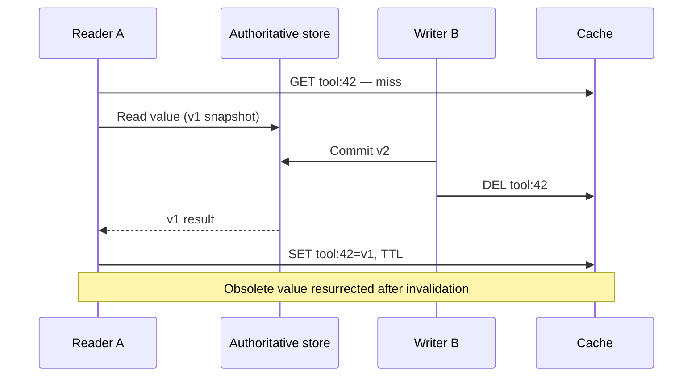

# Stale fills and regeneration ownership

**Owning question:** Which version or fencing rule prevents a refresh from publishing obsolete state?

This page belongs to [V06/C02 — Hot keys, cache stampedes and read amplification](README.md). Use the integrated walkthrough for the surrounding decision; the sections below own this narrower mechanism and its limits.

<!-- tycho-question-source:tycho.page.e0f0d5b68f834acbae94cc6714895dd3:1 -->
## 1. The stale-fill-after-invalidation race

**Original synthetic sequence:** cache key tool:42 has no value. Reader A begins an authoritative read of version v1. Meanwhile writer B commits v2 and deletes the key. The older reader completes and stores v1 after the delete; future readers may see obsolete data.

**Text alternative:** reader A starts loading an older version before a newer write. The writer commits and invalidates. A then repopulates the key with the obsolete value. Normal cache-aside with database-write-then-delete and an unguarded fill cannot eliminate this race by itself.

Possible mitigations have different complexity:
- accept bounded staleness for noncritical content, with a clearly defined maximum interval under real renewal rules;
- attach monotonic source versions and only allow cache writes that do not regress version;
- compare-and-set/atomic scripts at the shared key for a properly modeled version guard;
- avoid serving cache as authority for effect/authorization checks;
- route updates through a versioned projection with replay and tombstone semantics when justified.

A TTL is *not* itself a monotonic-version or consistency guarantee. Source and cache clocks or refreshing a stale value may complicate any claimed maximum-age contract. [Redis cache-aside](https://redis.io/docs/latest/develop/use-cases/cache-aside/) presents the basic flow, not a universal proof of protection from this concurrent fill order.

<!-- /tycho-question-source -->

> **Pattern atlas:**
> [Stale-While-Revalidate](../../v11-pattern-atlas/c05-caching-retrieval/README.md#stale-while-revalidate) — decision conditions and contraindications.

<!-- tycho-question-source:tycho.page.e0f0d5b68f834acbae94cc6714895dd3:3 -->
## 3. A refresh lock is not automatically a correctness lock

Imagine worker A acquires a distributed refresh lock, then pauses. Its lease expires and worker B acquires a new lease, fetches v2 and publishes it. Worker A resumes with stale v1 and writes it to cache. The lock allowed two overlapping active owners in time.

A safe design needs to specify whether refresh ownership is merely a **performance optimization** (duplicate loads are acceptable) or whether it must protect a **monotonic correctness property**. In the latter case, use source revision/fencing or conditional update at the destination; do not rely on time-based lease expiration alone. A Redis scripting capability can make one cache operation atomic, but cross-resource correctness still requires an appropriate model.

<!-- /tycho-question-source -->

## Navigation, prerequisites and source scope

| Route | Destination |
|---|---|
| Parent and source ledger | [Chapter introduction and exact source rows](README.md#chapter-source-ledger) |
| Previous / prerequisite | [Read preceding context](cache-invalidation-stampede-and-hot-keys.md) |
| Next | [Continue the reasoning](stampede-protection.md) |
| Integrated question | [Original scenario and limits](cache-invalidation-stampede-and-hot-keys.md) |

The source material keeps its original published/inferred/synthetic/unverified distinctions. Chapter-wide citations are shared reference context, not proof that every cited source supports every sentence on this page. Freshly inspected text is identified explicitly; absent dates and unknowns are retained.

## Bounded pattern ownership notes

These notes define the decision boundary for atlas cards whose mechanism is not the main subject of
this page. They are synthetic design guidance, not measured evidence, and they do not create a new
source claim.

### Stale-While-Revalidate

Stale-while-revalidate serves the current stale value while a cache revalidates it in the
background, within a bounded stale window. The window is the response's declared
`stale-while-revalidate` delta-seconds; it is not an open-ended permission.

RFC 5861 says caches "MAY serve the response in which it appears after it becomes stale, up
to the indicated number of seconds" and that if delta-seconds passes without revalidation
the response "SHOULD NOT continue to be served stale." RFC 9111 requires that a cache
"MUST NOT generate a stale response unless" it is disconnected or explicitly permitted,
and names extension directives such as RFC 5861. MDN's example allows reuse for the
following 86400 seconds "provided that they revalidate the response in the background,"
then says the next request revalidates normally. Read together, RFC 5861's SHOULD NOT
cutoff and RFC 9111's permission rule bound the window. The stale window is bounded by
the declared delta-seconds, and a failed or inconclusive refresh must not extend it.

A failed or inconclusive refresh may keep serving stale only inside the window; after the
bound, the next request blocks and is handled normally. RFC 5861's example says that when
"validation is inconclusive," after the window "the stale-while-revalidate function will
cease to operate" and the next request "will block and be handled normally." Cap the stale
age at the declared bound, and fall back to a blocking read when it is reached.

A single refresh owner and refresh-failure telemetry are Tycho guidance, not HTTP
requirements: the sources describe cache-level revalidation, not a coalescing owner or a
failure metric. RFC 5861 expected a stale response to carry a non-zero Age and a warning;
RFC 9111 later obsoleted Warning while keeping Age, so use Age as the observable staleness
signal and add an owner-specific failure signal.

TTL-only expiry is the alternative when background refresh cannot be bounded; it trades
freshness for no refresh coordination. A blocking refresh guarantees freshness at the cost
of latency; choose stale-while-revalidate only when the declared stale window is acceptable
to the reader.

**Limits.** The window is a user-visible correctness bound. RFC 5861 is Informational;
RFC 9111 is Standards Track STD 98. The sources specify HTTP caches and do not test a cache
implementation, a refresh owner or a failure metric. The single-owner and telemetry rules
are Tycho guidance.

**Source boundary.**

- RFC 5861, `read.batch3-rfc5861.2026-10-21`, raw text
  `1193f1c8710af162e1b9fb4250d79bc6dd26497df4caeeaaa8bcb2fefdd2529e`:
  sections 3 and 3.1; the delta-seconds window, the SHOULD NOT continuation and the
  inconclusive-validation fallback.
- RFC 9111, `read.rfc9111-stale.2026-10-30`, raw text
  `aeb52adb3279d5f23dae34f68af11bd5cef0a0aff7ffcd014c9ca93c5302cf3e`:
  section 4.2.4 (stale only when explicitly permitted, naming RFC 5861) and
  section 5.5 (Warning obsoleted; Age remains).
- MDN, "Cache-Control header", `read.mdn-cache-control.2026-10-30`, raw HTML
  `f10655f725b4f7735b97156ee8f9d699ffddf02d67edc05357d7c66de7c67f3c`:
  the `stale-while-revalidate` section and the Age definition.
- Limits: these are HTTP-cache specifications and documentation, not an implementation
  test; the single-owner and telemetry rules are Tycho guidance.
