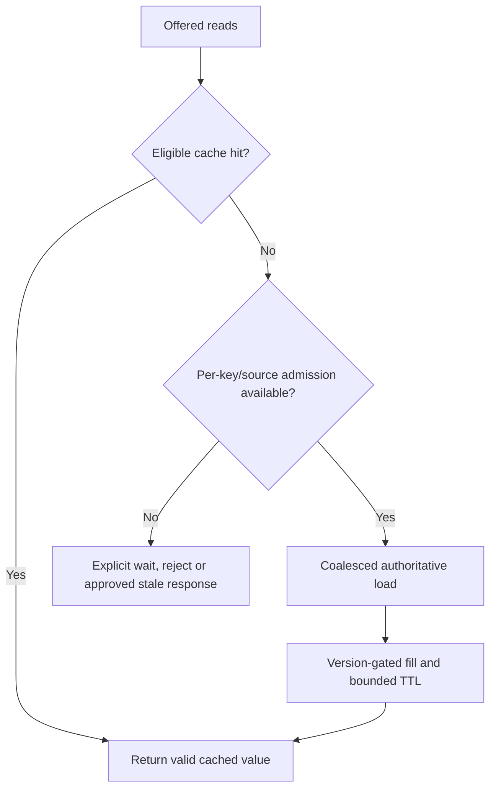

# Stampedes and source protection

**Owning question:** How do expiry and cache loss concentrate demand on the origin?

This page belongs to [V06/C02 — Hot keys, cache stampedes and read amplification](README.md). Use the integrated walkthrough for the surrounding decision; the sections below own this narrower mechanism and its limits.

<!-- tycho-question-source:tycho.page.e0f0d5b68f834acbae94cc6714895dd3:2 -->
## 2. Stampede at a synchronized expiry

A cache stampede occurs when many concurrent readers miss or decide that a cached value needs refreshing, then issue many redundant expensive origin loads.

**Illustrative fiction:** one key receives 600 reads/s. Its TTL expires and 300 clients overlap before the first origin read returns. Without per-key coalescing or a source admission budget, the origin may receive hundreds of near-identical queries even though normally it receives few. These are invented counts, not observed measurements.

Potential countermeasures:

| Technique | Can reduce | Required caveat |
|---|---|---|
| Single-flight within process | Multiple concurrent source loads per key on one instance | Many replicas still load in parallel |
| Distributed refresh lease | Duplicate concurrent refreshes across instances | Lease expiry/failure, fencing and stale writer concerns |
| Jittered TTL | Simultaneous expiry of *different* keys | One extremely hot key can still stampede |
| Stale-while-revalidate | User wait during refresh | Stale result must be acceptable for that operation |
| Proactive refresh/prewarm | Cold-start miss spike | Extra background origin work and false freshness assumptions |
| Source admission/bulkhead | Limits origin overload | Some reads must wait, reject or degrade explicitly |
| Versioned projection | Controlled update and monotonic read semantics | Extra storage, ordering/replay and version migration |

Single-flight may deduplicate only loads triggered inside one process. Caffeine's [Refresh documentation](https://github.com/ben-manes/caffeine/wiki/Refresh) describes eligible asynchronous refresh while an old value may remain available and a refresh operation may deduplicate concurrent refresh requests. That does not, by itself, provide global cross-replica coalescing or make the stale value safe for sensitive decisions.

**Invariant.** A stampede policy must bound concurrent origin loads per key and total
source work, and stale-while-revalidate is only valid when the operation accepts the stale
value. A per-process single-flight that leaves every replica loading is not a global bound.

**Failure and recovery.** An expired lease can release a second refresh while the first is
still writing; jittered TTLs do not protect one extremely hot key. Measure origin QPS and
queue age per key, coalesce or lease refreshes, cap source admission and return an explicit
wait/reject/degrade response when the source budget is exhausted.

<!-- /tycho-question-source -->

> **Pattern atlas:**
> [Cache Stampede Protection](../../v11-pattern-atlas/c05-caching-retrieval/README.md#cache-stampede-protection) — decision conditions and contraindications.
> [Single Flight / Request Coalescing](../../v11-pattern-atlas/c05-caching-retrieval/README.md#single-flight--request-coalescing) — decision conditions and contraindications.

<!-- tycho-question-source:tycho.page.e0f0d5b68f834acbae94cc6714895dd3:5 -->
## 5. Cache-loss and source-protection policy

Losing the cache might cause every request to hit the source. “Fallback to DB” is not automatically a safe policy when the source cannot handle full offered traffic.

**Text alternative:** a cache miss checks scarce source capacity and same-key load sharing. Admitted loads may fill the cache only under a valid version rule. Excess requests wait, fail or use an explicitly permitted stale result, not unlimited source queries.

The correct fallback depends on data importance. For public noncritical descriptions, serving a labeled stale value may be acceptable. For an authoritative reservation or access grant, a stale cache value may be forbidden; reject and explain lack of current state instead.

Cache loss is a load event, not only a latency event. Classify the cache as a latency cache
or a capacity cache using
[V06/C01 cache acceptance](../c01-local-and-distributed-caching/cache-acceptance.md).
If it is a capacity cache, the source cannot accept full miss traffic; admit, queue or
reject explicitly, and state the degraded contract. A broad restart of every replica is the
relevant test, not only one expired key.

### Original race: an old asynchronous fill resurrects invalid data

Suppose a catalogue cache contains version 17 of a resource. Reader A misses and begins a slow database read of version 17. Writer B commits version 18, invalidates the cache and returns success. A finishes later and populates the cache with its older version 17. The final cache state is stale **despite a correct invalidation message**: deletion alone does not fence an in-flight fill.

| Step | Database authority | Cache state |
|---|---|---|
| T0 A begins read | v17 | Miss / refill pending |
| T1 B commits | v18 | Invalidation arrives |
| T2 A finishes slow old read | v18 | **Unsafe** if v17 is installed without a version/generation check |
| T3 C requests item | v18 | Must not assume invalidation proved freshness |

One design is to attach an authority-issued version or generation to each value and admit a replacement only if it is not older than the cached high-water generation. This needs a coherent version source and atomic comparison under concurrency; local counters cannot provide cross-replica ordering. Another design can forgo strong freshness, explicitly allowing a bounded stale interval where business and authorization requirements permit it.

A refresh mutex limits stampede work but **does not necessarily prevent stale installation after a writer's invalidation**. Similarly, TTL limits lifetime under assumptions but is not transactional consistency. The [Redis cache-aside description](https://redis.io/docs/latest/develop/use-cases/cache-aside/) and [Caffeine refresh documentation](https://github.com/ben-manes/caffeine/wiki/Refresh) describe general mechanisms; neither certifies the fictional generation protocol.

**Negative recovery test, not run:** pause A before cache installation, commit B, resume A, then assert that a newer authoritative generation cannot be overwritten. Separately expire a popular key at burst load and check source/database admission, coalescing, timeout and correctness. If a cache cannot satisfy required freshness or tenant isolation, bypass/restrict that cache rather than label it eventually consistent without an approved bound.

<!-- /tycho-question-source -->

## Bounded pattern ownership notes

### Cache Stampede Protection

**Mechanism — synchronized misses, not a low hit ratio (Tycho summary, source-bound).**
A cache stampede occurs when many concurrent readers miss or decide that a cached value
needs refreshing, then issue many redundant expensive origin loads. Cloudflare's image-service
example shows the mechanism: after the cache expires, "these 10 requests are going to go
directly to the image server", and "When the image server sees these 10 requests all happening
at the same time, it gets overloaded." AWS describes the same event as the "thundering herd"
situation, "in which many clients make requests that need the same uncached downstream
resource at approximately the same time." Tycho's reading: the defect is correlated work
amplification, not merely a low hit ratio; the policy must bound concurrent origin loads per
key and total source work.

The countermeasure families differ in scope and failure mode:

- **Single-flight within process.** Reduces multiple concurrent source loads per key on one
  instance; many replicas still load in parallel.
- **Distributed refresh lease.** Reduces duplicate concurrent refreshes across instances;
  lease expiry/failure, fencing and stale-writer concerns remain.
- **Jittered TTL.** Spreads simultaneous expiry of *different* keys; one extremely hot key
  can still stampede.
- **Stale-while-revalidate.** Hides user wait during refresh; the stale result must be
  acceptable for that operation.
- **Proactive refresh/prewarm.** Reduces a cold-start miss spike; extra background origin
  work and false freshness assumptions remain.
- **Source admission/bulkhead.** Limits origin overload; some reads must wait, reject or
  degrade explicitly.
- **Versioned projection.** Supports controlled update and monotonic read semantics; extra
  storage, ordering/replay and version migration remain.

**Invariant — one refresh per key and a bounded source budget (Tycho rule, source-bound).**
Redis states the lock invariant as "Safety property: Mutual exclusion. At any given moment,
only one client can hold a lock." Go's singleflight package gives the in-process version:
"Do executes and returns the results of the given function, making sure that only one
execution is in-flight for a given key at a time", and "If a duplicate comes in, the
duplicate caller waits for the original to complete and receives the same results." Tycho's
rule: coalesce or lease refreshes per key, cap total source admission, and make the
wait/reject/declared-stale choice explicit. Stale-while-revalidate is valid only when the
operation accepts the stale value. A per-process singleflight is not a global bound: every
replica can still load the same key in parallel.

**Failure and recovery — leases expire, leaders fail, waiters need an outcome (Tycho
runbook, source-bound).**
Redis warns that "a client may acquire the lock, get blocked performing some operation for
longer than the lock validity time (the time at which the key will expire), and later remove
the lock, that was already acquired by some other client"; a random lock value makes deletion
safe, and "You should implement fencing tokens." Cloudflare adds that a lock service "might
be unavailable", and probabilistic early expiration avoids that dependency but "does so at
the cost of not guaranteeing the number of requests going to the origin server: maybe zero
for an extended period, maybe more than one." Go's `Forget` gives a way out: "Forget tells
the singleflight to forget about a key", and "Future calls to Do for this key will call the
function rather than waiting for an earlier call to complete"; `DoChan` returns a channel
that "will not be closed." Tycho's runbook: on lease or leader failure, stop admitting
duplicate work, bound the wait, share one outcome record with every waiter, fence a stale
writer before it installs an old value, and return an explicit wait/reject/declared-stale
response when the source budget is exhausted; never retry unbounded.

**Alternative — probabilistic early expiration, jittered TTL, or a lock (Tycho choice
rule, source-bound).**
Cloudflare contrasts the lock with probabilistic cache revalidation, which "does not suffer
from these, given it does not reach out to an external service but rolls a die with the local
randomness generator"; it can refresh before expiry based on a probability, at the cost that
"maybe zero for an extended period, maybe more than one" request reaches the origin. AWS's
Valkey guide gives the jitter alternative: "If a bunch of cache entries share the same TTL
(and are written at the same time), they all expire at the same time. Suddenly every request
is a cache miss and your database gets hammered. The fix is dead simple: ✨Jitter✨." A fixed
early-refresh window is not enough: Cloudflare observes that "all requests are going to be
made 5 minutes in advance, and that does not solve our cache stampede problem." Tycho's
choice rule: use probabilistic early expiration when occasional extra origin loads are
acceptable and no coordination service is wanted; use jittered TTL when many different keys
expire together, recognizing that one extremely hot key can still stampede; use a
distributed lease or request coalescing when one key dominates and duplicate loads are
unacceptable; reverse the
choice when coordination latency and failure outweigh source protection. An AWS Builder
Center community article (Portuguese) also describes an XFetch-style ElastiCache adapter; it
is community content, not AWS documentation, and is listed as bounded context rather than
certified behavior.

**Source boundary.** Public documentation and articles, accessed 2026-10-31. No cache, lock,
lease, coalescing or load test was executed. Quotes are short excerpts; line breaks are
editorial wrapping and whitespace is normalized. New source ids and ledger records are
proposed in the B52 lane note and are not added to the shared register by this lane.
Tycho-labelled sentences are synthesis, not source claims.

- Cloudflare, *Sometimes I cache: implementing lock-free probabilistic caching*; published
  2024-12-26, modified 2026-07-30; canonical text SHA-256
  `1095c942825ca57d17f82796398957e8dfa6fac01eb7fe2c0a47b52752220a19`; raw HTML
  SHA-256 `b95a03f213e8ab798292b1680a0bec71ee0e9ff242b94e7816616438e1935649`;
  record `read.cloudflare-sometimes-i-cache.2026-10-31` proposed.
- AWS Builders' Library, *Caching challenges and strategies*; published and last modified
  2019-12-05; canonical text SHA-256
  `55f310713a99dd8282b6e4e569538462793e6387a3c1ca6251a6aa1c42e739a1`; raw HTML
  SHA-256 `874cf4ac6ee84772dc37446ec34e41d8adc076a32a3f8c8e5468c9fd50587759`;
  record `read.aws-caching-challenges.2026-10-31` proposed.
- Redis documentation, *Distributed Locks with Redis*; Last-Modified 2026-10-30;
  canonical text SHA-256
  `628a3026cdbad3121deb6f604d43f9e01317db9d0f7bb74f9ea4e1524291bb17`; raw HTML
  SHA-256 `b96df057bbf4b9d2a321d47c3a319fe796b8705bb56ee5e62a819679d1d01ec7`;
  record `read.redis-distributed-locks.2026-10-31` proposed under `src.redis`.
- Go documentation, *singleflight package*; version v0.24.0; page published 2026-09-23;
  canonical text SHA-256
  `a3810adc75c789bbe3c59a2aa1ca627bcdedfc9962703c444234a99f225762c4`; raw HTML
  SHA-256 `ad466f6794e6bf6e5abf197636ca6db4fbbf270e45e6fbc798914aff4dd50c55`;
  record `read.go-singleflight.2026-10-31` proposed under `src.go-singleflight`.
- AWS Builder Center, *Database Caching on AWS with Valkey: A Developer's Guide*;
  published and last modified 2026-03-27; canonical text SHA-256
  `75b455cb1f36e9b17d840a5e20cacf68d56bd6a2d65e334098f3196d3451df07`; raw HTML
  SHA-256 `74a56d3425c6cda548bf924c4249af84525b5aa4b4f730159032c61b3e25f093`;
  record `read.aws-valkey-ttl-jitter.2026-10-31` proposed under `src.aws-ttl-jitter`.
- AWS Builder Center community article (Portuguese), *Resiliência Extrema em Camadas de
  Acesso a Dados*; published and last modified 2026-06-17; canonical text SHA-256
  `631905b81459a0deb70c8c675b4ae76b68a9f41cd23fb0e6bb6472e77e7a0c0f`; raw HTML
  SHA-256 `9625cea708d39110ef1d16fe95d9138efc6a4fec3066a177ec403c7fe5d7dbd8`;
  record `read.aws-community-per.2026-10-31` proposed under
  `src.aws-per-cache-stampede`; community content, not AWS documentation.

### Single Flight-Request Coalescing

Single-flight may deduplicate only loads triggered inside one process. A local cache can
serve an old value while one asynchronous refresh runs and coalesce concurrent refresh
requests, but that is a local optimization, not a global lock.

That does not, by itself, provide global cross-replica coalescing or make the stale value safe for
sensitive decisions. A coalesced call can fail after the leader has committed an external effect;
the followers need the same outcome record, not a fresh retry. Bound the wait and surface a leader
failure to every waiter.

Single-flight within process is a fit for multiple concurrent source loads per key on one instance;
many replicas still load in parallel. It is a fit for read-mostly stable keys whose waiters can
share failure; reject differing authorization or parameters and independent cancellation, and use
independent calls when isolation matters. A distributed refresh lease is preferable when duplicate
concurrent refreshes across instances matter, with its lease-expiry and fencing costs.

## Navigation, prerequisites and source scope

| Route | Destination |
|---|---|
| Parent and source ledger | [Chapter introduction and exact source rows](README.md#chapter-source-ledger) |
| Previous / prerequisite | [Read preceding context](stale-fill.md) |
| Next | [Continue the reasoning](negative-cache.md) |
| Integrated question | [Original scenario and limits](cache-invalidation-stampede-and-hot-keys.md) |

The source material keeps its original published/inferred/synthetic/unverified distinctions. Chapter-wide citations are shared reference context, not proof that every cited source supports every sentence on this page. Freshly inspected text is identified explicitly; absent dates and unknowns are retained.
