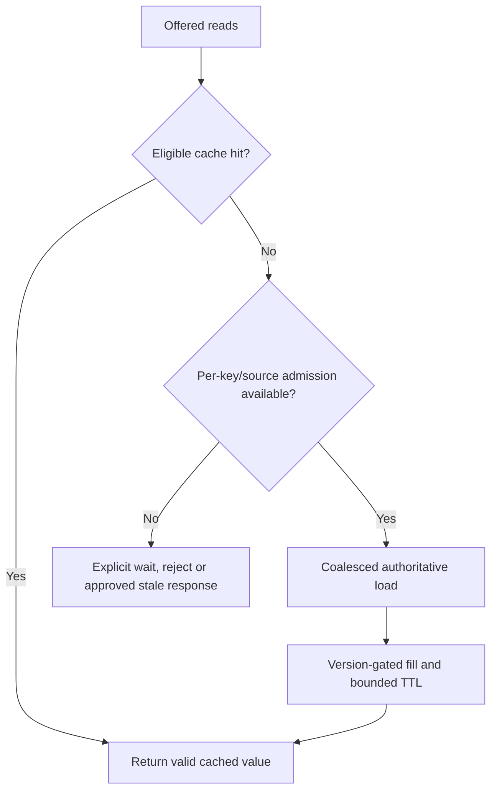

# Stampedes and source protection

**Owning question:** How do expiry and cache loss concentrate demand on the origin?

This page belongs to [V06/C02 — Hot keys, cache stampedes and read amplification](README.md). Use the integrated walkthrough for the surrounding decision; the sections below own this narrower mechanism and its limits.

<!-- tycho-question-source:tycho.page.e0f0d5b68f834acbae94cc6714895dd3:2 -->
## 2. Stampede at a synchronized expiry

A cache stampede occurs when many concurrent readers miss or decide that a cached value needs refreshing, then issue many redundant expensive origin loads.

**Illustrative fiction:** one key receives 600 reads/s. Its TTL expires and 300 clients overlap before the first origin read returns. Without per-key coalescing or a source admission budget, the origin may receive hundreds of near-identical queries even though normally it receives few. These are invented counts, not observed measurements.

Potential countermeasures:

| Technique | Can reduce | Required caveat |
|---|---|---|
| Single-flight within process | Multiple concurrent source loads per key on one instance | Many replicas still load in parallel |
| Distributed refresh lease | Duplicate concurrent refreshes across instances | Lease expiry/failure, fencing and stale writer concerns |
| Jittered TTL | Simultaneous expiry of *different* keys | One extremely hot key can still stampede |
| Stale-while-revalidate | User wait during refresh | Stale result must be acceptable for that operation |
| Proactive refresh/prewarm | Cold-start miss spike | Extra background origin work and false freshness assumptions |
| Source admission/bulkhead | Limits origin overload | Some reads must wait, reject or degrade explicitly |
| Versioned projection | Controlled update and monotonic read semantics | Extra storage, ordering/replay and version migration |

Single-flight may deduplicate only loads triggered inside one process. Caffeine's [Refresh documentation](https://github.com/ben-manes/caffeine/wiki/Refresh) describes eligible asynchronous refresh while an old value may remain available and a refresh operation may deduplicate concurrent refresh requests. That does not, by itself, provide global cross-replica coalescing or make the stale value safe for sensitive decisions.

**Invariant.** A stampede policy must bound concurrent origin loads per key and total
source work, and stale-while-revalidate is only valid when the operation accepts the stale
value. A per-process single-flight that leaves every replica loading is not a global bound.

**Failure and recovery.** An expired lease can release a second refresh while the first is
still writing; jittered TTLs do not protect one extremely hot key. Measure origin QPS and
queue age per key, coalesce or lease refreshes, cap source admission and return an explicit
wait/reject/degrade response when the source budget is exhausted.

<!-- /tycho-question-source -->

> **Pattern atlas:**
> [Cache Stampede Protection](../../v11-pattern-atlas/c05-caching-retrieval/README.md#cache-stampede-protection) — decision conditions and contraindications.
> [Single Flight / Request Coalescing](../../v11-pattern-atlas/c05-caching-retrieval/README.md#single-flight--request-coalescing) — decision conditions and contraindications.

<!-- tycho-question-source:tycho.page.e0f0d5b68f834acbae94cc6714895dd3:5 -->
## 5. Cache-loss and source-protection policy

Losing the cache might cause every request to hit the source. “Fallback to DB” is not automatically a safe policy when the source cannot handle full offered traffic.

**Text alternative:** a cache miss checks scarce source capacity and same-key load sharing. Admitted loads may fill the cache only under a valid version rule. Excess requests wait, fail or use an explicitly permitted stale result, not unlimited source queries.

The correct fallback depends on data importance. For public noncritical descriptions, serving a labeled stale value may be acceptable. For an authoritative reservation or access grant, a stale cache value may be forbidden; reject and explain lack of current state instead.

Cache loss is a load event, not only a latency event. Classify the cache as a latency cache
or a capacity cache using
[V06/C01 cache acceptance](../c01-local-and-distributed-caching/cache-acceptance.md).
If it is a capacity cache, the source cannot accept full miss traffic; admit, queue or
reject explicitly, and state the degraded contract. A broad restart of every replica is the
relevant test, not only one expired key.

### Original race: an old asynchronous fill resurrects invalid data

Suppose a catalogue cache contains version 17 of a resource. Reader A misses and begins a slow database read of version 17. Writer B commits version 18, invalidates the cache and returns success. A finishes later and populates the cache with its older version 17. The final cache state is stale **despite a correct invalidation message**: deletion alone does not fence an in-flight fill.

| Step | Database authority | Cache state |
|---|---|---|
| T0 A begins read | v17 | Miss / refill pending |
| T1 B commits | v18 | Invalidation arrives |
| T2 A finishes slow old read | v18 | **Unsafe** if v17 is installed without a version/generation check |
| T3 C requests item | v18 | Must not assume invalidation proved freshness |

One design is to attach an authority-issued version or generation to each value and admit a replacement only if it is not older than the cached high-water generation. This needs a coherent version source and atomic comparison under concurrency; local counters cannot provide cross-replica ordering. Another design can forgo strong freshness, explicitly allowing a bounded stale interval where business and authorization requirements permit it.

A refresh mutex limits stampede work but **does not necessarily prevent stale installation after a writer's invalidation**. Similarly, TTL limits lifetime under assumptions but is not transactional consistency. The [Redis cache-aside description](https://redis.io/docs/latest/develop/use-cases/cache-aside/) and [Caffeine refresh documentation](https://github.com/ben-manes/caffeine/wiki/Refresh) describe general mechanisms; neither certifies the fictional generation protocol.

**Negative recovery test, not run:** pause A before cache installation, commit B, resume A, then assert that a newer authoritative generation cannot be overwritten. Separately expire a popular key at burst load and check source/database admission, coalescing, timeout and correctness. If a cache cannot satisfy required freshness or tenant isolation, bypass/restrict that cache rather than label it eventually consistent without an approved bound.

<!-- /tycho-question-source -->

## Bounded pattern ownership notes

### Cache Stampede Protection

A cache stampede occurs when many concurrent readers miss or decide that a cached value needs
refreshing, then issue many redundant expensive origin loads. The problem is synchronized work
amplification, not merely a low hit ratio.

A stampede policy must bound concurrent origin loads per key and total source work, and
stale-while-revalidate is only valid when the operation accepts the stale value. An expired lease can
release a second refresh while the first is still writing; jittered TTLs do not protect one extremely
hot key. Add a per-key lock or lease, jitter the refresh time, and expose origin-load concurrency.

Jittered TTL is a competing technique for simultaneous expiry of *different* keys; one extremely hot
key can still stampede. A distributed refresh lease or request coalescing is preferable when one key
dominates and stale data is acceptable for the operation.

### Single Flight / Request Coalescing

Single-flight may deduplicate only loads triggered inside one process. Caffeine's Refresh
documentation describes eligible asynchronous refresh while an old value may remain available and a
refresh operation may deduplicate concurrent refresh requests. It is a local optimization, not a
global lock.

That does not, by itself, provide global cross-replica coalescing or make the stale value safe for
sensitive decisions. A coalesced call can fail after the leader has committed an external effect;
the followers need the same outcome record, not a fresh retry. Bound the wait and surface a leader
failure to every waiter.

Single-flight within process is a fit for multiple concurrent source loads per key on one instance;
many replicas still load in parallel. A distributed refresh lease is preferable when duplicate
concurrent refreshes across instances matter, with its lease-expiry and fencing costs.

## Navigation, prerequisites and source scope

| Route | Destination |
|---|---|
| Parent and source ledger | [Chapter introduction and exact source rows](README.md#chapter-source-ledger) |
| Previous / prerequisite | [Read preceding context](stale-fill.md) |
| Next | [Continue the reasoning](negative-cache.md) |
| Integrated question | [Original scenario and limits](cache-invalidation-stampede-and-hot-keys.md) |

The source material keeps its original published/inferred/synthetic/unverified distinctions. Chapter-wide citations are shared reference context, not proof that every cited source supports every sentence on this page. Freshly inspected text is identified explicitly; absent dates and unknowns are retained.
