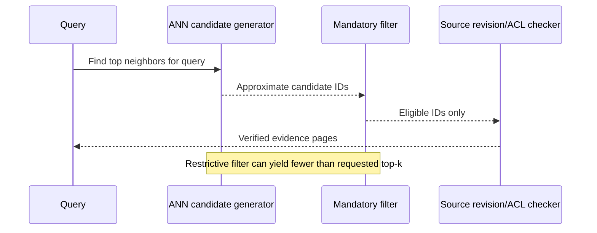

# Filtering, authorization and recall

**Owning question:** How can filtering change the available neighbor set without granting access?

This page belongs to [V06/C04 — Vector embeddings and nearest-neighbor retrieval](README.md). Use the integrated walkthrough for the surrounding decision; the sections below own this narrower mechanism and its limits.

<!-- tycho-question-source:tycho.page.7a67fd6346a54eff97784465c22bbc74:4 -->
## 4. Metadata filtering creates a subtle recall and security boundary

The pgvector project README states that when using approximate indexes, filtering can happen **after** scanning candidates. If only a small fraction of nearest neighbors meet a restrictive filter (e.g. topic, version, tenant), the first approximate scan may return fewer than the requested `LIMIT` and lower observed recall. The README documents *iterative index scans*, partitioning and partial indexes as mitigations, with version-specific options. [E01]

Text alternative: ANN produces candidates, which are filtered for required topic/version/ACL constraints and checked against authoritative source revisions. A selective filter may leave too few candidates; search design may need filtered indexes, broader scans or exact fallback.

**Security matters:** do not allow an approximate index to reveal restricted titles/excerpts through pre-filter snippets, side-channel counts or postfilter leakage. The intended Tycho corpus is independently public, but general methods should still model permission filtering and redaction explicitly.

<!-- /tycho-question-source -->

## Original ranked-set counterexample — authorization is not optional relevance

Suppose an exact hypothetical ranking is A, B, C, D, E. The caller may read only D and E. A candidate stage that retrieves three items and then removes unauthorized results returns nothing. A search over the authorized population can return D and E. The difference follows from the declared sets; it is not an observed result for an ANN library or a promise about any engine's planner.

Increasing the candidate budget may help find authorized results in this example, but it must never change what is authorized. Conversely, filtering early is not enough to prove recall: the index, model and permitted population still define the search problem. Evaluate quality against an exact authorized reference, and record whether the candidate budget, filter selectivity or snapshot changed between runs.

Two negative cases matter. A revoked grant must prevent disclosure even when an old cached candidate list contains the document. An empty authorized result must not be reported as proof that the corpus contains no relevant document. The response can state that nothing was found in the permitted scope without revealing the existence or identity of excluded material.

These are original set-based examples, not a fresh pgvector or Faiss behavior claim. Product-specific execution order and index behavior remain governed by the inherited versioned sources and require compatible integration evidence before deployment.

## Navigation, prerequisites and source scope

| Route | Destination |
|---|---|
| Parent and source ledger | [Chapter introduction and exact source rows](README.md#chapter-source-ledger) |
| Previous / prerequisite | [Read preceding context](exact-ann.md) |
| Next | [Continue the reasoning](vector-architecture.md) |
| Integrated question | [Original scenario and limits](vector-hnsw-faiss-pgvector.md) |

The source material keeps its original published/inferred/synthetic/unverified distinctions. Chapter-wide citations are shared reference context, not proof that every cited source supports every sentence on this page. Freshly inspected text is identified explicitly; absent dates and unknowns are retained.
