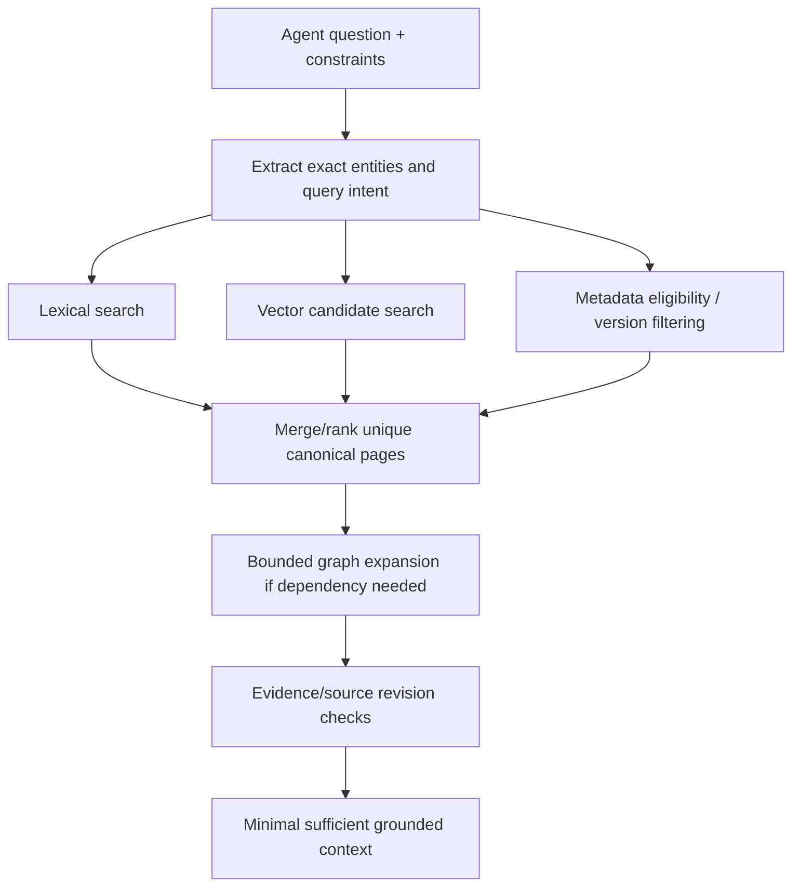

# Retrieval signals and rank fusion

**Owning question:** How does rank fusion combine rankings without treating scores as comparable probabilities?

This page belongs to [V06/C05 — Hybrid retrieval and reranking](README.md). Use the integrated walkthrough for the surrounding decision; the sections below own this narrower mechanism and its limits.

<!-- tycho-question-source:tycho.page.359813d554c84da794a353d4416b8047:1 -->
## 1. Retrieval has multiple independent signals

- **Exact lexical match:** names, versions, error codes, APIs and source paths; evidence in [lexical ranking](../c03-lexical-full-text-indexing-and-ranking/lexical-indexing-bm25-and-sql-fts.md).
- **Semantic similarity:** concepts expressed without the same terminology; candidate/ANN trade-offs in [vector search](../c04-vector-embeddings-and-nearest-neighbor-retrieval/vector-hnsw-faiss-pgvector.md).
- **Structured metadata:** technology, platform release, page ownership, source revision and evidence status; must be validated, not simply inferred from LLM prose.
- **Graph relationships:** "depends on", "implemented by", "fails under", "replaced by" and ownership links; needs directed, typed and source-backed graph edges rather than arbitrary link popularity.
- **Freshness and authority:** source revisions and canonical page content govern whether a match can justify a technical decision.

Text alternative: the same question queries exact words and semantic candidates under version/metadata constraints. Results are fused, then optional canonical dependency links are explored and exact provenance verified before passing a bounded context to an agent.

<!-- /tycho-question-source -->
<!-- tycho-question-source:tycho.page.359813d554c84da794a353d4416b8047:2 -->
## 2. Reciprocal Rank Fusion handles incompatible score scales

BM25 scores, cosine distances and model reranker logits have different numerical scales. Adding them directly is unsafe unless calibrated using real relevance data. Elasticsearch's public [Reciprocal Rank Fusion](https://www.elastic.co/docs/reference/elasticsearch/rest-apis/reciprocal-rank-fusion) documentation defines the rank-only RRF score for each document:

\[
 \mathrm{RRF}(d)=\sum_{r \in \mathcal R}\frac{1}{k+\operatorname{rank}_{r}(d)}
\]

where \(\mathcal R\) are ranked source lists, and documents missing from a list contribute zero. The \(k\) constant is a ranking hyperparameter, not the "number of documents." [E01]

### Tiny synthetic example, not an evaluation result

Let \(k=60\), and two lists:

- Lexical ranks: `A=1`, `B=2`; document `C` absent.
- Semantic ranks: `C=1`, `A=2`; document `B` absent.

Then `score(A)=1/61 + 1/62 ≈ 0.032522`, `score(B)=1/62 ≈ 0.016129`, `score(C)=1/61 ≈ 0.016393`. The combined rank is A, C, B. The example demonstrates score arithmetic—not whether any of those documents is actually relevant.

RRF does not guarantee top-k recall, intent understanding, freshness, ACL safety or proof of correctness. If the lexical result matches an exact method name with strong evidence, merging in an appealing but irrelevant semantic page can still hurt if candidates or fusion settings are poor.

<!-- /tycho-question-source -->

## Navigation, prerequisites and source scope

| Route | Destination |
|---|---|
| Parent and source ledger | [Chapter introduction and exact source rows](README.md#chapter-source-ledger) |
| Previous / prerequisite | [Read preceding context](hybrid-ranking-graph-and-evaluation.md) |
| Next | [Continue the reasoning](evidence-refusal.md) |
| Integrated question | [Original scenario and limits](hybrid-ranking-graph-and-evaluation.md) |

The source material keeps its original published/inferred/synthetic/unverified distinctions. Chapter-wide citations are shared reference context, not proof that every cited source supports every sentence on this page. Freshly inspected text is identified explicitly; absent dates and unknowns are retained.
