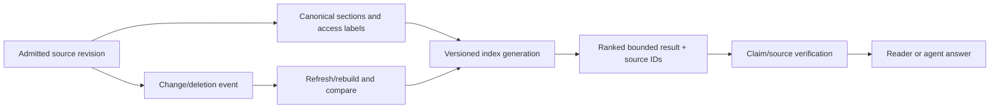

# Index identity, access and provenance

**Owning question:** Which identity and permission contract prevents stale or unauthorized results?

This page belongs to [V06/C07 — Retrieval evaluation and index lifecycle](README.md). Use the integrated walkthrough for the surrounding decision; the sections below own this narrower mechanism and its limits.

<!-- tycho-question-source:tycho.page.d79b0a48b30f4995a9bc110dbe691e52:4 -->
## 4. Snapshot and index identity prevent silent staleness

Text alternative: index generations belong to an admitted source revision and access scope. A result must resolve back to canonical source evidence. Changes and deletion must trigger versioned refresh or a documented stale result condition; this is a design plan, not a running index.

Define rebuild consistency: what happens when source changes mid-build, how a candidate generation is validated before promotion, whether queries pin one generation, and how old generations are retired safely. A mix of document versions can produce an internally plausible answer whose sources never coexisted at one point in time.

<!-- /tycho-question-source -->
<!-- tycho-question-source:tycho.page.d79b0a48b30f4995a9bc110dbe691e52:5 -->
## 5. Permission and provenance are part of retrieval correctness

If the caller cannot read a document, its title, section count, relevance score, embedded neighbor relationships or citation may also leak information. Authorization must constrain the actual search result and follow-up source retrieval; caching a previous authorized user's result is not a shortcut.

Provenance records must distinguish:
- the source **cited** from the source **actually read**;
- source revision or access date and the question's version requirement;
- direct evidence from synthesized inference;
- missing/contradictory sources from positive answers.

The book chapter [Safe agent-accessible knowledge](../../v09-observability-security-and-operations/c07-safety-isolation-and-privacy-in-agent-accessible-services/safe-agent-access-and-knowledge-isolation.md) owns security boundaries. Retrieval rank does not confer authority to execute instructions embedded in returned documents.

<!-- /tycho-question-source -->

## Navigation, prerequisites and source scope

| Route | Destination |
|---|---|
| Parent and source ledger | [Chapter introduction and exact source rows](README.md#chapter-source-ledger) |
| Previous / prerequisite | [Read preceding context](retrieval-judgments.md) |
| Next | [Continue the reasoning](task-recovery.md) |
| Integrated question | [Original scenario and limits](retrieval-evaluation-and-index-lifecycle.md) |

The source material keeps its original published/inferred/synthetic/unverified distinctions. Chapter-wide citations are shared reference context, not proof that every cited source supports every sentence on this page. Freshly inspected text is identified explicitly; absent dates and unknowns are retained.
