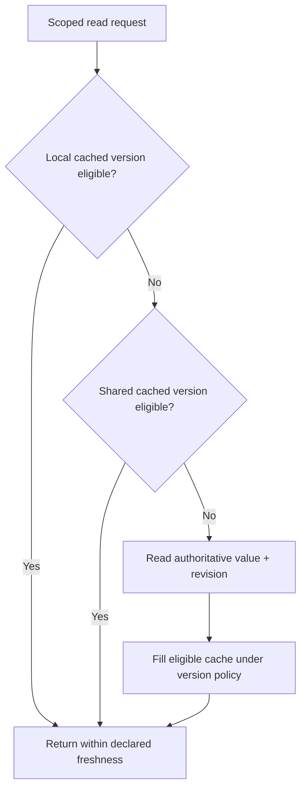

# Local and distributed caching: authority, freshness and placement

> **Independent Tycho draft V06/C01, 2026-10-19.** Public Redis cache-aside and Caffeine eviction/refresh specifications inform the mechanism. All examples are invented. No application, cache server, performance test or independent reviewer was involved. The former [combined caching research](../../../scaling/local-distributed-caching-and-invalidation.md) is retained for source/claim reconciliation.

## Purpose and mission

Caching trades extra, potentially stale copies for less source work and faster or cheaper common reads. Its architectural value depends on what information is safe to reuse, how long the copy may differ from authoritative state, and whether local or shared placement matches the demand profile.

This chapter owns **cache roles, authoritative ownership, local/shared placement, expiration and refresh policy**. [V06/C02 cache invalidation and stampede](../c02/cache-invalidation-stampede-and-hot-keys.md) owns concurrency races, hot-key collapse and source protection; they are closely related but not interchangeable questions.

## 1. Begin with the authority and the data contract

**Original fictional case:** a tool-sharing application keeps authoritative reservations in a transactional store, and public display descriptions in a read-mostly catalogue. A cached display title can usually tolerate a bounded stale window; a cached “one device remains available” count cannot necessarily authorize acceptance of the final reservation.

For each cacheable value, record:

| Field | Requirement |
|---|---|
| Authority | Which system/state revision determines the correct value? |
| Key and scope | Stable resource, variant and tenant/permission scope |
| Freshness | Maximum tolerated age/version gap for the user journey |
| Cache miss | Whether and how to read from the authority |
| Cache loss | Safe operation when local/shared cache is down |
| Error | What to show when both source and cache are unavailable |
| Data class | Sensitive fields, retention, encryption and revocation |
| Validation | Evidence that hit/miss paths yield correct user effects |

A TTL expresses a cache lifetime condition; it does not guarantee that a stale value cannot be reinserted after invalidation by an in-flight load. Similarly, a cache hit ratio is not proof of user correctness.

## 2. Three basic placements

| Placement | Can help | Costs and correctness gap |
|---|---|---|
| No cache | Simplest authority/read path when origin is fast and affordable | Every query reaches origin, possibly expensive |
| Per-process local cache | Very low read overhead, no cache network call | Each replica warms independently; divergent contents, memory/GC cost, lost state on restart |
| Shared distributed cache | Many application replicas share reusable keyspace and memory | Added network/auth/HA dependency; cache node loss and consistency rules |
| Multi-level local + shared | Avoid remote cache on hot local hits and reduce origin work on misses | Two invalidation/expiration layers, complex stale-version and failure behavior |

The choice does not establish the authoritative database. A shared Redis instance can improve read reuse, but its key value is still a derived projection unless business policy deliberately makes it an authority with proven durability/transactions.

## 3. Local cache eviction and refresh are different actions

The [Caffeine Eviction wiki](https://github.com/ben-manes/caffeine/wiki/Eviction) documents size/weight and time-based eviction, including expire-after-write and expire-after-access. The [Caffeine Refresh wiki](https://github.com/ben-manes/caffeine/wiki/Refresh) distinguishes asynchronous refresh from eviction and notes that refresh-after-write eligibility generally triggers an actual reload only when a key is queried.

This difference is architectural:
- **expire-after-write:** after a defined lifetime, the entry can no longer be served as a normal valid hit;
- **expire-after-access:** frequently accessed values may remain resident longer (subject to other bounds);
- **refresh-after-write:** an old value may remain visible while a new load runs, with configured failure/expiration behavior;
- **size/weight eviction:** bounds memory and may remove useful hot entries, creating origin read bursts.

The installed Caffeine version and precise loader/executor policy must be checked before promising behavior. “Refreshes asynchronously” is not equal to “returns current authoritative state under every failure”.

## 4. Cache-aside is a sequence, not a consistency theorem

The [Redis cache-aside use-case](https://redis.io/docs/latest/develop/use-cases/cache-aside/) describes reading cache first, fetching an origin on miss, setting a TTL-bound value and invalidating on writes. It also identifies stampede hazards.

**Text alternative:** a read can reuse a local value, then a shared value, then the source, *only* when each value satisfies the required freshness and authorization. A source result may fill a cache if a competing update has not made it obsolete. The figure is original hypothetical topology, not evidence a version gate was implemented.

Even a cache with TTL may expose stale authorization or deleted content. Bypass caching or require strict verification for revocation-sensitive operations. Data authorization must be performed at an enforced boundary; a copied permission bit is not its own authority.

## 5. Failure/operation cost model

The effective cost of caching includes more than hit latency:
- memory bytes/entry and per-replica duplication;
- serialization/compression and CPU/GC work;
- network to shared cache, TLS, connection pools and retries;
- cache warm-up after scaling or restart;
- source demand on miss, refresh and rebuild;
- invalidation coordination and event replay;
- operating the cache availability tier and its recovery;
- data leakage/staleness consequences.

Original synthetic arithmetic: if 900 of 1,000 eligible reads hit cache, 100 misses remain **only if** each miss results in one origin read with no parallel revalidation or retries. If those 100 misses happen simultaneously for the same expensive key, peak origin load may be unacceptable despite a 90% overall hit rate. This is a model, not a measured service.

## 6. Choose based on the user-visible contract

A local Caffeine-style cache may be appropriate when a few instances frequently read insensitive, slowly changing descriptions and per-instance copies are tolerable. Shared Redis-style caching may help when many nodes repeat reads of the same expensive dataset and a shared failure domain is manageable.

Prefer no cache when origin read cost is below the target or correctness/authorization changes require current state. A write-through, write-behind or cache-aside design must state write ordering and possible loss; the mere cache pattern name does not create an atomic dual write.

## 7. Decision tests and recovery

Proposed, **not executed** experiments:
1. Verify request/tenant key isolation with same apparent resource IDs.
2. Compare local/shared/no cache with identical offered workload and origin resource budget.
3. Measure cold start, size/eviction, refresh failure and read staleness.
4. Kill the shared cache or restart every application replica; observe source pressure and correctness.
5. Revoke access during an in-flight read and confirm policy-compliant results.
6. Verify cache freshness under concurrent modification and multiple versions.

A cache is justified only if it preserves hard state/security invariants and improves the selected latency or cost objective at representative load.

## Engineering walkthrough — Local cache update versus cross-instance freshness

**Original synthetic topology:** API replicas A and B cache the same inventory availability record, authoritative database revision v17. A writes v18 and invalidates *its own* local cache. B continues serving v17 until TTL expiry. A successful local invalidation has not provided globally strong freshness.

| User requirement | Possible choice | Required failure proof |
|---|---|---|
| Public catalogue description may lag up to 30 s | Bounded TTL/local cache acceptable if measured | Worst-case age under clock skew, write burst and restart |
| Exclusive booking result must be current | Authoritative transaction or version-checked read | Stale value never authorizes duplicate confirmed allocation |
| Fast shared read model under load | Shared cache or invalidation bus | Redis/network loss, stale fill, authorization and fallback admission |

**Outage:** distributed cache becomes unavailable while 1,000 callers request one hot item. Blind bypass can turn a cache incident into an authoritative database overload. Define bounded concurrent fallback, explicit overload response and whether stale public descriptions may be served. Never treat cached tenant permissions or exclusive availability as harmlessly stale without the actual security/domain owner's approval.

The cache-aside and Caffeine eviction/refresh sources support mechanics but do not promise cross-replica coherence. **Proposed, not run:** perform a write on A while B is isolated from invalidation, then restore connectivity and measure staleness/incorrect decisions. Fail the cache strategy if user-visible freshness or pool budgets are breached; a direct authoritative query with better indexes may be the lower-risk alternative.

## 8. Public source ledger and nonclaims

| Public source | Narrow support | Does not establish |
|---|---|---|
| [Caffeine Eviction](https://github.com/ben-manes/caffeine/wiki/Eviction) | Size, weight and expiration choices | Strong coherence across replicas |
| [Caffeine Refresh](https://github.com/ben-manes/caffeine/wiki/Refresh) | Refresh eligibility and previous-value serving model | Actual app cache freshness bound |
| [Redis cache-aside](https://redis.io/docs/latest/develop/use-cases/cache-aside/) | Read-through-on-miss / TTL / invalidate-on-write pattern | Atomic cross-resource consistency or measured performance |
| [Combined earlier cache research](../../../scaling/local-distributed-caching-and-invalidation.md) | Previously bounded original explanations | Independently accepted final source claim mapping |

All application names, diagrams, decisions, numerical examples and tests are original fictional teaching material. No cache implementation or benchmark was exercised.

**Navigation:** proposed owner **V06/C01** in [outline](../../../PROPOSED-STRUCTURE.md), via [scaling landing](../../../scaling/README.md). Read [cache invalidation/stampedes](../c02/cache-invalidation-stampede-and-hot-keys.md), [source connection pools](../../v03/c05/connection-pools-hikaricp-pgbouncer.md), [overload controls](../../v07/c05/overload-admission-control-and-graceful-degradation.md).

<!-- tycho-edition-navigation -->

## Edition navigation and evidence scope

| Route | Destination |
|---|---|
| Parent chapter | [Question, conclusions and reading route](README.md) |
| Parent volume | [Volume synthesis](../README.md) |
| Book | [Authoritative contents](../../../README.md) |
| Source versions and access scope | [Registered sources](../../../../sources/README.md) and the exact page-local citation ledger above |

The original manuscript was accepted under #213 at the recorded baseline. Earlier draft/review labels describe historical authoring events. Source access, versions, unexecuted experiments and nonclaims retain their original scope; assembly does not assert a new source read or benchmark. The chapter landing adds editorial synthesis and navigation.
