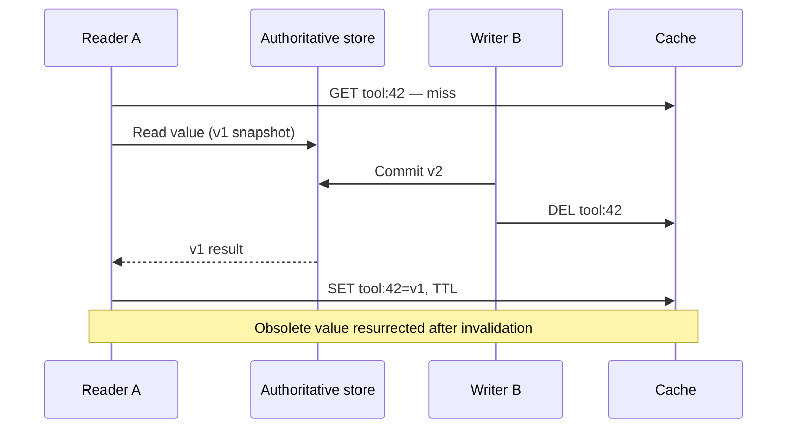

# Stale fills and regeneration ownership

**Owning question:** Which version or fencing rule prevents a refresh from publishing obsolete state?

This page belongs to [V06/C02 — Hot keys, cache stampedes and read amplification](README.md). Use the integrated walkthrough for the surrounding decision; the sections below own this narrower mechanism and its limits.

<!-- tycho-question-source:tycho.page.e0f0d5b68f834acbae94cc6714895dd3:1 -->
## 1. The stale-fill-after-invalidation race

**Original synthetic sequence:** cache key tool:42 has no value. Reader A begins an authoritative read of version v1. Meanwhile writer B commits v2 and deletes the key. The older reader completes and stores v1 after the delete; future readers may see obsolete data.

**Text alternative:** reader A starts loading an older version before a newer write. The writer commits and invalidates. A then repopulates the key with the obsolete value. Normal cache-aside with database-write-then-delete and an unguarded fill cannot eliminate this race by itself.

Possible mitigations have different complexity:
- accept bounded staleness for noncritical content, with a clearly defined maximum interval under real renewal rules;
- attach monotonic source versions and only allow cache writes that do not regress version;
- compare-and-set/atomic scripts at the shared key for a properly modeled version guard;
- avoid serving cache as authority for effect/authorization checks;
- route updates through a versioned projection with replay and tombstone semantics when justified.

A TTL is *not* itself a monotonic-version or consistency guarantee. Source and cache clocks or refreshing a stale value may complicate any claimed maximum-age contract. [Redis cache-aside](https://redis.io/docs/latest/develop/use-cases/cache-aside/) presents the basic flow, not a universal proof of protection from this concurrent fill order.

<!-- /tycho-question-source -->
<!-- tycho-question-source:tycho.page.e0f0d5b68f834acbae94cc6714895dd3:3 -->
## 3. A refresh lock is not automatically a correctness lock

Imagine worker A acquires a distributed refresh lock, then pauses. Its lease expires and worker B acquires a new lease, fetches v2 and publishes it. Worker A resumes with stale v1 and writes it to cache. The lock allowed two overlapping active owners in time.

A safe design needs to specify whether refresh ownership is merely a **performance optimization** (duplicate loads are acceptable) or whether it must protect a **monotonic correctness property**. In the latter case, use source revision/fencing or conditional update at the destination; do not rely on time-based lease expiration alone. A Redis scripting capability can make one cache operation atomic, but cross-resource correctness still requires an appropriate model.

<!-- /tycho-question-source -->

## Navigation, prerequisites and source scope

| Route | Destination |
|---|---|
| Parent and source ledger | [Chapter introduction and exact source rows](README.md#chapter-source-ledger) |
| Previous / prerequisite | [Read preceding context](cache-invalidation-stampede-and-hot-keys.md) |
| Next | [Continue the reasoning](stampede-protection.md) |
| Integrated question | [Original scenario and limits](cache-invalidation-stampede-and-hot-keys.md) |

The source material keeps its original published/inferred/synthetic/unverified distinctions. Chapter-wide citations are shared reference context, not proof that every cited source supports every sentence on this page. Freshly inspected text is identified explicitly; absent dates and unknowns are retained.
