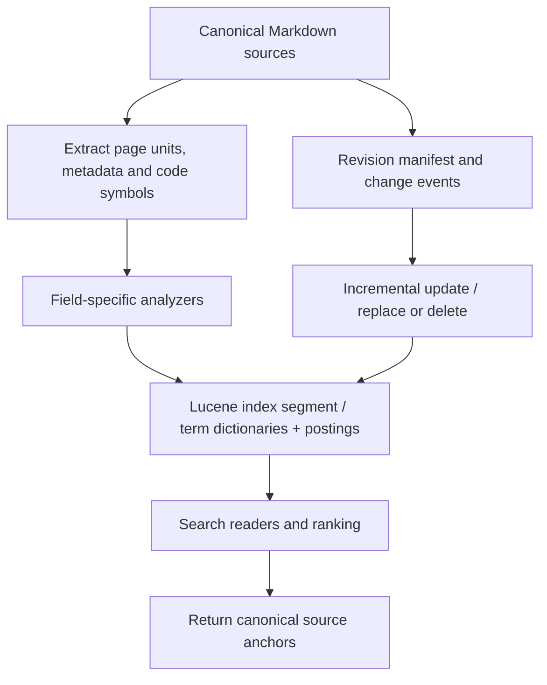
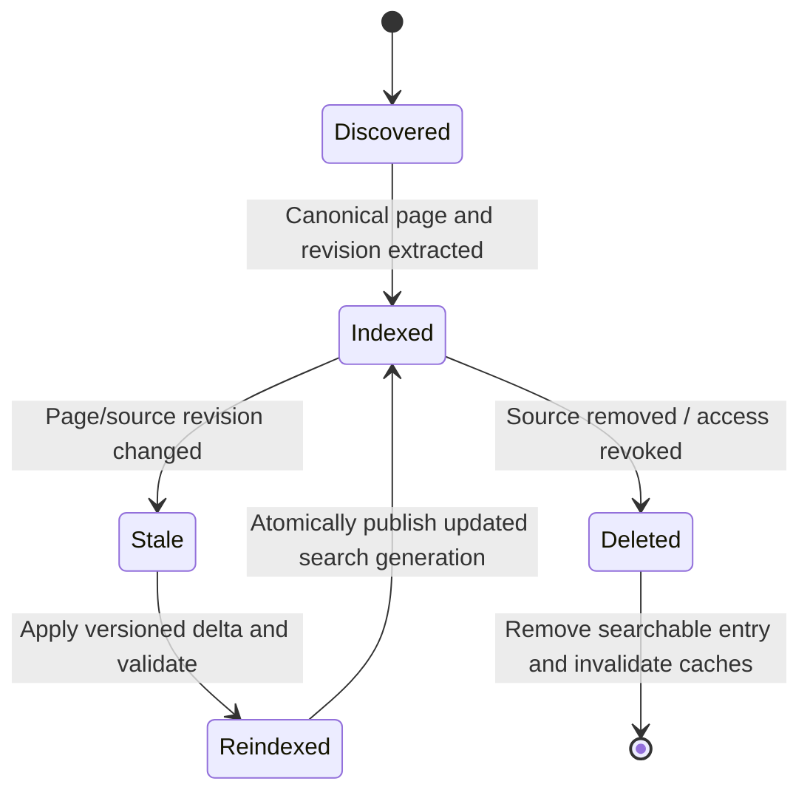

# Search clusters, update visibility and stale citations

**Owning question:** Which generation and refresh contract keeps retrieved evidence attributable?

This page belongs to [V06/C03 — Lexical full-text indexing and ranking](README.md). Use the integrated walkthrough for the surrounding decision; the sections below own this narrower mechanism and its limits.

<!-- tycho-question-source:tycho.page.39a694d604d646a996bf90c3357c3b27:3 -->
## 3. Lucene indexing and search clusters

Apache Lucene is a Java indexing/search **library** with analyzers, fields, postings, term dictionaries and scoring components. A Lucene-based cluster adds storage topology, distributed segments/replicas, shard ownership, refresh and operational recovery **outside the bare library**; Elasticsearch/OpenSearch are separate products, not simply Lucene API calls in a database.

Text alternative: index builders parse canonical Markdown and provenance, analyze text into fields/postings, then publish searchable segments. Revisions update/delete affected documents and search results retain pointers to authoritative pages.

A search cluster can add replication and parallel shard execution; it also creates index management, schema mapping, rollout, query fan-out and staleness complexity. An index replica is a **derived search artifact**, not a replacement for the canonical source repository and its version lock.

<!-- /tycho-question-source -->
<!-- tycho-question-source:tycho.page.39a694d604d646a996bf90c3357c3b27:4 -->
## 4. Incremental indexing and the stale citation problem

A document page may change title, content, source revision, security status or canonical owner. If an index holds old contents after a source edit, an agent can receive **wrong or stale evidence**. The indexing pipeline must explicitly handle change detection, tombstones/deletions, old-ID redirects, partial failures and rollback/rebuild.

Text alternative: a page enters the index at a known revision. Source changes make that entry stale until a validated update is published. Deletions and permission changes must remove obsolete results. The diagram is a **proposed index maintenance contract**, not implemented Tycho infrastructure.

### What to measure before choosing a product

Index disk size by field/segment and N documents, indexing/refresh time, query p95/p99, ranking quality, corpus change rate, tombstone and recovery overhead, and agent payload tokens to get **sufficient evidence**. A small or mid-sized standalone reference corpus does not automatically need a distributed search cluster; scale requirements depend on its measured indexing and retrieval workload.

An exact query like `jdk.VirtualThreadPinned` should retrieve the versioned Java pinning page ahead of a generic scheduling document. A query like "why does a rollback fail after new-schema writes?" may benefit from semantic/hybrid navigation. The [hybrid retrieval chapter](../c05/hybrid-ranking-graph-and-evaluation.md) defines how to evaluate this distinction.

<!-- /tycho-question-source -->
<!-- tycho-question-source:tycho.page.39a694d604d646a996bf90c3357c3b27:5 -->
## 5. Failure and decision criteria

| Failure | Symptom | Required check |
|---|---|---|
| Analyzer destroys exact code symbol | Queries for configuration/API names miss target | Unit fixtures for exact token and normalized forms |
| Index update lags source | Agents cite obsolete passage/commit | Version/freshness gate and source-pointer validation |
| Too much title weight | Short low-evidence overview outranks mechanism | Blind NDCG/recall judgments and error analysis |
| Index expansion duplicates canonical text | Conflicting truth across index and book | One source of truth; index derived, rebuildable |
| Cluster shard unavailable | Partial or delayed results | Completeness flags, degraded routing and operational recovery |
| Synonyms expand too broadly | "Partition" finds unrelated DB/network/stream concepts | Domain context and exact canonical owner filtering |

**Insufficient evidence:** "Lucene is faster than PostgreSQL FTS because it is a search engine." Not established. Need representative queries, corpus fields, analyzer configs, hardware, data volumes, warmup, freshness, quality labels and total maintenance cost.

<!-- /tycho-question-source -->

## Navigation, prerequisites and source scope

| Route | Destination |
|---|---|
| Parent and source ledger | [Chapter introduction and exact source rows](README.md#chapter-source-ledger) |
| Previous / prerequisite | [Read preceding context](lexical-model.md) |
| Next | [Continue the reasoning](README.md) |
| Integrated question | [Original scenario and limits](lexical-indexing-bm25-and-sql-fts.md) |

The source material keeps its original published/inferred/synthetic/unverified distinctions. Chapter-wide citations are shared reference context, not proof that every cited source supports every sentence on this page. Freshly inspected text is identified explicitly; absent dates and unknowns are retained.
