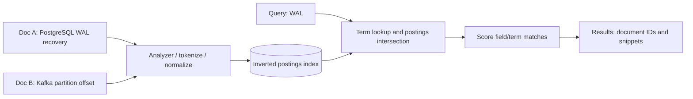

# Inverted indexes and SQL full-text search

**Owning question:** How do analyzer and query semantics define a lexical match?

This page belongs to [V06/C03 — Lexical full-text indexing and ranking](README.md). Use the integrated walkthrough for the surrounding decision; the sections below own this narrower mechanism and its limits.

<!-- tycho-question-source:tycho.page.39a694d604d646a996bf90c3357c3b27:1 -->
## 1. Why inverted indexes work

An **inverted index** associates each indexed term with the document IDs (and often positions/frequencies) where that term occurs. This reverses a document-to-words list into term-to-doc lookup, avoiding a full scan of all text for many queries.



Text alternative: a document analyzer extracts terms and builds postings. A query's terms select candidate document IDs, and ranking chooses which evidence pages to present. This is an original schematic; Lucene's actual codec/layout choices can vary.

Tokenization must consider code identifiers, dotted package names, camelCase, hyphenated configuration fields, Unicode and stemming. Overaggressive stemming or splitting can erase distinctions such as `Serializable` vs `serialization_failure`; exact-match fields and preserved code symbol forms may be needed alongside language-analyzed prose.

### BM25 and field weighting

BM25-style ranking combines term evidence, document-length normalization and inverse-document-frequency weighting; Apache Lucene's BM25Similarity class is a concrete scorer implementation. It is a **text relevance model**, not a guarantee that results are technically true. Scores from different indexes, analyzers or corpora need not share a common calibration.

| Field | Example | Relative retrieval importance (hypothesis) |
|---|---|---|
| Canonical title and stable term IDs | `PostgreSQL WAL`, `JEP 491` | Strong exact-match signals |
| Technical paragraphs | Failure handling, constraints, alternatives | Broad contextual relevance |
| Version/technology tags | `postgresql-17`, `kafka-4.1` | Precise filtering, not free-text guessing |
| Source anchors/revisions | URL, section, commit hash | Evidence navigation and freshness proof |
| Navigation breadcrumbs | Volume/chapter owner | Discovery routing, not duplicate technical content |

An arbitrary field boost (e.g. 10× title) is only a tuning hypothesis. Evaluate it on unseen queries and judgment labels; too much title boost can rank a shallow overview above an exact failure explanation.

<!-- /tycho-question-source -->
<!-- tycho-question-source:tycho.page.39a694d604d646a996bf90c3357c3b27:2 -->
## 2. PostgreSQL 17 full-text search is a real candidate

PostgreSQL 17 Chapter 12 describes `tsvector`, `tsquery`, search configuration and ranking via `ts_rank` / `ts_rank_cd`. The §12.3.3 ranking section explicitly treats relevance as application-dependent rather than an objectively sufficient measure. A GIN index can help certain match operations, but planner/transactional limits must be tested against workload. [E01]

```sql
-- Fictional document-search schema; NOT executed or benchmarked.
SELECT id, title,
       ts_rank(search_vector, websearch_to_tsquery('english', $1)) AS score
FROM technical_pages
WHERE search_vector @@ websearch_to_tsquery('english', $1)
ORDER BY score DESC
LIMIT 10;
```

A SQL-based FTS system is attractive if the corpus is modest, transactional ownership and simpler infrastructure matter, and capabilities cover field/phrase/fuzzy requirements. It may be insufficient if the product requires specialized relevance tooling, large distributed shards, analyzers or cross-cluster search operations that a SQL instance cannot efficiently serve.

Beware material differences between **full-text search indexing** and **vector embedding similarity**: SQL text rank remains lexical, regardless of whether its results are later used by an LLM.

<!-- /tycho-question-source -->

## Navigation, prerequisites and source scope

| Route | Destination |
|---|---|
| Parent and source ledger | [Chapter introduction and exact source rows](README.md#chapter-source-ledger) |
| Previous / prerequisite | [Read preceding context](lexical-indexing-bm25-and-sql-fts.md) |
| Next | [Continue the reasoning](index-lifecycle.md) |
| Integrated question | [Original scenario and limits](lexical-indexing-bm25-and-sql-fts.md) |

The source material keeps its original published/inferred/synthetic/unverified distinctions. Chapter-wide citations are shared reference context, not proof that every cited source supports every sentence on this page. Freshly inspected text is identified explicitly; absent dates and unknowns are retained.
