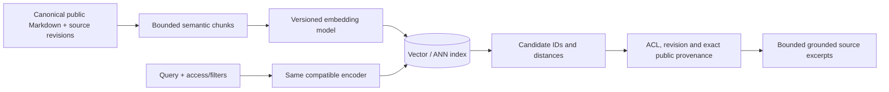
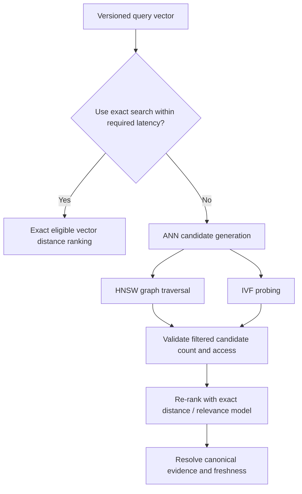

# Embedding contracts and approximate-neighbor trade-offs

**Owning question:** What exact reference and workload define acceptable ANN recall?

This page belongs to [V06/C04 — Vector embeddings and nearest-neighbor retrieval](README.md). Use the integrated walkthrough for the surrounding decision; the sections below own this narrower mechanism and its limits.

<!-- tycho-question-source:tycho.page.7a67fd6346a54eff97784465c22bbc74:1 -->
## 1. The retrieval contract begins before embeddings

A valid vector search workflow requires:

1. A **canonical document/page** identifier and source revision.
2. An explicit chunk/paragraph boundary with relative navigation to its parent page.
3. A documented embedding model/version, dimension, preprocessing and tokenizer.
4. One distance metric (L2, cosine similarity or inner product) with correct normalization and query conventions.
5. Tenant/privacy/access filters enforced before a result can be returned.
6. Exact or approximate search with candidate IDs, distances and freshness information.
7. Retrieval of the **canonical page and precise source anchor** before a final factual answer.

Text alternative: canonical pages are chunked and embedded with a documented model. Queries are embedded compatibly; approximate candidates are checked against identity, access and revisions, then resolved to authoritative source text. The model does not replace source verification.

A vector distance measures representation proximity, **not business applicability**. A request to choose an architecture for 100,000 users requires constraints and evidence rather than a nearest paragraph.

<!-- /tycho-question-source -->
<!-- tycho-question-source:tycho.page.7a67fd6346a54eff97784465c22bbc74:2 -->
## 2. Exact nearest neighbors are the reference baseline

An exact search can compare a query vector against every eligible candidate and rank by distance. This is a useful **ground truth for approximate search recall**, within the same model, metric, filtering and corpus version. It does not establish that the embedding ranking matches human relevance labels.

The public **pgvector** project README states that nearest-neighbor search is exact by default and supports approximate HNSW and IVFFlat indexes. The README documents distance/operator classes for L2, inner product and cosine distance. [E01]

A *fictional* mathematical sketch: three 2-D vectors `A=(1,0)`, `B=(0,1)`, `C=(0.8,0.2)` with query `q=(1,0)`. Under ordinary Euclidean distance, `A` ranks first at distance 0, `C` has distance `sqrt(0.08)≈0.283`, `B` has distance `sqrt(2)≈1.414`. This arithmetic says nothing about semantic quality or trained embedding behavior.

<!-- /tycho-question-source -->
<!-- tycho-question-source:tycho.page.7a67fd6346a54eff97784465c22bbc74:3 -->
## 3. ANN index types and their trade-offs

| Index | Conceptual mechanism | Benefits and costs to evaluate |
|---|---|---|
| **Flat/exact** | Compare against every eligible vector | Deterministic exact top-k by chosen metric; potentially higher scan cost |
| **HNSW** | Multi-layer navigable proximity graph; approximate traversal | Recall/latency trade-off, graph memory/build/update costs |
| **IVF/IVFFlat** | Assign vectors to coarse lists and search selected lists | Adjustable probes/recall; training/centroid and load-skew considerations |
| **PQ/quantization** | Store compressed codes, sometimes with exact re-ranking | Smaller memory and faster candidate selection at added approximation/encoding complexity |
| **Hybrid index/cluster** | Couple ANN with metadata filters, replication and source lookup | More components, freshness/ACL coordination, operational failover |

Faiss's official open [Faiss Indexes wiki](https://github.com/facebookresearch/faiss/wiki/Faiss-indexes), including the table of flat, HNSW, IVF and PQ methods, documents these index families and approximate/exhaustive distinctions. That is an index toolkit, not automatically a persistent, multi-tenant distributed vector database. [E02]

Text alternative: prefer exact search when it meets constraints. Otherwise use a graph or coarse-list ANN to generate candidates, apply correct filtering and optionally precise reranking, then return source-backed pages. This is an **original selection sketch**, not a software algorithm recommendation.

Neither HNSW nor IVF is an invariant that guarantees a particular recall percentage across all data distributions. Duplicate/near-duplicate vectors, dimension, cluster shape, vector quantization and deletion/update behavior can change efficiency and accuracy.

<!-- /tycho-question-source -->

## Navigation, prerequisites and source scope

| Route | Destination |
|---|---|
| Parent and source ledger | [Chapter introduction and exact source rows](README.md#chapter-source-ledger) |
| Previous / prerequisite | [Read preceding context](vector-hnsw-faiss-pgvector.md) |
| Next | [Continue the reasoning](vector-filters.md) |
| Integrated question | [Original scenario and limits](vector-hnsw-faiss-pgvector.md) |

The source material keeps its original published/inferred/synthetic/unverified distinctions. Chapter-wide citations are shared reference context, not proof that every cited source supports every sentence on this page. Freshly inspected text is identified explicitly; absent dates and unknowns are retained.
