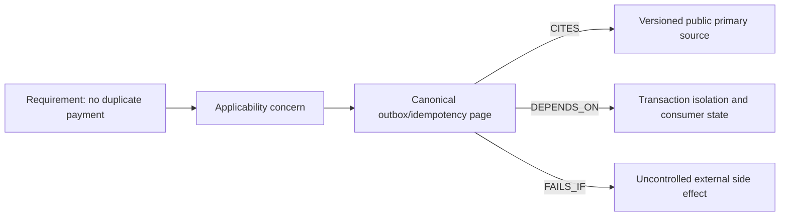

# Traversal, evidence and calibrated refusal

**Owning question:** Which relation or passage supports an answer and when should a system refuse?

This page belongs to [V06/C05 — Hybrid retrieval and reranking](README.md). Use the integrated walkthrough for the surrounding decision; the sections below own this narrower mechanism and its limits.

<!-- tycho-question-source:tycho.page.359813d554c84da794a353d4416b8047:3 -->
## 3. Graph traversal is an explicit reasoning step, not a search replacement

A directed typed graph can represent canonical architectural relationships. Neo4j's property-graph docs describe typed directed relationships and property-bearing nodes. Those primitive capabilities are not the same as a verified Tycho knowledge graph: an edge should have a defined semantic type, confidence/evidence and source revision. [E02]

Text alternative: a requirement is associated with an applicability question and a canonical mechanism page. The page cites primary evidence and links to dependencies and counterexamples. Each arrow is a **proposed semantic relation**, not a generated graph record or a claim that any application satisfies it.

### Bounded expansion and graph validity

1. Start with one canonical question owner (not every title containing a keyword).
2. Follow only typed edges relevant to the query: prerequisites, failure dependencies, evidence or alternatives.
3. Limit depth/branching based on **sufficient evidence**, not a hard global cap that hides necessary dependencies.
4. Reject dangling IDs, incorrect edge direction, cycles where hierarchy must be acyclic, and stale source revisions.
5. Retrieve canonical page and exact cited section for each consequential inference.
6. Stop when the answer can be supported, or report **insufficient evidence** with a bounded measurement/research task.

A curated graph is distinct from a link index or vector neighborhood. Typed edges are manually or mechanically verified facts; nearest-neighbor similarity is **not** an asserted architecture dependency.

<!-- /tycho-question-source -->
<!-- tycho-question-source:tycho.page.359813d554c84da794a353d4416b8047:4 -->
## 4. The evidence ladder and calibrated refusal

Consider an agent asked: "We have 1,000 RPS and PostgreSQL. Should we shard or use Redis?"

- The [queueing mechanism](../../v07/c01/queueing-littles-law.md) says RPS alone does not establish latency, concurrent service demand or bottleneck.
- [PostgreSQL data research](../../../data/postgresql-mvcc-indexes-and-query-plans.md) identifies index/transaction/plan evidence to collect.
- [Sharding/pooling/caching](../../../scaling/README.md) explains hotspot, bounded connections and stale state risks.
- The agent must determine actual query mix, CPU/IO, hot keys, staleness tolerances and transactional invariants before making a technology recommendation.

The best output may be **insufficient evidence** plus instrumentation/experiment steps. It should not blindly return "Redis + 16 shards" because those tools appear frequently in a text corpus.

<!-- /tycho-question-source -->

## Navigation, prerequisites and source scope

| Route | Destination |
|---|---|
| Parent and source ledger | [Chapter introduction and exact source rows](README.md#chapter-source-ledger) |
| Previous / prerequisite | [Read preceding context](fusion-signals.md) |
| Next | [Continue the reasoning](hybrid-evaluation.md) |
| Integrated question | [Original scenario and limits](hybrid-ranking-graph-and-evaluation.md) |

The source material keeps its original published/inferred/synthetic/unverified distinctions. Chapter-wide citations are shared reference context, not proof that every cited source supports every sentence on this page. Freshly inspected text is identified explicitly; absent dates and unknowns are retained.
