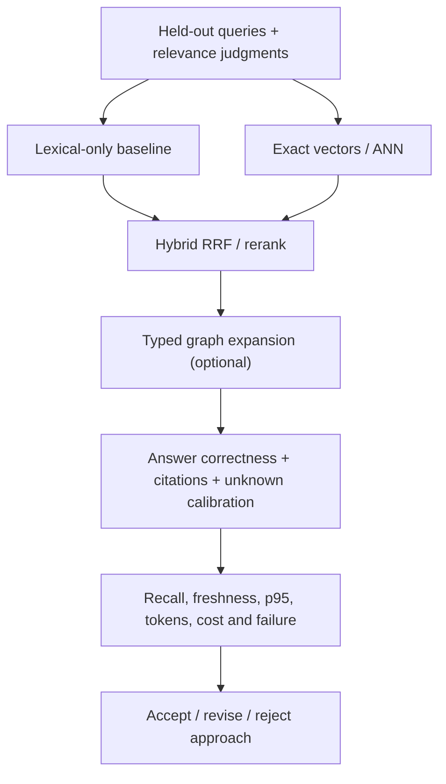

# Hybrid evaluation and snapshot consistency

**Owning question:** What matched judgments and snapshot boundaries make an evaluation reproducible?

This page belongs to [V06/C05 — Hybrid retrieval and reranking](README.md). Use the integrated walkthrough for the surrounding decision; the sections below own this narrower mechanism and its limits.

<!-- tycho-question-source:tycho.page.359813d554c84da794a353d4416b8047:5 -->
## 5. Quality metrics: retrieval is not answer quality

| Dimension | Meaning and measurement | Error if omitted |
|---|---|---|
| **Recall@k** | Fraction of independently judged relevant items found among top k | Miss key dependency while top result looks similar |
| **Precision@k** | Fraction of top k judged relevant | Drown context in irrelevant pages |
| **MRR / nDCG@k** | Ranking order and graded relevance on judged questions | Strong evidence buried below shallow context |
| **ANN recall@k** | Match of approximate neighbors to exact vector baseline under same filter/model | Mistake vector algorithm accuracy for human relevance |
| **Answer correctness** | Independently checked conclusions against public sources | Confident but false architecture guidance |
| **Citation support** | Consequential claims backed by exact, current and admissible source sections | Source listed but does not support claim |
| **Unknown calibration** | Correctly refuse questions with insufficient facts or unsupported private evidence | Hallucinate instance counts or transactional guarantees |
| **Freshness lag** | Change→index availability and source revision consistency | Cite stale code/docs |
| **End-to-end latency** | p50/p95/p99 routing+search+retrieval+answer at stated offered load | "Index is fast" hides expensive agent context assembly |
| **Token cost** | Tokens for routing, expansion, returned excerpts and output | Minimal query count still burns monthly allowance |
| **Operational cost** | Storage/index updates, memory/CPU, replicas, personnel and failure recovery | Pick a needlessly complex cluster |
| **Security** | Authorized-only results, tenant isolation and citation-safe logging | Leak source even with final-answer filter |

These metrics are **proposed evaluation contracts**, not measured figures for Tycho.

<!-- /tycho-question-source -->
<!-- tycho-question-source:tycho.page.359813d554c84da794a353d4416b8047:6 -->
## 6. A reproducible evaluation design

Build a *held-out* set spanning fact lookups (exact APIs), synthesis, trade-offs, failure analysis, change-impact, contradictory sources and deliberately unanswerable problems. Separate training/tuning questions from acceptance; an author-generated in-sample set alone is too easy.

For each query record:

- required canonical pages and high-consequence evidence IDs, with independent subject review;
- acceptable answer elements and disqualifying unsupported recommendations;
- required negative/failure cases and what must be called unknown;
- time/version constraints (before vs after source revision);
- minimal context span and cost budget;
- latency at tested concurrency and failure/no-index fallback.

Run ablations: **lexical-only**, **vector-only exact**, **vector ANN**, **hybrid fusion**, **hybrid + bounded graph**, and **hybrid + reranker**. Use the same underlying corpus/revision, exact eligible filters, query set and measurement environment. Assess pairwise trade-offs rather than just overall top-1 counts.

Tycho's existing [pilot 25-question fixture](../../../../evaluation/pilot-questions.json) is **small, authored from the same three pages and in-sample**. Its prior 25/25 topic-routing smoke test is **not** evidence of full-book search quality. Do not expand that score into a fictitious whole-corpus benchmark.

Text alternative: an independently reviewed question set is run through baseline and alternative search strategies. Combined candidates and optional graph expansion are evaluated on actual answers, citations, negative cases, token cost and latency before selection.

<!-- /tycho-question-source -->
<!-- tycho-question-source:tycho.page.359813d554c84da794a353d4416b8047:7 -->
## 7. Failure/recovery and indexing consistency

A search index must be regenerable from the canonical corpus and its versioned source anchors. If the vector index lags after a documentation deletion, the system must not show stale private or withdrawn material. If one lexical shard fails, returning partial answers silently can be unsafe; represent degraded completeness. If model or tokenizer changes, dual-run until evaluation passes. If graph edges contradict source evidence, quarantine and report them rather than silently incorporate.

User-facing requirements should specify a freshness bound in time/version and a source revision gate. A fast but stale retrieval path is not successful simply because it saves tokens.

**Insufficient evidence:** "Hybrid search improves accuracy by 30% and reduces token use 60%." These are unverified until a controlled dataset, comparable latency/tokens and actual answer/citation judgments exist. No such experiment is executed here.

<!-- /tycho-question-source -->

## Navigation, prerequisites and source scope

| Route | Destination |
|---|---|
| Parent and source ledger | [Chapter introduction and exact source rows](README.md#chapter-source-ledger) |
| Previous / prerequisite | [Read preceding context](evidence-refusal.md) |
| Next | [Continue the reasoning](README.md) |
| Integrated question | [Original scenario and limits](hybrid-ranking-graph-and-evaluation.md) |

The source material keeps its original published/inferred/synthetic/unverified distinctions. Chapter-wide citations are shared reference context, not proof that every cited source supports every sentence on this page. Freshly inspected text is identified explicitly; absent dates and unknowns are retained.
