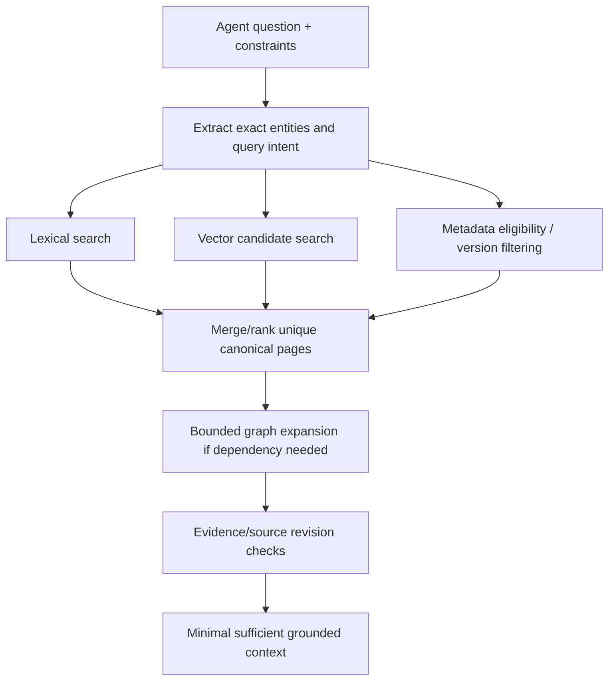
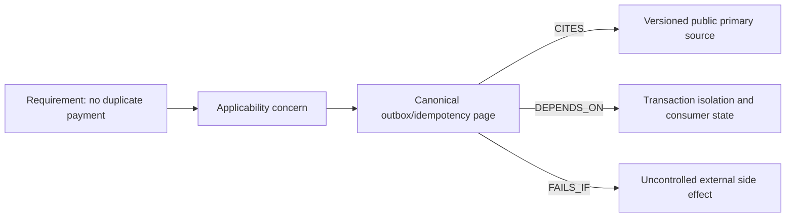
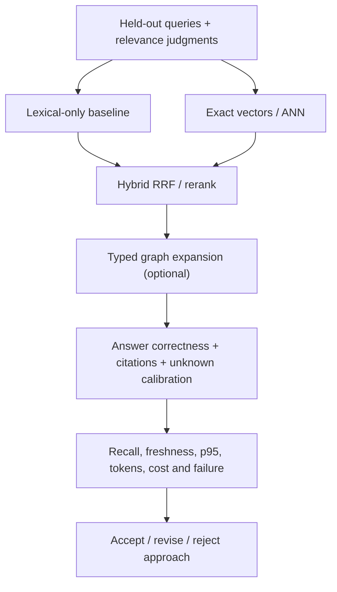

# Hybrid retrieval, graph expansion, reranking and evidence-quality evaluation

> Tycho technical research for [Issue #85](https://github.com/rouslanbaranov/tycho/issues/85); inspected public Elasticsearch RRF, PostgreSQL text search, pgvector and Neo4j graph concepts on 2026-10-19. Original algorithms/diagrams and **synthetic** examples only. No deployed retrieval server or independently judged quality benchmark is claimed.

## Purpose and mission

A good knowledge-search system answers *why*, *under which constraints* and *according to which source*—not merely "what documents have similar words". AI agents also have a token budget: returning 30 whole chapters can be less useful than a precise primary page plus its dependency/source anchors.

**Primary question:** How can lexical, semantic, metadata and graph signals be combined while measuring relevance, grounding, freshness, latency, resource cost and total tokens rather than ranking a system by queries per second alone?

## 1. Retrieval has multiple independent signals

- **Exact lexical match:** names, versions, error codes, APIs and source paths; evidence in [lexical ranking](../c03/lexical-indexing-bm25-and-sql-fts.md).
- **Semantic similarity:** concepts expressed without the same terminology; candidate/ANN trade-offs in [vector search](../c04/vector-hnsw-faiss-pgvector.md).
- **Structured metadata:** technology, platform release, page ownership, source revision and evidence status; must be validated, not simply inferred from LLM prose.
- **Graph relationships:** "depends on", "implemented by", "fails under", "replaced by" and ownership links; needs directed, typed and source-backed graph edges rather than arbitrary link popularity.
- **Freshness and authority:** source revisions and canonical page content govern whether a match can justify a technical decision.

Text alternative: the same question queries exact words and semantic candidates under version/metadata constraints. Results are fused, then optional canonical dependency links are explored and exact provenance verified before passing a bounded context to an agent.

## 2. Reciprocal Rank Fusion handles incompatible score scales

BM25 scores, cosine distances and model reranker logits have different numerical scales. Adding them directly is unsafe unless calibrated using real relevance data. Elasticsearch's public [Reciprocal Rank Fusion](https://www.elastic.co/docs/reference/elasticsearch/rest-apis/reciprocal-rank-fusion) documentation defines the rank-only RRF score for each document:

\[
 \mathrm{RRF}(d)=\sum_{r \in \mathcal R}\frac{1}{k+\operatorname{rank}_{r}(d)}
\]

where \(\mathcal R\) are ranked source lists, and documents missing from a list contribute zero. The \(k\) constant is a ranking hyperparameter, not the "number of documents." [E01]

### Tiny synthetic example, not an evaluation result

Let \(k=60\), and two lists:

- Lexical ranks: `A=1`, `B=2`; document `C` absent.
- Semantic ranks: `C=1`, `A=2`; document `B` absent.

Then `score(A)=1/61 + 1/62 ≈ 0.032522`, `score(B)=1/62 ≈ 0.016129`, `score(C)=1/61 ≈ 0.016393`. The combined rank is A, C, B. The example demonstrates score arithmetic—not whether any of those documents is actually relevant.

RRF does not guarantee top-k recall, intent understanding, freshness, ACL safety or proof of correctness. If the lexical result matches an exact method name with strong evidence, merging in an appealing but irrelevant semantic page can still hurt if candidates or fusion settings are poor.

## 3. Graph traversal is an explicit reasoning step, not a search replacement

A directed typed graph can represent canonical architectural relationships. Neo4j's property-graph docs describe typed directed relationships and property-bearing nodes. Those primitive capabilities are not the same as a verified Tycho knowledge graph: an edge should have a defined semantic type, confidence/evidence and source revision. [E02]

Text alternative: a requirement is associated with an applicability question and a canonical mechanism page. The page cites primary evidence and links to dependencies and counterexamples. Each arrow is a **proposed semantic relation**, not a generated graph record or a claim that any application satisfies it.

### Bounded expansion and graph validity

1. Start with one canonical question owner (not every title containing a keyword).
2. Follow only typed edges relevant to the query: prerequisites, failure dependencies, evidence or alternatives.
3. Limit depth/branching based on **sufficient evidence**, not a hard global cap that hides necessary dependencies.
4. Reject dangling IDs, incorrect edge direction, cycles where hierarchy must be acyclic, and stale source revisions.
5. Retrieve canonical page and exact cited section for each consequential inference.
6. Stop when the answer can be supported, or report **insufficient evidence** with a bounded measurement/research task.

A curated graph is distinct from a link index or vector neighborhood. Typed edges are manually or mechanically verified facts; nearest-neighbor similarity is **not** an asserted architecture dependency.

## 4. The evidence ladder and calibrated refusal

Consider an agent asked: "We have 1,000 RPS and PostgreSQL. Should we shard or use Redis?"

- The [queueing mechanism](../../v07/c01/queueing-littles-law.md) says RPS alone does not establish latency, concurrent service demand or bottleneck.
- [PostgreSQL data research](../../../data/postgresql-mvcc-indexes-and-query-plans.md) identifies index/transaction/plan evidence to collect.
- [Sharding/pooling/caching](../../../scaling/README.md) explains hotspot, bounded connections and stale state risks.
- The agent must determine actual query mix, CPU/IO, hot keys, staleness tolerances and transactional invariants before making a technology recommendation.

The best output may be **insufficient evidence** plus instrumentation/experiment steps. It should not blindly return "Redis + 16 shards" because those tools appear frequently in a text corpus.

## 5. Quality metrics: retrieval is not answer quality

| Dimension | Meaning and measurement | Error if omitted |
|---|---|---|
| **Recall@k** | Fraction of independently judged relevant items found among top k | Miss key dependency while top result looks similar |
| **Precision@k** | Fraction of top k judged relevant | Drown context in irrelevant pages |
| **MRR / nDCG@k** | Ranking order and graded relevance on judged questions | Strong evidence buried below shallow context |
| **ANN recall@k** | Match of approximate neighbors to exact vector baseline under same filter/model | Mistake vector algorithm accuracy for human relevance |
| **Answer correctness** | Independently checked conclusions against public sources | Confident but false architecture guidance |
| **Citation support** | Consequential claims backed by exact, current and admissible source sections | Source listed but does not support claim |
| **Unknown calibration** | Correctly refuse questions with insufficient facts or unsupported private evidence | Hallucinate instance counts or transactional guarantees |
| **Freshness lag** | Change→index availability and source revision consistency | Cite stale code/docs |
| **End-to-end latency** | p50/p95/p99 routing+search+retrieval+answer at stated offered load | "Index is fast" hides expensive agent context assembly |
| **Token cost** | Tokens for routing, expansion, returned excerpts and output | Minimal query count still burns monthly allowance |
| **Operational cost** | Storage/index updates, memory/CPU, replicas, personnel and failure recovery | Pick a needlessly complex cluster |
| **Security** | Authorized-only results, tenant isolation and citation-safe logging | Leak source even with final-answer filter |

These metrics are **proposed evaluation contracts**, not measured figures for Tycho.

## 6. A reproducible evaluation design

Build a *held-out* set spanning fact lookups (exact APIs), synthesis, trade-offs, failure analysis, change-impact, contradictory sources and deliberately unanswerable problems. Separate training/tuning questions from acceptance; an author-generated in-sample set alone is too easy.

For each query record:

- required canonical pages and high-consequence evidence IDs, with independent subject review;
- acceptable answer elements and disqualifying unsupported recommendations;
- required negative/failure cases and what must be called unknown;
- time/version constraints (before vs after source revision);
- minimal context span and cost budget;
- latency at tested concurrency and failure/no-index fallback.

Run ablations: **lexical-only**, **vector-only exact**, **vector ANN**, **hybrid fusion**, **hybrid + bounded graph**, and **hybrid + reranker**. Use the same underlying corpus/revision, exact eligible filters, query set and measurement environment. Assess pairwise trade-offs rather than just overall top-1 counts.

Tycho's existing [pilot 25-question fixture](../../../../evaluation/pilot-questions.json) is **small, authored from the same three pages and in-sample**. Its prior 25/25 topic-routing smoke test is **not** evidence of full-book search quality. Do not expand that score into a fictitious whole-corpus benchmark.

Text alternative: an independently reviewed question set is run through baseline and alternative search strategies. Combined candidates and optional graph expansion are evaluated on actual answers, citations, negative cases, token cost and latency before selection.

## 7. Failure/recovery and indexing consistency

A search index must be regenerable from the canonical corpus and its versioned source anchors. If the vector index lags after a documentation deletion, the system must not show stale private or withdrawn material. If one lexical shard fails, returning partial answers silently can be unsafe; represent degraded completeness. If model or tokenizer changes, dual-run until evaluation passes. If graph edges contradict source evidence, quarantine and report them rather than silently incorporate.

User-facing requirements should specify a freshness bound in time/version and a source revision gate. A fast but stale retrieval path is not successful simply because it saves tokens.

**Insufficient evidence:** "Hybrid search improves accuracy by 30% and reduces token use 60%." These are unverified until a controlled dataset, comparable latency/tokens and actual answer/citation judgments exist. No such experiment is executed here.

## Engineering walkthrough — Hand-computed rank fusion and a false evidence match

**Original synthetic example:** lexical search ranks documents A, B, C; semantic search ranks C, D, A. Using Reciprocal Rank Fusion with illustrative `k=60`, the score for A is `1/61 + 1/63 ≈ 0.03227`; for C it is `1/63 + 1/61 ≈ 0.03227`; B and D each contribute one list hit. A and C tie under these assumptions, **without any claim that either is factually correct**. Different handling of missing ranks, duplicate IDs or list truncation changes the result.

A restricted document can be top-ranked in one retriever: fusion must not reveal its title or score through results, explanations or related links. Reranking may improve relevance for permitted candidate texts but cannot repair a source-revision mismatch or transform a speculative claim into published evidence. The [Elasticsearch RRF reference](https://www.elastic.co/docs/reference/elasticsearch/rest-apis/reciprocal-rank-fusion) defines the general rank-only fusion mechanism; actual feature/version requirements must be pinned for production.

| Stage | Necessary gate | Failure consequence |
|---|---|---|
| Retrieve lexical/vector candidates | Source snapshot and permission scope | Authorized evidence omitted or forbidden text leaked |
| Fuse ranks | Stable identity and declared missing-rank behavior | Duplicate content treated as independent corroboration |
| Rerank | Preserve source boundaries and disclose heuristic nature | Plausible but stale claim promoted over current authority |
| Answer | Verify material claims against original source/version | Confident answer when evidence is insufficient |

**Proposed experiment, not run:** hand-verify small fusion scores, then evaluate real held-out questions with authorized judgment sets and deliberately contradictory/stale snippets. If relevant sources remain absent, **refuse a substantive architectural conclusion and request evidence** instead of increasing model confidence or traversal depth.

## Evidence ledger and implementation boundaries

| ID | Public primary source / examined scope | Supports / exclusions |
|---|---|---|
| E01 | [Elasticsearch Reciprocal Rank Fusion reference](https://www.elastic.co/docs/reference/elasticsearch/rest-apis/reciprocal-rank-fusion), RRF score equation and multi-retriever combination; rolling docs observed 2026-10-19 | Rank fusion semantics; no Tycho benchmark |
| E02 | [Neo4j property graph concepts](https://neo4j.com/docs/getting-started/appendix/graphdb-concepts/), *Node, Relationship, Schema* | Typed directional edges as a graph model, not a verified Tycho relationship dataset |
| E03 | [PostgreSQL 17 FTS ranking](https://www.postgresql.org/docs/17/textsearch-controls.html), §12.3.3 | Application-dependent lexical rank and structured weighting |
| E04 | [pgvector official README](https://github.com/pgvector/pgvector), exact vs ANN, filtered search and hybrid notes; rolling revision observed 2026-10-19 | Candidate generation mechanics, not search or agent-answer superiority |

**Review status:** conceptual evaluation method only; no full Tycho hybrid engine, graph traversal service, LLM answer evaluation, ranking judgment, cost measurement or independent reviewer approval has been implemented by this issue.

<!-- tycho-edition-navigation -->

## Edition navigation and evidence scope

| Route | Destination |
|---|---|
| Parent chapter | [Question, conclusions and reading route](README.md) |
| Parent volume | [Volume synthesis](../README.md) |
| Book | [Authoritative contents](../../../README.md) |
| Source versions and access scope | [Registered sources](../../../../sources/README.md) and the exact page-local citation ledger above |

The original manuscript was accepted under #213 at the recorded baseline. Earlier draft/review labels describe historical authoring events. Source access, versions, unexecuted experiments and nonclaims retain their original scope; assembly does not assert a new source read or benchmark. The chapter landing adds editorial synthesis and navigation.
