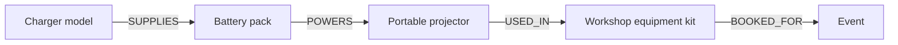

# Edge meaning and relationship questions

**Owning question:** Which explicit relation is being traversed and what can a path not prove?

This page belongs to [V06/C06 — Graph relationships and traversal](README.md). Use the integrated walkthrough for the surrounding decision; the sections below own this narrower mechanism and its limits.

<!-- tycho-question-source:tycho.page.d34afc7f27b54431b779f7f75f11e2c3:1 -->
## 1. Clarify the meaning of an edge

A useful graph schema identifies:
- node identity and node type;
- relationship type, direction, endpoints and cardinality;
- whether multiple parallel relationships are allowed;
- temporal validity/version of the relation;
- authorization and visibility of nodes **and edges**;
- whether the relationship is authoritative or derived;
- deletion, cycle, duplicate and integrity policies.

The [Neo4j Cypher pattern manual](https://neo4j.com/docs/cypher-manual/current/patterns/) explains declarative patterns over nodes and relationships, including traversals and paths. A path is a specific sequence of matched graph elements, not a guarantee that all reachable nodes or every shortest path were enumerated within a query budget.

<!-- /tycho-question-source -->
<!-- tycho-question-source:tycho.page.d34afc7f27b54431b779f7f75f11e2c3:2 -->
## 2. Original fictional example: a workshop equipment dependency map

A community event uses portable devices with replaceable parts. A battery pack is compatible with a charger, a projector uses a specific cable, and a setup checklist requires a functioning power supply. The question is whether an unavailable charger affects a set of planned equipment kits.

**Text alternative:** the fictional charger supplies a battery, which powers a projector used in a kit booked for an event. Querying the paths could show affected event kits. The arrows express modeled relationships, not measured physical behavior, actual inventory or authoritative compatibility certifications.

A direct question “Which chargers supply battery B?” is one hop. “Which events might depend transitively on charger C?” follows a variable-length typed path. But a path is a potential dependency chain, **not automatically a proof that the event cannot proceed**: spare batteries, alternate chargers and temporal availability matter.

<!-- /tycho-question-source -->

## Navigation, prerequisites and source scope

| Route | Destination |
|---|---|
| Parent and source ledger | [Chapter introduction and exact source rows](README.md#chapter-source-ledger) |
| Previous / prerequisite | [Read preceding context](graph-data-models-and-traversal.md) |
| Next | [Continue the reasoning](bounded-traversal.md) |
| Integrated question | [Original scenario and limits](graph-data-models-and-traversal.md) |

The source material keeps its original published/inferred/synthetic/unverified distinctions. Chapter-wide citations are shared reference context, not proof that every cited source supports every sentence on this page. Freshly inspected text is identified explicitly; absent dates and unknowns are retained.
