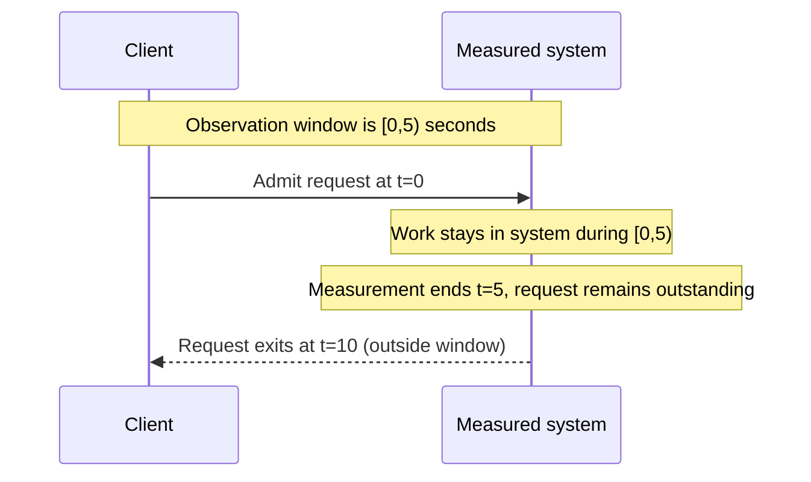
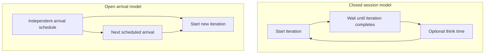

# Finite windows and load-generator feedback

**Owning question:** Why can unfinished work and closed-loop arrivals invalidate a naive estimate?

This page belongs to [V07/C01 — Queueing, Little's Law and measurement boundaries](README.md). Use the integrated walkthrough for the surrounding decision; the sections below own this narrower mechanism and its limits.

<!-- tycho-question-source:tycho.page.a9a28aaa4d1e4e9cb0accd2fc2c5ba9b:3 -->
## Evidence-based counterexample: a short finite window

In the following fully original toy timeline, **one** request arrives at time `t=0`, remains inside the boundary for **10 seconds**, then exits at `t=10`. Observe only the interval `[0,5)`.

| Finite-window observation | Value |
|---|---:|
| Accepted arrivals in window | 1 |
| Window length | 5 seconds |
| Mean in-boundary population during window | 1 |
| Arrival count / window | 0.20 arrivals/s |
| That request's full eventual residence time | 10 seconds |
| Naive `(arrivals/window) × full W` | `0.20 × 10 = 2` |
| Actual observed mean population | **1**, not 2 |

The apparent mismatch is not a failure of Little's Law. The interval ends with unfinished work and the full residence time extends **beyond** the observation boundary. The finite-time quantities have incompatible accounting; Kim & Whitt's §1.1 and §2.2 discuss precisely this kind of edge effect. [E01, E02]

**Engineering consequence:** do not estimate a team's timeout, p99 or pool occupancy by slicing unrelated dashboards into arbitrary windows and substituting one mean for another. Record start/end backlog, arrival/exit counts, residence-time cohort, sampling, warmup and whether the window is stationary. A real finite-window estimator needs uncertainty analysis; a screenshot of three averaged metrics is not such an analysis.

### Visualizing the finite-window edge effect

Text alternative: the only request enters at t=0, remains outstanding at t=5 when observation stops, and exits at t=10. Using its full eventual residence time in the five-second window mixes incompatible intervals and produces the counterexample above.

<!-- /tycho-question-source -->
<!-- tycho-question-source:tycho.page.a9a28aaa4d1e4e9cb0accd2fc2c5ba9b:4 -->
## Workload generators: closed feedback versus independent arrivals

An apparently successful load test may be invalid for its stated demand assumption.

The official **Grafana k6 Open and closed models** documentation, viewed in the *v2.2.x* documentation family on 2026-10-18, distinguishes two executor semantics. In the **closed model**, a virtual user's next iteration waits for the previous iteration to finish. In the **open model**, starts are paced independently of prior iteration duration. The documentation explicitly discusses the slowed-arrival/coordinated-omission pitfall. [E03]

A simple invented illustration, **one request per iteration and no think time**:

| 100 closed virtual users | Estimated iteration starts/s |
|---|---:|
| Each iteration completes in 2 s | `100/2 = 50` |
| Each iteration slows to 4 s | `100/4 = 25` |

If the target slows under load, the closed scenario automatically offers fewer new operations. This can hide what would happen under independently arriving clients, while still being a valid model for some feedback-controlled interactive populations. A k6 iteration may perform multiple HTTP calls, so **iterations/s must not be relabelled RPS** without inspecting the script.

An open-arrival generator can target 50 starts/s independently of completion, but that is still only a **target**: the generator itself can become resource-limited or drop scheduled starts. A valid experiment records planned and actually started iterations, offered/admitted/completed requests, generator health, refused connections, errors and end-to-end latency.

### Visual comparison of offered work

Text alternative: a closed virtual user waits for its previous iteration (and think time) before issuing the next one. An open scheduler issues starts according to an external arrival plan rather than waiting for prior completion. Neither representation guarantees a healthy load generator.

### When a closed model is appropriate

When modelling a fixed number of clients who genuinely wait between operations, the completion-coupled behavior may be exactly the desired premise. When modelling external transactions arriving regardless of service slowdown (e.g., independent events, bursts), a controlled open-arrival model is usually more relevant. Neither choice is universally superior without the question and workload.

<!-- /tycho-question-source -->

## Navigation, prerequisites and source scope

| Route | Destination |
|---|---|
| Parent and source ledger | [Chapter introduction and exact source rows](README.md#chapter-source-ledger) |
| Previous / prerequisite | [Read preceding context](measurement-boundary.md) |
| Next | [Continue the reasoning](queue-recovery.md) |
| Integrated question | [Original scenario and limits](queueing-littles-law.md) |

The source material keeps its original published/inferred/synthetic/unverified distinctions. Chapter-wide citations are shared reference context, not proof that every cited source supports every sentence on this page. Freshly inspected text is identified explicitly; absent dates and unknowns are retained.
