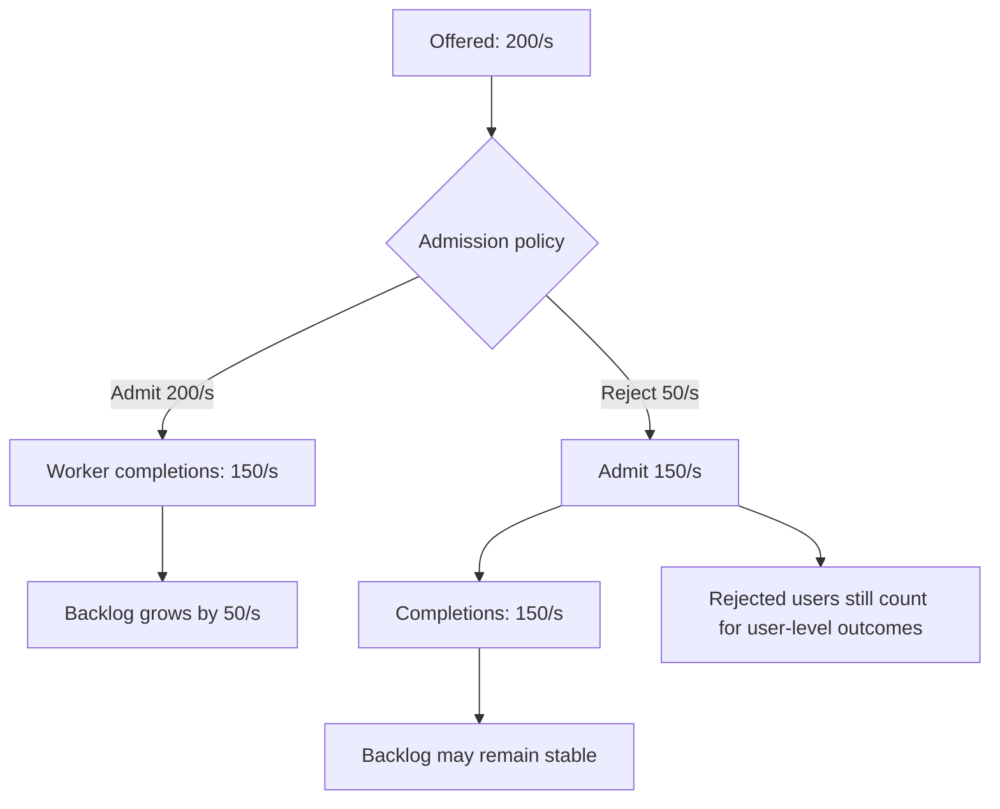

# Overload, recovery and alternative measurements

**Owning question:** Which admission and exit policy makes the queue's recovery observable?

This page belongs to [V07/C01 — Queueing, Little's Law and measurement boundaries](README.md). Use the integrated walkthrough for the surrounding decision; the sections below own this narrower mechanism and its limits.

<!-- tycho-question-source:tycho.page.a9a28aaa4d1e4e9cb0accd2fc2c5ba9b:5 -->
## Partial failure, saturation and recovery

Assume a synthetic 30-second interval:

- Clients **offer 200 operations/s**.
- Workers **complete 150 operations/s**, and initial in-flight backlog is zero.
- No requests are abandoned, shed or retried inside this boundary.

Admitted and offered rate are equal, so **backlog grows by** `(200 - 150) × 30 = 1,500` operations. This is exact balance for the hypothetical interval, **not** a valid claim that the growing queue is in steady state or that `L = 200 × W` predicts a fixed response time during it.

Change the admission policy: if **50 operations/s** are rejected *before* they enter this boundary and the remaining **150/s** are completed, backlog need not grow. But legitimate rejected requests may harm user-level success SLOs, and the rejection path itself consumes resources.

The public SRE *Handling Overload* chapter (2017 edition), specifically **Client-Side Throttling** and its final discussion of protecting backend tasks, describes why rejected calls can consume meaningful backend work and why distributed overload may require limiting work before it reaches an overloaded server. [E04] This is an author's described implementation and practice, **not** a measurement of the invented Tycho service.

**Queue-based load leveling.** A bounded queue between arrival and processing can absorb a
short burst while workers drain at a sustainable rate. It needs an admission rule, a
retention/age bound, durable acceptance when the caller is told "accepted", and idempotent
consumers. A queue does not create capacity: if offered work exceeds drain rate, backlog
and age grow even while every worker is busy.

**Failure and recovery.** An unbounded queue converts overload into memory growth and
expired work; retries can duplicate effects after an ambiguous acknowledgment. Bound
retention and age, reject before the queue is useless, and drain/reconcile rather than
claiming success. Shedding, backpressure or provisioning may be preferable when work is not
deferrable or the burst is sustained.

### Queue growth and admission control — synthetic flow

Text alternative: without pre-admission rejections, offered work exceeds completions by 50/s and accumulates. Rejecting 50/s before the boundary can balance arrivals and exits there but must not be interpreted as successful user-level service.

| Situation | What the operator can observe | False inference to avoid | Next measurement / mitigation |
|---|---|---|---|
| Upstream burst exceeds completions | Growing boundary occupancy, waiting time, possible timeouts | "Little's Law says concurrency is constant" | Separate arrivals, admits, exits, errors; bound queues and overload behavior |
| Dependency or pool saturates | Increased residence time, connection waits, unchanged CPU elsewhere | "Add more application threads" | Inspect named downstream concurrency, hold times, pending waits and utilization |
| Retries after timeout | More offered attempts than unique business operations | "Success rate is unchanged if attempts are counted as users" | Measure attempts, unique operations, retry rate, timeout and idempotency behavior |
| Client-side throttling | Declining backend offered traffic; local client rejections | "Server capacity improved automatically" | Count locally dropped traffic and resulting user outcomes |
| Capacity restored | Departures may exceed new arrivals while backlog drains | "Transient rates must still be equal" | Monitor queue drainage, tail latency, admission recovery and business SLOs |

A response timeout does not prove the underlying work was cancelled. That distinction can change queue accounting and duplicate side effects; it must be established for the concrete protocol. This is especially important for later event/retry work in the [second pilot contract](../../../../authoring/contracts/PILOT-02-transactional-outbox.md).

<!-- /tycho-question-source -->

> **Pattern atlas:**
> [Queue-Based Load Leveling](../../v11-pattern-atlas/c07-resilience/README.md#queue-based-load-leveling) — decision conditions and contraindications.

<!-- tycho-question-source:tycho.page.a9a28aaa4d1e4e9cb0accd2fc2c5ba9b:6 -->
## Alternatives and applicability boundaries

Little's Law is an **accounting/estimation relationship**, not a scheduler, control strategy or bottleneck finder. Alternative or complementary tools answer different questions:

1. **Direct instrumentation:** track per-stage queue depths, service timings and downstream wait spans; sufficient when the key problem is local resource saturation.
2. **Queueing models or simulation:** describe arrival/service distributions and scheduling assumptions to investigate variability and tail behavior; requires model validation and uncertainty, not just a mean identity.
3. **Controlled open/closed workload tests:** choose based on the real behavior of clients and the goal of the experiment; inspect achieved load, failures and generator limits.
4. **Admission/overload controls:** bound new work and report rejected requests instead of allowing unbounded queues; trade off accepted throughput, error budgets and fairness.
5. **Application simplification:** reduce unnecessary request fan-out or slow operations when evidence says distribution is not the problem. Adding a broker, cache or shard is not an automatic step up.

**Disqualifying misuse:** given only registered users, RPS and p99, do not estimate instance count; given an overloaded transient queue, do not apply the stable-state identity to each second; given a synthetic calculation, do not claim demonstrated production capacity.

<!-- /tycho-question-source -->

## Navigation, prerequisites and source scope

| Route | Destination |
|---|---|
| Parent and source ledger | [Chapter introduction and exact source rows](README.md#chapter-source-ledger) |
| Previous / prerequisite | [Read preceding context](finite-window.md) |
| Next | [Continue the reasoning](README.md) |
| Integrated question | [Original scenario and limits](queueing-littles-law.md) |

The source material keeps its original published/inferred/synthetic/unverified distinctions. Chapter-wide citations are shared reference context, not proof that every cited source supports every sentence on this page. Freshly inspected text is identified explicitly; absent dates and unknowns are retained.

## Bounded pattern ownership notes

### Queue-Based Load Leveling

The admission rule of a bounded queue decides four things that the queue cannot decide for itself: which producers may
enqueue, the maximum accepted backlog age, what "accepted" means durably, and which worker pool
drains it. Size the queue from observed peak arrival minus sustained drain, not from an average.
An unbounded queue is not a capacity plan. Shedding is preferable when work cannot be deferred.

An enqueue acknowledgement must be a durable write; if it is not, the caller keeps the effect
identity and retries the enqueue. Workers commit their outcome and queue offset together, or
deduplicate by effect identity, so a redelivery after an ambiguous ack cannot repeat a side effect.

When backlog age crosses its bound, reject new work before enqueue or shed it at the worker; do not
let the queue grow until memory or retention expires it. A backlog incident runbook names the
producer to pause, the age threshold, and the drain-rate check that says when to resume.
