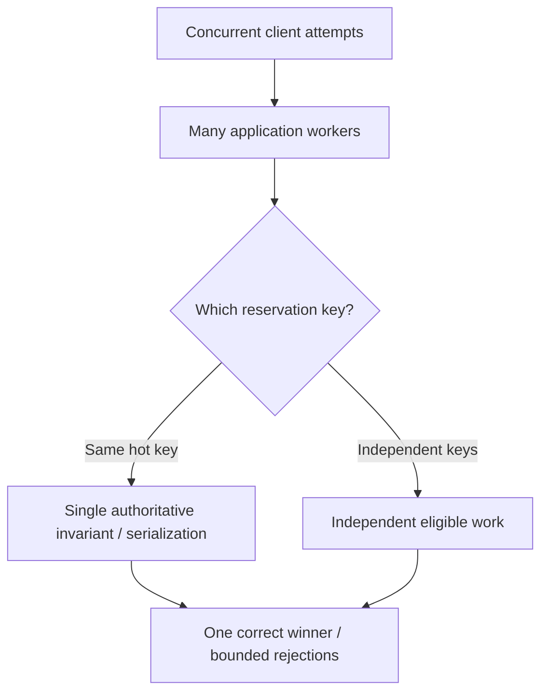

# Contended authority and discriminating scaling experiments

**Owning question:** Which observation distinguishes resource saturation from coordination overhead?

This page belongs to [V07/C02 — Contention, saturation and scaling laws](README.md). Use the integrated walkthrough for the surrounding decision; the sections below own this narrower mechanism and its limits.

<!-- tycho-question-source:tycho.page.7ad835c06d5a4e3aabf6b14632f92c86:4 -->
## 4. Identify the actual contended authority

**Original synthetic scenario:** many users attempt to reserve the same shared workshop device at the beginning of an event. The server runs on eight application instances, but only one operation at a time can safely commit an exclusive reservation for a particular device/time combination.

More application instances can perform authentication and independent reads concurrently. They **cannot** create two successful exclusive allocations for the same slot, however many CPUs exist. If request attempts against one slot arrive faster than its safe serialization capacity, queue age and rejections may grow while accepted bookings remain capped by the invariant.

**Text alternative:** many workers can process independent reservation keys, but calls for the same exclusive key contend for one authoritative allocation rule. The output count is constrained by valid business effects, not only by available execution threads.

Sharding can spread *independent* keys, but hashing one hot key does not split that key's exclusivity invariant. A queue may smooth demand or offer pending status only if it meets the user contract. [Sharding/hot keys](../../v05-data-models-engines-and-lifecycle/c05-partitioning-sharding-and-rebalancing/shard-keys-hotspots-and-resharding.md) owns data-routing mechanics; [admission/degradation](../c05-overload-protection-and-graceful-degradation/overload-admission-control-and-graceful-degradation.md) owns bounding overload effects.

<!-- /tycho-question-source -->
<!-- tycho-question-source:tycho.page.7ad835c06d5a4e3aabf6b14632f92c86:5 -->
## 5. Resource bottlenecks can move after optimization

Suppose a fictional query spends most elapsed time waiting for DB connections. Increasing a connection pool may reduce acquisition delay for a brief period and worsen DB locking under sustained load. Faster CPU processing can make a downstream API quota the next limiter. Changing a bottleneck is a success only if the overall **useful user journey** improves at the target workload and budget.

| Candidate constraint | Distinguishing metric | Misleading signal |
|---|---|---|
| CPU compute | Per-core saturation and CPU hot samples aligned to useful work | Average node CPU without throttling or hot-core detail |
| DB lock/transaction | Wait/hold time, owner, per-key skew and correct commits | Total SQL RPS without transaction outcome |
| Connection pool | Acquisition time, active/idle/pending, DB limits | Thread count alone |
| Broker partition | Per-partition lag/rate, key distribution and consumer ordering | Cluster-wide aggregate throughput |
| Remote quota | Provider rejection/throttle and retry amplification | Application-side successful request count |
| Cache coherence | Invalidation/rebuild work and stale data under writes | High hit rate without correctness test |
| Work-queue bound | Queue age, deadlines, admitted/completed/rejected distinction | Resident task count mistaken for parallel work |

Measure under normal, peak and degraded conditions; a single average can hide transient saturation or starvation.

### Worked saturation counterexample: the bottleneck moves, not disappears

**Original synthetic service:** four application replicas process independent reads and reservations. Suppose a fraction `p = 0.8` of the isolated CPU work can parallelize while the remainder stays serial. Amdahl's illustrative bound at four workers is `1 / ((1 - 0.8) + 0.8/4) = 2.5` times a one-worker baseline, **only under the model's assumptions**. It is not a measured fleet speedup and does not account for network, contention, memory, skew or the database's maximum transaction rate.

Now suppose the hypothetical database can sustain only 200 correctly completed reservations per second at the declared isolation level. App replicas can collectively issue 350 attempted reservations/s. The extra concurrency may grow database pool wait, drive retries after timeouts and *reduce correct business completions*, even when app CPU appears healthy. A synthetic test that shows p99 growth while CPU falls does not demonstrate that the application needs more replicas.

| Observed shape | Candidate mechanism | Discriminator | Unsafe "fix" |
|---|---|---|---|
| CPU near limit, DB/pool quiet | Actual CPU-bound work | Per-request CPU profiling at fixed arrival mix | Unbounded threads |
| Pool wait rises as replicas grow | Shared database admission constraint | Active leases, pool acquisition, transaction service time | More pools per replica without fleet budget |
| One item's latency dominates | Hot-key serialization | Per-key contention and offered/finished operations | More app replicas |
| Queue drains long after arrivals stop | Backlog and retry amplification | Queued age, new vs retry operations, correct completions | Interpret accepted RPS as throughput |

The [Universal Scalability Law source](https://arxiv.org/abs/0808.1431) provides a model for coherence/contending costs, not parameters for this made-up service. Model fitting requires actual independent measured points and error bars; do not set coefficients by guessing a technology brand.

**Proposed failure-and-recovery experiment, not executed:** at equal open-model offered arrivals, step from one to four to eight replicas, then remove the injected burst while recording correct outcomes, queue length and time-to-drain. Re-run under a deliberately hot key and under a distributed key mix. A valid remedy may be query optimization, bounded admission, domain-local serialization or fewer active workers, rather than horizontal scale. The [pool owner](../../v03-execution-concurrency-and-flow-control/c05-thread-connection-and-buffer-pools/connection-pools-hikaricp-pgbouncer.md) specifies resource budgets; [autoscaling](../c06-horizontal-vertical-scaling-and-autoscaling-delay/autoscaling-lag-and-capacity-limits.md) owns the response delay and hysteresis.

<!-- /tycho-question-source -->
<!-- tycho-question-source:tycho.page.7ad835c06d5a4e3aabf6b14632f92c86:6 -->
## 6. A discriminating scalability experiment

A meaningful test holds input data, authorized outcomes and total resource envelope controlled while varying concurrency/replica count:

1. Freeze input fixture, key skew, data size, service versions and dependency limits.
2. Replay an open arrival schedule at staged offered rates; capture dropped-generator iterations separately.
3. Record useful logical completions, explicit rejections, timeouts, queue age, p95/p99 and wrong/duplicate effects.
4. Vary application replicas at constant DB/backend resource ceiling; observe whether bottleneck shifts.
5. Repeat with independent keys and one hot-key scenario, and compare dependency traces.
6. Fit a simple capacity model **only after** collecting enough stable comparable observations; reserve independent loads for checking predictions.
7. Reject the interpretation if measurements are confounded by a different dataset, warm-up, retries, missing denominator or correctness loss.

**Hypothesis:** scale-out helps independent read-heavy keys until another resource becomes limiting, but may not help one serialized reservation key. These are proposed tests only, not reported outcomes.

<!-- /tycho-question-source -->
<!-- tycho-question-source:tycho.page.7ad835c06d5a4e3aabf6b14632f92c86:7 -->
## 7. Choosing a response to saturation

Options are conditional: optimize a hot query or lock critical section; reduce unnecessary dependency calls; change transaction/concurrency model when invariants permit; partition independent keys; add capacity at the verified scarce resource; enforce admission and backoff; or change the business outcome to a deferred job only when allowed.

A system that sustains a high RPS with unbounded queue age might still fail a latency SLO. A system that returns many fast 429 responses can legitimately protect state but must count reduced availability honestly. The best architecture is the one that satisfies the declared combination of correctness, availability, latency and operating constraints—not the one with the highest raw request counter.

<!-- /tycho-question-source -->

## Navigation, prerequisites and source scope

| Route | Destination |
|---|---|
| Parent and source ledger | [Chapter introduction and exact source rows](README.md#chapter-source-ledger) |
| Previous / prerequisite | [Read preceding context](scaling-models.md) |
| Next | [Continue the reasoning](README.md) |
| Integrated question | [Original scenario and limits](contention-saturation-and-scaling-laws.md) |

The source material keeps its original published/inferred/synthetic/unverified distinctions. Chapter-wide citations are shared reference context, not proof that every cited source supports every sentence on this page. Freshly inspected text is identified explicitly; absent dates and unknowns are retained.
