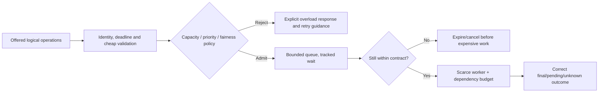

# Scarce resources, admission and queues

**Owning question:** Where must rejection occur to protect the expensive operation?

This page belongs to [V07/C05 — Overload protection and graceful degradation](README.md). Use the integrated walkthrough for the surrounding decision; the sections below own this narrower mechanism and its limits.

<!-- tycho-question-source:tycho.page.c5d20ae7ef6445e5b23dd5fbac625060:1 -->
## 1. Define the scarce resource and the acceptance outcome

Potential constraints include CPU, thread/connection pools, DB locks, broker quotas, external API limits, expensive query operators, request buffers and sustained storage I/O. More application instances do not relax a shared database quota or single-key transaction bottleneck. Protect the resource that actually limits **useful completed operations**.

Distinguish these outcomes:

| Event | Meaning | Client behavior |
|---|---|---|
| Accepted and completed | Authoritative logical operation reached defined correct result | Use result and do not duplicate effect |
| Rejected before acceptance | No durable work accepted, assuming that boundary is verifiable | Back off/try later under policy, or tell user capacity unavailable |
| Accepted as durable pending | Work is stored and promised under an asynchronous contract | Read stable operation status; do not treat pending as completed |
| Deadline expired before admission | Work is not useful/eligible for processing | Abort or return explicitly, avoiding stale queue |
| Outcome unknown after possible commit | Acceptance/effect status cannot be inferred from timeout alone | Reconcile by stable identity; never blindly recreate irreversible effect |
| Degraded partial result | Only an explicitly optional capability omitted | Display partial/stale scope to user; never claim required data complete |

A fast rejection can be safer than admitting an operation that inevitably misses its deadline, but this does not allow rejecting required work and reporting a higher success rate. Track offered, admitted, rejected, completed and failed populations separately.

<!-- /tycho-question-source -->

> **Pattern atlas:**
> [Priority Queue](../../v11-pattern-atlas/c07-resilience/README.md#priority-queue) — decision conditions and contraindications.

<!-- tycho-question-source:tycho.page.c5d20ae7ef6445e5b23dd5fbac625060:2 -->
## 2. Admission must precede the expensive operation

[Google SRE's Handling Overload](https://sre.google/sre-book/handling-overload/) explains why operations with unequal costs cannot be controlled solely by requests per second and describes client-side throttling, request criticality and retry policy. [AWS Builders' Library load shedding](https://aws.amazon.com/builders-library/using-load-shedding-to-avoid-overload/) motivates accepting bounded useful work rather than collapsing under unlimited demand. These are published operational lessons, not a proof that any proposed local limit is safe.

**Text alternative:** validate cheap, essential input and check its remaining deadline before admission. Bounded admission either explicitly rejects or queues within a policy. Queue entries whose useful time has expired leave without consuming expensive downstream resources. An accepted effect whose outcome becomes ambiguous still requires reconciliation rather than pretending rejection.

**Design caveat:** cheap authentication/validation is still needed to enforce permission; overload controls must not bypass authorization or permit malicious clients to reserve disproportionate capacity.

### Rejection has a cost

A rejection is not free. Parsing, authentication, authorization checks, logging, error
rendering, network transfer and client retries still consume resources. If a large fraction
of offered work is rejected, the rejection path can dominate the remaining capacity.

- Validate identity, permission, basic shape and deadline before expensive work.
- Keep the overload response small and bounded; avoid per-rejection work that scales with
  payload size or produces high-cardinality telemetry.
- Make the rejection contract explicit: which work was not accepted, whether a retry could
  help, and how long the caller should wait. A retry hint that every client follows
  immediately recreates the overload.
- Prefer client-side self-throttling when a client observes a sustained rejection rate; a
  client that keeps retrying shifts the cost back to the server.
- Measure the rejection path itself: CPU, allocation, logging, network and the ratio of
  rejected to admitted and completed work. A service can be overloaded while most of its
  CPU is spent rejecting requests.

The SRE book's *Client-Side Throttling* section describes this effect; its adaptive
throttling example is source-specific, not a default policy.

<!-- /tycho-question-source -->
<!-- tycho-question-source:tycho.page.c5d20ae7ef6445e5b23dd5fbac625060:3 -->
## 3. Queues, limits and priority create new contracts

A bounded queue must name both **number of items** and **maximum age**. A small queue of slow operations can still exceed caller deadlines. An old task may be useless even if the system has capacity after the peak; cancel it only where cancellation semantics and any committed effects permit.

Choose concurrency/queue limits from observed service-time and downstream saturation behavior rather than a universal rule. A token bucket rate limiter constrains arrival over time according to configured tokens and burst capacity; a concurrency semaphore limits simultaneous resident work. These solve related but different problems. Neither prevents unbounded work within the other dimension unless combined with deadlines and measured downstream budgets.

**Fairness and priority:** reserving some capacity for critical operations can preserve essential user journeys, but naive priority queues can starve ordinary work forever. Define which classes may overtake, maximum wait, starvation policy and tenant isolation. Do not treat one high-paying or high-volume client as entitled to consume all shared resource without an explicitly authorized service policy.

Criticality must be authenticated and propagated. A class visible only at the edge cannot
protect a downstream dependency: the dependency sees an ordinary caller and may shed the
high-criticality work first. Propagate the class with the request, keep it separate from the
deadline and from any client-asserted priority, and verify at each hop that lower classes are
rejected before higher ones. Propagation is not a license to starve ordinary work; keep a
bounded wait and a starvation policy.

**Alternative.** FIFO with admission control, separate lanes per class, or a shared queue
with reserved capacity may be preferable when priority cannot be authenticated or
starvation is unacceptable. Reverse the priority choice when inversion and starvation
exceed the latency benefit for critical work.

<!-- /tycho-question-source -->

## Local limits, global quotas and fair admission

**Enrichment contract:** turn a named limit into an enforceable budget with units, scope and failure behavior. A rate cap, concurrency cap and queue bound constrain different populations.

### Original token-budget calculation

Assume a fictional tenant receives 20 work units/s with a bucket capacity of 40 work units. An operation costs five units. At most eight such operations can spend a full bucket immediately; in steady state the refill supports four operations/s. Across an interval of t seconds, admitted cost is bounded by 40 + 20t only if the single logical bucket and its refill/update rules are correctly enforced. These invented values are arithmetic examples, not measurements or recommended defaults.

With four replicas each independently granting the same bucket, the aggregate allowance can approach four times the intended scope. A global quota needs atomic shared accounting, coordinated budget leases or a deliberately documented approximation. A shared limiter adds a dependency; its timeout must not become permission to spend an unlimited budget.

| Limiter design | Benefit | Required failure contract |
|---|---|---|
| Per-instance bucket | Simple local protection | Aggregate allowance changes with replicas and routing |
| Central atomic bucket | Explicit shared scope | Quota-store latency/outage and hot-key behavior |
| Leased local budgets | Fewer shared operations | Never grant overlapping spend; account for unused/lost allocations |
| Approximate distributed counts | Scalable signals | Bound permitted overshoot and identify protected invariant |
| Concurrency cap | Limits resident work | Release permits after termination; distinguish stuck from completed work |

### Fairness before one shared FIFO

A single tenant can fill a shared queue even when average capacity is sufficient. Define per-tenant outstanding work, maximum age and how spare capacity may be borrowed. Weighted fair scheduling can reserve progress for other tenants, but weights alone do not cap the cost of one operation or prevent starvation unless the scheduling and admission rules do so.

An original scenario has tenant A submit 1,000 cheap reads while B submits two costly exports. Request-count fairness and resource-cost fairness produce different outcomes. Choose the protected objective explicitly; include a bounded estimate or separate class budget for expensive work. Reconcile estimated and actual cost without allowing untrusted clients to choose an artificially cheap class.

### Failure and recovery

For a quota protecting a hard external limit, unavailable shared accounting may require rejecting new work or using only a known unused local allocation. For a best-effort UI feature, an intentionally bounded fallback may be acceptable. State the permitted overshoot and recovery reconciliation; the labels fail-open/fail-closed do not answer this design question.

Advertise retry guidance consistent with remaining budget and deadline. Randomized backoff must not cause all replicas to refill and retry in the same wave. Track offered, rejected, admitted and correctly completed work per class/tenant, plus queue age and shared-store failures.

### Evidence and proposed acceptance

[Handling Overload](https://sre.google/sre-book/handling-overload/) supports resource-aware overload handling and criticality, not a benchmark for the invented bucket or a proof of a global quota implementation. All numeric budgets and distribution comparisons above are original synthetic reasoning, inspected/self-reviewed 2026-10-20.

Proposed tests: route one tenant across all replicas, change replica count, partition the quota store, duplicate a budget lease, cancel admitted work and restart a permit owner. Verify actual aggregate admitted cost, bounded overshoot and progress for a quiet tenant. No load test or distributed-limiter execution was performed.

## Navigation, prerequisites and source scope

| Route | Destination |
|---|---|
| Parent and source ledger | [Chapter introduction and exact source rows](README.md#chapter-source-ledger) |
| Previous / prerequisite | [Read preceding context](overload-admission-control-and-graceful-degradation.md) |
| Next | [Continue the reasoning](dependency-isolation.md) |
| Integrated question | [Original scenario and limits](overload-admission-control-and-graceful-degradation.md) |

The source material keeps its original published/inferred/synthetic/unverified distinctions. Chapter-wide citations are shared reference context, not proof that every cited source supports every sentence on this page. Freshly inspected text is identified explicitly; absent dates and unknowns are retained.
