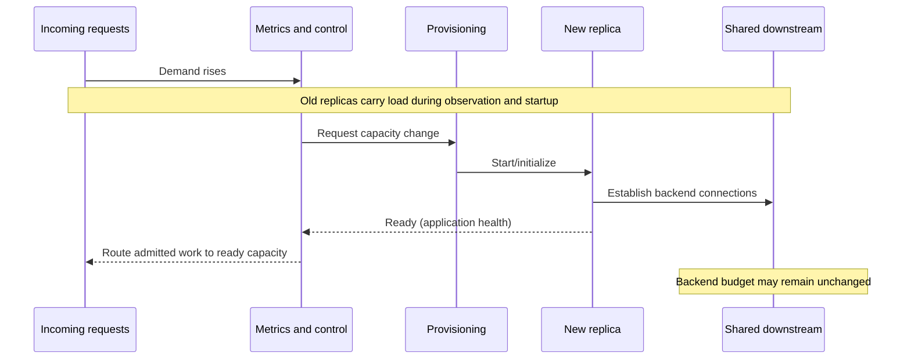

# Demand signals and scale-out delay

**Owning question:** When does new capacity become useful relative to the demand timescale?

This page belongs to [V07/C06 — Horizontal/vertical scaling and autoscaling delay](README.md). Use the integrated walkthrough for the surrounding decision; the sections below own this narrower mechanism and its limits.

<!-- tycho-question-source:tycho.page.49d9df04c0b4488e936b02e580a62271:1 -->
## 1. Decompose the actual scale-out response time

Let the observed actuation delay be the sum of several **measured** stages:

- Metric event/aggregation delay: offered demand changes before a configured observation becomes visible.
- Decision delay: sampling interval, target deviation, policy threshold and stabilization.
- Capacity provisioning delay: resource scheduler, instance/image/container startup and possible quota checks.
- Application warm-up: runtime initialization, compilation, connection establishment, cache fill and readiness checks.
- Effective service delay: traffic routing and arrival at an instance that can really perform the required work.

These stages may overlap, so simply summing averages is not an empirical latency estimate. Measure earliest useful additional **completed throughput** as well as readiness timestamps. A new Pod may be marked running while its downstream DB budget remains exhausted.

[Kubernetes HPA documentation](https://kubernetes.io/docs/concepts/workloads/autoscaling/horizontal-pod-autoscale/) distinguishes horizontal replica changes from vertical resource assignment, and describes metric-driven control and scale behavior. [AWS EC2 Auto Scaling warm-up guidance](https://docs.aws.amazon.com/autoscaling/ec2/userguide/ec2-auto-scaling-default-instance-warmup.html) explains why newly started instances' initialization metrics can distort demand signals. Their control models are examples of implementation-dependent behavior, not a universal response-time SLA.

Text alternative: increased demand first reaches existing capacity; the controller observes it and requests more resources. A new replica becomes useful only after provisioning, readiness and routing, and may still be limited by a shared downstream dependency.

<!-- /tycho-question-source -->
<!-- tycho-question-source:tycho.page.49d9df04c0b4488e936b02e580a62271:2 -->
## 2. Feedback signals and the hot-key trap

A policy must choose a signal that reflects the **scarce resource** limiting useful progress:

| Proposed metric | Useful when | Deceptive when |
|---|---|---|
| Average CPU utilization | Work is CPU-bound and can be spread across replicas | Requests wait on DB locks or remote I/O; average hides one hot process |
| Memory pressure | Resource limit and cache footprint are known | More memory only retains more stale objects or delays leaks |
| Queue length / age | Each item has bounded work and service level is defined | A single blocked key/consumer prevents queue progress |
| Active requests | Per-request work and admitted load are stable enough | Long-polling/streaming changes what "active" costs |
| Successful completion rate | Business usefulness matters | Completed rate plateaus while offered attempts and failures rise |
| Custom downstream budget | External quota/pool is true bottleneck | Multiple upstream controllers compete over the same limited quota |

A ten-replica deployment that opens a 30-connection pool per instance can request 300 backend connections. A scale-out decision based only on CPU can exhaust a fixed database connection ceiling and make the service less reliable. [Connection pool architecture](../../v03-execution-concurrency-and-flow-control/c05-thread-connection-and-buffer-pools/connection-pools-hikaricp-pgbouncer.md) explains cross-instance budgeting. Similarly, if all requests contend for the same item lock, sharding or more replicas may only increase waiting work.

<!-- /tycho-question-source -->
<!-- tycho-question-source:tycho.page.49d9df04c0b4488e936b02e580a62271:3 -->
## 3. Autoscaling can lose the race against a burst

**Fully synthetic example:** one replica completes at most 40 relevant operations/s *under a hypothetical independent workload and known downstream capacity*. Four warm replicas therefore have an optimistic nominal ceiling of 160 operations/s. A burst of 300 attempted operations/s begins and lasts 15 seconds. Extra replicas become useful only after an invented 45-second decision/provision/warm-up sequence.

During this burst, horizontal autoscaling **cannot** add useful capacity in time, even if the controller eventually chooses eight replicas. If admission is unlimited, unfinished work can grow; after the burst, scaled replicas may wake to a backlog and interfere with normal requests. The simplistic arithmetic surplus is (300 − 160) × 15 = **2,100 attempted operations** before accounting for service times, errors, key skew or retries. This is a **hypothetical upper-bound illustration under fixed offered/completed rates**, not a measured queue size. Dropped work, deadline expiry and admission policies change it dramatically.

| Mitigation | Benefit | Explicit trade-off |
|---|---|---|
| Pre-provision enough warm capacity | Immediate headroom under predictable peaks | Higher idle resource cost |
| Scheduled/predictive scaling | Capacity can arrive before expected patterns | Poor under surprise bursts or invalid forecasts |
| Bounded queue | Converts spikes to waiting when the user contract permits | Queue age, storage and replay/retry semantics become requirements |
| Admission control/load shedding | Prevents uncontrolled resource exhaustion | User-visible rejection and backoff behavior required |
| Faster startup/warm pools | Reduces provisioning delay | Warm resources consume capacity/cost and need correctness checks |
| Optimize/vertical scale bottleneck | Avoid unnecessary network decomposition | Physical resource and restart limits still apply |

A deferred operation is **not** equivalent to a completed synchronous operation. If a user's contract requires a final answer within 700 ms, an async queue without result retrieval and changed client semantics does not satisfy it.

<!-- /tycho-question-source -->

## Navigation, prerequisites and source scope

| Route | Destination |
|---|---|
| Parent and source ledger | [Chapter introduction and exact source rows](README.md#chapter-source-ledger) |
| Previous / prerequisite | [Read preceding context](autoscaling-lag-and-capacity-limits.md) |
| Next | [Continue the reasoning](controller-stability.md) |
| Integrated question | [Original scenario and limits](autoscaling-lag-and-capacity-limits.md) |

The source material keeps its original published/inferred/synthetic/unverified distinctions. Chapter-wide citations are shared reference context, not proof that every cited source supports every sentence on this page. Freshly inspected text is identified explicitly; absent dates and unknowns are retained.
