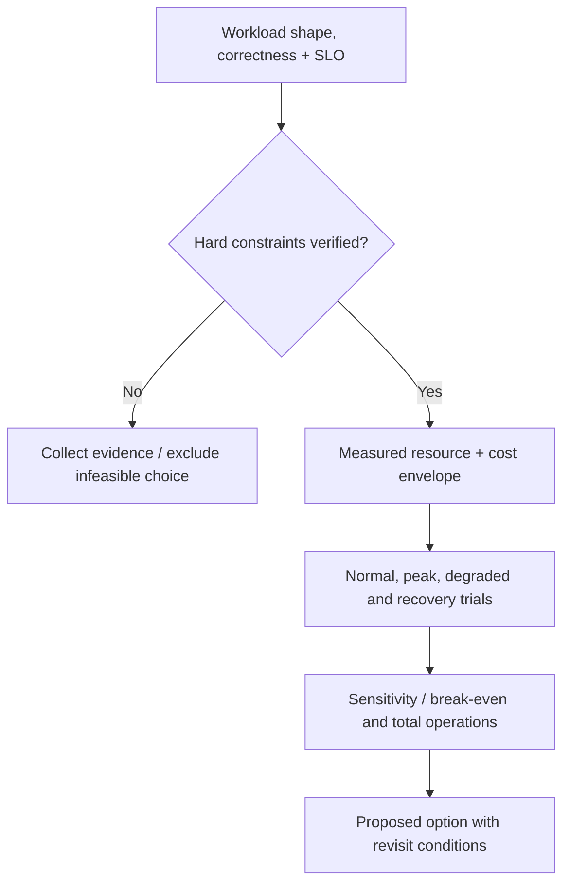

# Sensitivity, extrapolation and simpler alternatives

**Owning question:** Which uncertain input or hard constraint can reverse the preferred capacity option?

This page belongs to [V07/C07 — Capacity planning and cost/performance trade-offs](README.md). Use the integrated walkthrough for the surrounding decision; the sections below own this narrower mechanism and its limits.

<!-- tycho-question-source:tycho.page.5ae9f2c4b45842c7975fd32c252dc4d8:4 -->
## 4. Unit cost and sensitivity

Useful unit costs include:
- total relevant cost per **correct user journey**, rather than per HTTP attempt;
- per indexed/retained object at an agreed freshness and query quality;
- per durable asynchronous job completed within its age SLO;
- cost per recoverable acknowledged operation under a named RPO/RTO.

**Example:** if a synthetic environment costs 1,000 units/month and completes 500,000 correct user journeys, then illustrative unit cost is 0.002 units per journey. If the same hosting cost produces only 250,000 correct journeys because of overload/retries, unit cost doubles. This is arithmetic on invented values, not a measured service efficiency result.

Sensitivity analysis must vary:
- offered arrivals and burst frequency/duration;
- per-operation CPU/DB/I/O work and key skew;
- storage growth and retention;
- replica startup time and minimum headroom;
- downtime cost, recovery staffing and data-loss constraints;
- egress, logs, inter-zone traffic and non-peak idle capacity;
- utilization versus request latency/quality.

A decision can reverse when any of these change. Report break-even conditions and credible uncertainty rather than one precise ranking from guesses.

<!-- /tycho-question-source -->
<!-- tycho-question-source:tycho.page.5ae9f2c4b45842c7975fd32c252dc4d8:5 -->
## 5. Capacity cannot be extrapolated from one benchmark

Suppose four replicas complete 1,000 operations/s in a controlled test. Doubling replicas does **not** imply 2,000 correct operations/s: shared DB locks, network, index rebuilds, quota ceilings, connection pools and per-key serialization may cap useful throughput. [Contention and scaling laws](../c02-contention-saturation-and-scaling-laws/contention-saturation-and-scaling-laws.md) discusses serial/coherence limits. [Load-test validity](../c03-load-test-methods-and-benchmark-validity/load-testing-and-benchmark-validity.md) explains why generator saturation and omitted requests invalidate apparent improvements.

A trustworthy capacity study should:
1. Pin workload input, dataset, versions and runtime ceilings.
2. Measure *offered* versus admitted and correctly completed business operations.
3. Check each independent scarce resource and reject hidden data loss.
4. Run multiple steps in concurrency and replica count, normal and degraded.
5. Compare equivalent cost and end-to-end correctness, not just per-node throughput.
6. Test warm-up and failure recovery, especially during the demand peak.
7. Record uncertainty and revisit when the workload changes.

<!-- /tycho-question-source -->
<!-- tycho-question-source:tycho.page.5ae9f2c4b45842c7975fd32c252dc4d8:6 -->
## 6. When deferral, throttling and a simpler design win

A delayed batch may process a short surge economically if its **accepted/pending** status and deadline are part of the business contract. A bounded queue does not make synchronous work complete. Similarly, a modular monolith can have a lower operating cost than many services when independent lifecycle is not required, but one deployable may be a poor fit under mandatory isolation.

An economically rational architecture can deliberately choose higher idle cost to meet a strict recovery or availability gate. Cost optimization is constrained optimization; it does not license breaking correctness or authorization.

Text alternative: establish requirements and hard constraints before comparing cost. Evaluate realistic resource use across varied workload and failure states, and test sensitivity; any unknown mandatory constraint blocks unconditional selection.

<!-- /tycho-question-source -->

## Navigation, prerequisites and source scope

| Route | Destination |
|---|---|
| Parent and source ledger | [Chapter introduction and exact source rows](README.md#chapter-source-ledger) |
| Previous / prerequisite | [Read preceding context](capacity-cost-model.md) |
| Next | [Continue the reasoning](README.md) |
| Integrated question | [Original scenario and limits](capacity-planning-and-cost-performance.md) |

The source material keeps its original published/inferred/synthetic/unverified distinctions. Chapter-wide citations are shared reference context, not proof that every cited source supports every sentence on this page. Freshly inspected text is identified explicitly; absent dates and unknowns are retained.
