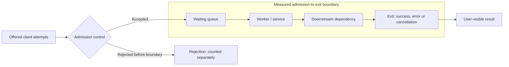

# Population boundaries and Little's Law

**Owning question:** When are occupancy, throughput and mean residence time comparable?

This page belongs to [V07/C01 — Queueing, Little's Law and measurement boundaries](README.md). Use the integrated walkthrough for the surrounding decision; the sections below own this narrower mechanism and its limits.

<!-- tycho-question-source:tycho.page.a9a28aaa4d1e4e9cb0accd2fc2c5ba9b:1 -->
## Orientation: four numbers that are not interchangeable

Consider a request passing through a fictional gateway and worker, possibly waiting for a downstream resource. Choose **one** boundary with ingress at admission and egress when a request exits *for any reason*. For example:



The Mermaid diagram is an **original synthetic model**, not an observed deployment. Text alternative: client attempts are either rejected before the boundary or accepted into a queue; accepted work passes through execution and a dependency to a recorded exit. The arrows represent an **original illustrative model**, not a deployed system. Real systems may reject or cancel work at several places. The endpoint and termination rule must be documented before measuring time or concurrency.

| Quantity | Unit | Meaning and common mistake |
|---|---|---|
| Offered arrival rate, `λ_offered` | operations/s | Requests clients attempt to send. An overload reject may never enter the measured boundary. |
| Admitted rate, `λ_admitted` | operations/s | Work entering the boundary after admission. This may differ from offered demand during shedding. |
| Exit/completion rate, `λ_exit` | operations/s | Requests leaving the boundary, including successful, failed and cancelled exits **when the occupancy definition counts those as departures**. A success-only metric is not total flow. |
| Successful throughput | successful operations/s | A subset of exits. A stable queue can deliver many errors; high throughput alone is not a healthy user-level SLO. |
| Instantaneous in-system population, `N(t)` | operations | Work admitted but not yet exited, including waiting and processing stages inside the chosen boundary. |
| Mean in-system population, `L` | operations | A time average or stationary mean of `N(t)`; not the peak, an exact count of threads or users. |
| Mean residence time, `W` | seconds/operation | Average time in that same boundary, including waiting and service. Not p95/p99 and not necessarily client-perceived round trip. |

**Registered users, DAU, active sessions, open connections, in-flight work and RPS are distinct.** A user might make no request for minutes or produce many concurrent operations; an automated event stream can have no human user at all. A closed-user model also requires action and think-time assumptions before an activity count has rate meaning. See the already established [requirements/workload model](../../../../authoring/models/requirements-workload-profile.md).

### Conservation before prediction

For cumulative **accepted** arrivals `A(t0,t1)` and **all exits** `D(t0,t1)`, the exact count balance is

```text
N(t1) = N(t0) + A(t0,t1) - D(t0,t1)
```

provided each accepted entity is counted once and every termination is represented consistently; no hidden transfers, recycled jobs or entity redefinitions. This balance holds for a finite observation interval. It does **not** assert that arrival and exit rates are equal during an overloaded burst.

In a stable, non-growing population over a sufficiently representative horizon, the long-run admitted arrival rate and exit rate converge under the corresponding flow assumptions. Otherwise distinguish offered, admitted, completed and abandoned events instead of picking whichever rate makes a model look plausible.

<!-- /tycho-question-source -->
<!-- tycho-question-source:tycho.page.a9a28aaa4d1e4e9cb0accd2fc2c5ba9b:2 -->
## Architecture: Little's Law is an average identity

For a stable system with a consistent customer/work definition and well-defined steady-state or long-run averages, Little's Law relates average in-boundary work to throughput and *mean* time spent there:

```text
                 L = λ × W

L:    average work in boundary        [operations]
λ:    throughput or admitted rate     [operations / second]
W:    mean residence time             [seconds / operation]
```

This is not a rule that response time is *always* occupancy divided by offered RPS. The mathematical literature distinguishes stationary/long-run theory from finite-interval estimators. Kim & Whitt (2013), Abstract, §§1–2, explain why finite-window edge effects arise if a measurement begins or ends with customers still present; §2.2 identifies a special finite-interval equality when the observed system begins **and** ends empty. [E01, E02]

For a single, purely **synthetic conditional scenario**:

- Suppose completed throughput at the named boundary is **120 operations/s** and the *measured mean* in-system residence time is **0.20 seconds/operation** during a sufficiently stable period.
- Then `L = 120 × 0.20 = 24` *average outstanding operations*.
- If those inputs were observed and appropriately bounded, 24 would be an inferred **mean occupancy for that boundary**, **not** an observed maximum, database connection requirement, queue capacity, worker count or memory budget.
- In this Tycho example they have **not** been measured. They are invented to demonstrate the arithmetic, and 120 offered requests/s alone would not establish 120 completed requests/s.

There is no conclusion here about CPU saturation, the size of a connection pool, the number of virtual threads, a good number of service instances or whether to shard data. Those require service-time/resource-demand distributions, constraints, actual waiting, downstream capacity, failure headroom, queue policy and measurements.

### Average latency cannot be replaced by a tail percentile

Suppose an *invented* request-time distribution has 95% of requests at **0.10 s** and 5% at **2.10 s**. Its arithmetic mean is `0.95 × 0.10 + 0.05 × 2.10 = 0.20 s`. Its 99th-percentile threshold (under the usual nearest-rank interpretation at a population with these proportions) is **2.10 s**, not 0.20 s.

At a completed rate of 120/s and the same stable-boundary conditions, Little's Law uses **0.20 s** to infer mean occupancy 24. Inserting **p99=2.10 s** and concluding that `120 × 2.10 = 252` is the "required concurrency" is an invalid use of the law. A single mean equation does not reveal the full latency distribution or guarantee an SLO.

Likewise, a pool size must respect the *actual* pool ownership and hold time, queueing policy, timeouts and downstream bottlenecks. Many in-flight requests can be waiting for an already saturated small pool. Making the pool larger can increase downstream contention rather than magically create capacity.

<!-- /tycho-question-source -->

## Navigation, prerequisites and source scope

| Route | Destination |
|---|---|
| Parent and source ledger | [Chapter introduction and exact source rows](README.md#chapter-source-ledger) |
| Previous / prerequisite | [Read preceding context](queueing-littles-law.md) |
| Next | [Continue the reasoning](finite-window.md) |
| Integrated question | [Original scenario and limits](queueing-littles-law.md) |

The source material keeps its original published/inferred/synthetic/unverified distinctions. Chapter-wide citations are shared reference context, not proof that every cited source supports every sentence on this page. Freshly inspected text is identified explicitly; absent dates and unknowns are retained.
