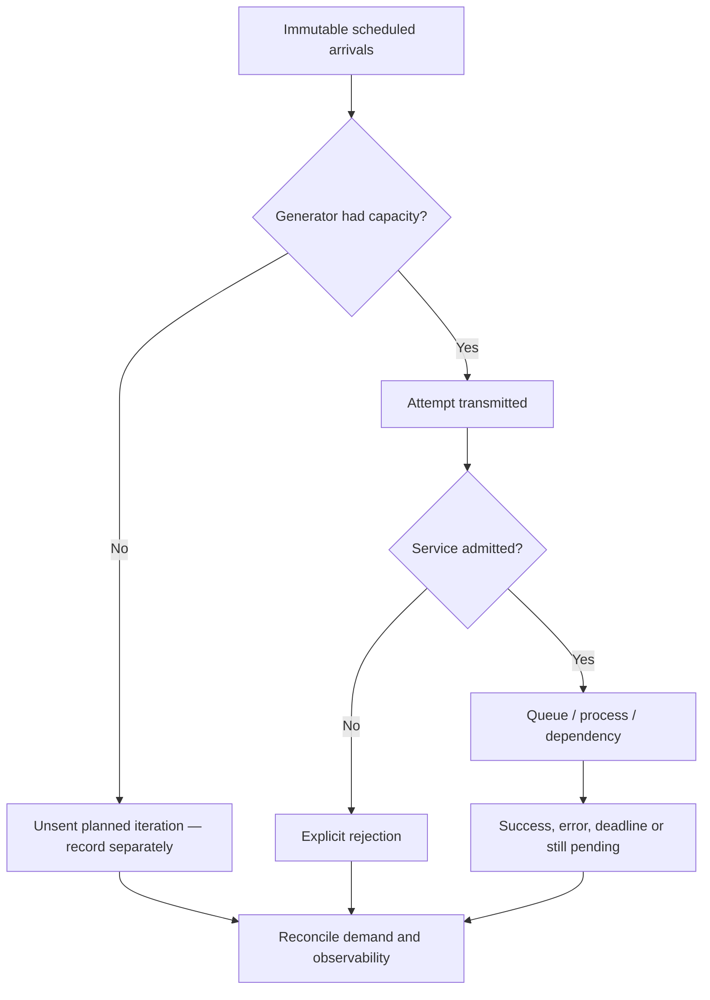

# Experiment claims, arrival models and denominators

**Owning question:** Which offered workload must a load generator preserve while the system slows?

This page belongs to [V07/C03 — Load-test methods and benchmark validity](README.md). Use the integrated walkthrough for the surrounding decision; the sections below own this narrower mechanism and its limits.

<!-- tycho-question-source:tycho.page.1cfb9cfdf1604fada0f508c123fe8b2e:1 -->
## 1. Write the experiment claim before starting a load generator

Use a falsifiable statement rather than “the new design is faster”. Example:

**Original fictional case:** a public reading-list application has a query endpoint with an index built from a known synthetic dataset. We want to compare a local in-process cache against direct indexed reads. Both must serve the same authorized content and satisfy a defined maximum-staleness contract.

Proposed hypothesis: under the *same actual offered arrival sequence* and skew, caching reduces user-observed p95/p99 response time without creating a freshness violation or increasing timeouts. Reject the hypothesis if reduced reported latency is explained by requests omitted from the test, a changed dataset, stale invalid results or different infrastructure ceilings.

Every experiment contract needs:

| Dimension | Required frozen specification |
|---|---|
| User operation | Input/output definition; logical request ID; success, rejection and timeout classification |
| Environment | Exact application/dependency versions, CPU/memory quotas, placement/network, container and runtime settings |
| Dataset | Size, selectivity, distribution, mutation history, integrity checks and cache warm/cold state |
| Demand | Scheduled arrival timestamps, operation mix, burst, key/tenant skew, retries and intended duration |
| Generator | Tool version, executor mode, virtual-user capacity, client machines, connection reuse, clocks and saturation checks |
| Observation | Client boundary, raw timestamps, histograms, errors, queue wait and per-dependency telemetry |
| Acceptance | Named correctness invariant, error/time budget, uncertainty and stop condition |
| Repetition | Trial count, order/randomization, warm-up, reset procedure and environment-drift tracking |

A timestamped statement “we sent 1,000 RPS” is not evidence until the **actual sent** and **unsent intended** workloads are available.

<!-- /tycho-question-source -->
<!-- tycho-question-source:tycho.page.1cfb9cfdf1604fada0f508c123fe8b2e:2 -->
## 2. Open versus closed arrivals: the generator can hide degradation

The [Grafana k6 open/closed model documentation](https://grafana.com/docs/k6/latest/using-k6/scenarios/concepts/open-vs-closed/) distinguishes arrivals independent of iteration completion from a fixed-VU loop whose next iteration starts after the previous finishes. An open arrival model is appropriate when the externally imposed arrival rate should remain independent of service latency. A closed model is suitable when the real population genuinely waits before initiating another operation. Neither is universally “more realistic”.

Suppose a fictional generator runs 20 concurrent virtual users, each repeatedly issuing a request and waiting. At 0.2 s average iteration time, an ideal ceiling would be about 100 iterations/s. If service time becomes 2 s, the same closed population can offer only about 10 iterations/s. This arithmetic ignores scheduling and think-time details; it illustrates why response-driven generators can hide the queue that *independent* arrivals would create.

The [k6 dropped-iterations documentation](https://grafana.com/docs/k6/latest/using-k6/scenarios/concepts/dropped-iterations/) explicitly records unsent scheduled iterations and explains that missing free virtual users can reflect generator configuration, degradation in the target, or both. A dropped-iteration counter is not the same as an HTTP rejection recorded by the application: one never started the intended request, while the other reached some defined ingress boundary.

**Text alternative:** distinguish a planned arrival never executed by the generator from a transmitted attempt rejected by the service and from one admitted but unfinished. These populations must not silently disappear from the denominator.

<!-- /tycho-question-source -->
<!-- tycho-question-source:tycho.page.1cfb9cfdf1604fada0f508c123fe8b2e:3 -->
## 3. Define denominators and avoid coordinated omission

Four different rates can coexist during one window:

- **Scheduled arrivals:** logical operations intended by the workload fixture.
- **Transmitted attempts:** actual requests emitted by the generator, including configured retries.
- **Admitted operations:** server-accepted work before queue/service.
- **Completed useful operations:** correct business outcomes within the selected time window.

A single logical operation may produce multiple attempts. Timeouts and client disconnects do not automatically imply the server committed nothing. A test should retain operation identity and terminal state when possible; counting attempts as distinct successful business operations can falsely inflate throughput.

The [HdrHistogram coordinated-omission discussion and correction API](https://github.com/HdrHistogram/HdrHistogram/blob/master/src/main/java/org/HdrHistogram/AbstractHistogram.java) shows how a correction may reconstruct *modeled* missing intervals when an expected interval is known. Corrected samples are **not direct observations** of requests that never happened. Preserve both raw data and correction assumptions. Without a credible intended arrival schedule, a synthetic corrected p99 cannot be presented as measured user latency.

For each percentiled metric, state:
1. What event starts and ends the clock; client or server perspective.
2. Which operations populate the histogram, including timeouts and never-started operations.
3. Whether result values are raw, modeled, corrected, sampled or censored.
4. How sufficient sample size and temporal correlation affect interpretation; no universally magic p99 sample count.
5. Why aggregated p99 across heterogeneous tenants, operation types or versions can hide a regression.

A lower p99 with fewer successful and more rejected requests is not a performance improvement without an explicit service-level contract allowing that trade-off.

<!-- /tycho-question-source -->

## Navigation, prerequisites and source scope

| Route | Destination |
|---|---|
| Parent and source ledger | [Chapter introduction and exact source rows](README.md#chapter-source-ledger) |
| Previous / prerequisite | [Read preceding context](load-testing-and-benchmark-validity.md) |
| Next | [Continue the reasoning](benchmark-controls.md) |
| Integrated question | [Original scenario and limits](load-testing-and-benchmark-validity.md) |

The source material keeps its original published/inferred/synthetic/unverified distinctions. Chapter-wide citations are shared reference context, not proof that every cited source supports every sentence on this page. Freshly inspected text is identified explicitly; absent dates and unknowns are retained.
