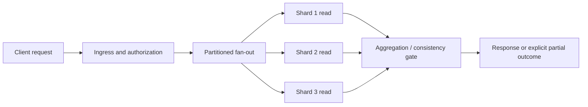

# Percentiles, correlation and critical paths

**Owning question:** How do serial work and fan-out change end-to-end tail behavior?

This page belongs to [V07/C04 — Tail latency, fan-out and time budgets](README.md). Use the integrated walkthrough for the surrounding decision; the sections below own this narrower mechanism and its limits.

<!-- tycho-question-source:tycho.page.eb130a7f820544a2ba0e0883c0ce587b:1 -->
## 1. One percentile cannot describe a distributed request

A latency sample must be named by boundary: client-observed request, ingress-to-egress request, queue wait, individual dependency call, DB lock wait or full background job. A percentile is a value of a **distribution**, not a single request's maximum. Define the observation window, whether timed-out requests are included, how sampling works, and whether successful, rejected and failed requests share the same population.

Suppose the fictional service above a user interface has ten independent operations at a downstream service. Each operation responds within a proposed threshold in 99% of independently sampled calls. The probability that all ten finish within this threshold is **0.99^10 ≈ 90.4%**, meaning about 9.6% of composed requests have at least one slow dependency *under these assumptions*. At fifty calls, **1 − 0.99^50 ≈ 39.5%** have at least one such outlier. These numbers are elementary model arithmetic using deliberately invented populations; they are not observations or universal distribution laws.

For N calls with identical independent latency CDF F(t), and a parent that waits for **all** replies, the maximum's distribution is:

\[
P(\max(T_1,\ldots,T_N)\le t)=F(t)^N.
\]

Real dependencies can be correlated through a shared database, GC event, network congestion, regional fault or request mix. Fan-out can include conditional branches, quorum/first-success logic and optional results, so the formula cannot simply be applied to every service graph. The published [Dean and Barroso, *The Tail at Scale*, 2013](https://research.google/pubs/the-tail-at-scale/) studies this phenomenon and mitigation strategies in large-scale services; it does not measure our synthetic system.

**Important distinction:** p99 of the *parent* is not the sum of p99 of each child; nor is the p99 of a parallel fan-out equal to the p99 of one child. Percentiles do not generally add. Sum latency across serial critical-path steps can be bounded by hard upper limits, but adding percentile values is not a valid quantile theorem without additional joint-distribution assumptions.

<!-- /tycho-question-source -->
<!-- tycho-question-source:tycho.page.eb130a7f820544a2ba0e0883c0ce587b:2 -->
## 2. Draw the critical path and distinguish parallel from serial

Original model of a fictional "preview and analysis" request:

Text alternative: after ingress, several shard reads start concurrently. The aggregation stage may require all results, a quorum, or a defined partial response. Which of these is correct is a business invariant; only after choosing that correctness condition can we tell whether the slowest shard is on the critical path.

| Dependency policy | Parent latency relationship | Correctness question |
|---|---|---|
| All results required | Wait for slowest prerequisite, plus serial stages | Is partial output prohibited? |
| First successful response among replicas | Wait for first acceptable result; cancel remaining speculative work | Are replicas fresh/consistent enough to interchange? |
| Quorum reads | Wait for required qualifying responses | Which conflicts/staleness are acceptable? |
| Optional enrichments | Return partial result at a defined cutoff | Does the client understand missing information? |
| Sequential dependencies | Add actual elapsed work/queue waits on each critical-path segment | Could stages overlap without changing business meaning? |

Avoid claiming an architecture is "parallel" just because it launches asynchronous code: a shared connection pool, global lock, fan-in serialization or constrained executor can reintroduce an effectively serial bottleneck.

<!-- /tycho-question-source -->

## Navigation, prerequisites and source scope

| Route | Destination |
|---|---|
| Parent and source ledger | [Chapter introduction and exact source rows](README.md#chapter-source-ledger) |
| Previous / prerequisite | [Read preceding context](tail-latency-fanout-and-deadline-budgets.md) |
| Next | [Continue the reasoning](deadline-hedging.md) |
| Integrated question | [Original scenario and limits](tail-latency-fanout-and-deadline-budgets.md) |

The source material keeps its original published/inferred/synthetic/unverified distinctions. Chapter-wide citations are shared reference context, not proof that every cited source supports every sentence on this page. Freshly inspected text is identified explicitly; absent dates and unknowns are retained.
