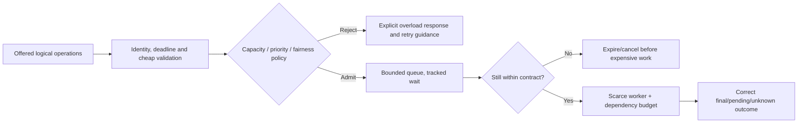

# Scarce resources, admission and queues

**Owning question:** Where must rejection occur to protect the expensive operation?

This page belongs to [V07/C05 — Overload protection and graceful degradation](README.md). Use the integrated walkthrough for the surrounding decision; the sections below own this narrower mechanism and its limits.

<!-- tycho-question-source:tycho.page.c5d20ae7ef6445e5b23dd5fbac625060:1 -->
## 1. Define the scarce resource and the acceptance outcome

Potential constraints include CPU, thread/connection pools, DB locks, broker quotas, external API limits, expensive query operators, request buffers and sustained storage I/O. More application instances do not relax a shared database quota or single-key transaction bottleneck. Protect the resource that actually limits **useful completed operations**.

Distinguish these outcomes:

| Event | Meaning | Client behavior |
|---|---|---|
| Accepted and completed | Authoritative logical operation reached defined correct result | Use result and do not duplicate effect |
| Rejected before acceptance | No durable work accepted, assuming that boundary is verifiable | Back off/try later under policy, or tell user capacity unavailable |
| Accepted as durable pending | Work is stored and promised under an asynchronous contract | Read stable operation status; do not treat pending as completed |
| Deadline expired before admission | Work is not useful/eligible for processing | Abort or return explicitly, avoiding stale queue |
| Outcome unknown after possible commit | Acceptance/effect status cannot be inferred from timeout alone | Reconcile by stable identity; never blindly recreate irreversible effect |
| Degraded partial result | Only an explicitly optional capability omitted | Display partial/stale scope to user; never claim required data complete |

A fast rejection can be safer than admitting an operation that inevitably misses its deadline, but this does not allow rejecting required work and reporting a higher success rate. Track offered, admitted, rejected, completed and failed populations separately.

<!-- /tycho-question-source -->
<!-- tycho-question-source:tycho.page.c5d20ae7ef6445e5b23dd5fbac625060:2 -->
## 2. Admission must precede the expensive operation

[Google SRE's Handling Overload](https://sre.google/sre-book/handling-overload/) explains why operations with unequal costs cannot be controlled solely by requests per second and describes client-side throttling, request criticality and retry policy. [AWS Builders' Library load shedding](https://aws.amazon.com/builders-library/using-load-shedding-to-avoid-overload/) motivates accepting bounded useful work rather than collapsing under unlimited demand. These are published operational lessons, not a proof that any proposed local limit is safe.

**Text alternative:** validate cheap, essential input and check its remaining deadline before admission. Bounded admission either explicitly rejects or queues within a policy. Queue entries whose useful time has expired leave without consuming expensive downstream resources. An accepted effect whose outcome becomes ambiguous still requires reconciliation rather than pretending rejection.

**Design caveat:** cheap authentication/validation is still needed to enforce permission; overload controls must not bypass authorization or permit malicious clients to reserve disproportionate capacity.

<!-- /tycho-question-source -->
<!-- tycho-question-source:tycho.page.c5d20ae7ef6445e5b23dd5fbac625060:3 -->
## 3. Queues, limits and priority create new contracts

A bounded queue must name both **number of items** and **maximum age**. A small queue of slow operations can still exceed caller deadlines. An old task may be useless even if the system has capacity after the peak; cancel it only where cancellation semantics and any committed effects permit.

Choose concurrency/queue limits from observed service-time and downstream saturation behavior rather than a universal rule. A token bucket rate limiter constrains arrival over time according to configured tokens and burst capacity; a concurrency semaphore limits simultaneous resident work. These solve related but different problems. Neither prevents unbounded work within the other dimension unless combined with deadlines and measured downstream budgets.

**Fairness and priority:** reserving some capacity for critical operations can preserve essential user journeys, but naive priority queues can starve ordinary work forever. Define which classes may overtake, maximum wait, starvation policy and tenant isolation. Do not treat one high-paying or high-volume client as entitled to consume all shared resource without an explicitly authorized service policy.

<!-- /tycho-question-source -->

## Navigation, prerequisites and source scope

| Route | Destination |
|---|---|
| Parent and source ledger | [Chapter introduction and exact source rows](README.md#chapter-source-ledger) |
| Previous / prerequisite | [Read preceding context](overload-admission-control-and-graceful-degradation.md) |
| Next | [Continue the reasoning](dependency-isolation.md) |
| Integrated question | [Original scenario and limits](overload-admission-control-and-graceful-degradation.md) |

The source material keeps its original published/inferred/synthetic/unverified distinctions. Chapter-wide citations are shared reference context, not proof that every cited source supports every sentence on this page. Freshly inspected text is identified explicitly; absent dates and unknowns are retained.
