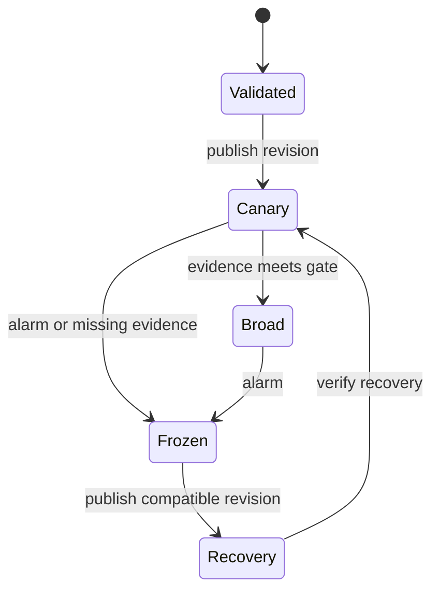

---
{
  "metadata_version": 1,
  "id": "tycho.page.9681d7dd04749125f5749d0c83f96d9b",
  "kind": "page",
  "parent_id": "tycho.chapter.5e4761e1a3e34c2f8023ec8ac4fa81d5",
  "canonical_path": "book/volumes/v08-delivery-deployment-and-recovery/c04-gitops-rollout-and-progressive-delivery/configuration-rollout.md",
  "title": "Dynamic configuration and feature flags",
  "topic_ids": [
    "software-delivery"
  ],
  "perspectives": [
    "architecture",
    "evaluation",
    "operations"
  ],
  "summary": "How can configuration change safely while different processes observe different versions?",
  "route_hints": {
    "questions": [
      "How can configuration change safely while different processes observe different versions?"
    ],
    "prerequisites": [],
    "related_ids": [
      "tycho.chapter.5e4761e1a3e34c2f8023ec8ac4fa81d5"
    ],
    "excludes": [
      "Original synthetic designs and proposed checks; no executed product experiment or independent acceptance."
    ],
    "keywords": [
      "dynamic",
      "configuration",
      "feature",
      "flags",
      "change",
      "safely",
      "while",
      "different",
      "processes",
      "observe",
      "versions"
    ]
  },
  "evidence_scope": {
    "source_ids": [
      "src.appconfig-rollout",
      "src.appconfig-validation"
    ],
    "claim_ids": [],
    "status": "source-linked",
    "notes": "Selected public evidence and limits are in the page ledger and dated inspection record. Scenarios, workloads and architecture decisions are original synthetic reasoning, not production observations."
  },
  "content_review": {
    "status": "self-checked",
    "reviewed_at": "2026-10-20",
    "reviewer": "Codex author; integration execution and independent acceptance pending",
    "proof_uri": null
  },
  "authored_at": "2026-10-20",
  "updated_at": "2026-10-20",
  "source_inspection_date": "2026-10-20",
  "content_verified_at": null
}
---

# Dynamic configuration and feature flags

**Owning question:** How can configuration change safely while different processes observe different versions?

> **Pattern atlas:**
> [Feature Flags / Feature Toggles](../../v11-pattern-atlas/c10-deployment-modernization/README.md#feature-flags-feature-toggles) — decision conditions and contraindications.

## A configuration change is a distributed transition

A feature flag selects behavior; a dynamic parameter changes an operating limit. Neither becomes simultaneous merely because its value sits outside a binary. Processes fetch at different times, disconnected workers retain old snapshots, and a rollback can encounter writes produced by the new behavior. Define the scope of consistency before choosing a configuration service.

This original design assumes an authoritative configuration publisher, authenticated readers, asynchronous snapshot delivery, and durable application data outside the configuration store. Every snapshot has a monotonically increasing revision, a payload digest, an activation policy and a minimum compatible binary version. A reader installs a complete snapshot atomically. It never assembles a request's limits from several revisions.

Separate three kinds of decision:

| Decision | Suitable propagation contract | Failure policy |
| --- | --- | --- |
| Optional interface behavior | Eventual refresh with a last-known-good snapshot | Use a documented local default |
| Concurrency or resource limit | Bounded staleness with a conservative ceiling | Stop expansion when the snapshot expires |
| Permission or irreversible action | Authoritative decision or explicit short-lived capability | Reject when authority cannot be established |

The last row cannot safely inherit the first row's convenient cache policy. A flag is also not a substitute for an authorization check.

**Feature-flag mechanism.** A flag decouples deployment from exposure by evaluating a
versioned value at request time, scoped by tenant, user or cohort, with a documented default
and kill switch. The flag service is not authoritative for permissions or irreversible
actions; those need their own decision path.

**Failure and recovery.** Stale snapshots, flag interactions, permanent flags and
unauthorized overrides are common. Audit changes, expire temporary flags, bound snapshot age
and keep a local default that fails safe. A canary or branch-by-abstraction may be preferable
when the flag would become a permanent configuration surface.

## Publish, observe, promote

The publisher validates schema and cross-field constraints, checks compatibility, records an immutable revision, and selects a small exposure cohort. Cohorts must be stable for the observation interval: hashing a tenant identifier is more useful than randomly changing the behavior on every request. Exposure percentage measures eligibility, not traffic or risk; a small cohort can contain the most expensive tenant.

Text alternative: validation precedes a canary; promotion requires evidence. An alarm freezes expansion, after which a compatible recovery revision must itself be observed. These are proposed lifecycle states, not a particular product API.

Record the revision actually used in metrics, logs and asynchronous work. A request pins its snapshot until completion; a long workflow explicitly chooses whether each step pins the original behavior or re-evaluates current policy. That choice must survive retries. Do not serialize every flag into every job if the job only needs one stable semantic decision.

## Worked example: changing a catalogue parser

Assume an invented service changes its accepted manifest format from A to A-or-B. Readers first deploy support for both formats. Revision 41 then enables B writes for one stable tenant cohort; revision 42 increases exposure after a full observation window. Every produced record carries its format version, independent of the flag revision.

At revision 42, parse failures increase. Publishing revision 43 disables new B writes. Revision 43 deliberately has a higher revision than 42 even though its behavior resembles 40. A client that rejects older revisions can therefore accept the recovery. Existing B records still require a compatible reader. Removing B support from the binary during recovery would strand those records.

A counterexample is a boolean that switches both writers and readers at once. A stale reader cannot parse a new record even if the percentage rollout appears healthy on the publisher. Another counterexample is a parameter pair updated independently: a request observes the new batch size but the old memory ceiling. Whole-snapshot installation prevents the mixed pair, but does not prove the pair is safe for all workloads.

## Failure and recovery contract

If publication succeeds but the publisher loses its response, retry using the publication identifier and compare the digest. If one process cannot refresh, report its observed revision and snapshot age; serving with an old value is a deliberate policy, not evidence of convergence. If telemetry is absent, pause promotion rather than interpreting no samples as success.

A failed publisher must not be on the critical request path for ordinary cached behavior. Conversely, isolating the publisher does not justify indefinite use of an expired security capability. Recovery can require draining jobs, retaining dual-format readers, or repairing data, in addition to changing a flag.

Operational gates should include error rate, latency, resource use, data correctness signals, cohort sample size, and the share of processes actually on the intended revision. A canary may miss a rare workload; retain an explicit exposure bound and a reversal plan even after its gate passes.

## Alternatives and decision reversal

Static configuration tied to a binary reduces the number of independent version combinations and is preferable for infrequent structural changes. A dynamic control plane pays for faster response with propagation, compatibility and audit complexity. Per-request authoritative reads simplify freshness reasoning but introduce a latency and availability dependency. A small set of versioned snapshots is often easier to reason about than many independently mutable flags.

Reconsider the design when refresh delay exceeds the decision's validity window, flag interactions multiply, or recovery repeatedly requires manual data repair. Remove a flag after its rollout ends; otherwise the configuration space becomes an untested permanent interface.

## Proposed acceptance checks and evidence limits

Exercise a stale process, a missing telemetry stream, a duplicate publication, an incompatible binary, and a rollback after durable B writes. The oracle requires whole-snapshot reads, nondecreasing accepted revisions, no unsupported record format, and no promotion without its evidence gate. Bound snapshot age separately for each decision class. These are proposed checks and have not been executed here.

[Deploying configuration](https://docs.aws.amazon.com/appconfig/latest/userguide/appconfig-deploying.html) documents staged configuration deployment and rollback controls for that product. [Configuration validators](https://docs.aws.amazon.com/appconfig/latest/userguide/appconfig-creating-configuration-and-profile-validators.html) documents validation hooks and their scope. They support separating validation from monitored rollout; they do not establish that this synthetic application's data transition is reversible. Snapshot pinning, revision 41–43 and the manifest example are original design reasoning.
## Navigation

- Parent chapter: [GitOps, rollout and progressive delivery](README.md).
- Related decision: [Safe rollout and recovery](../../../delivery/safe-rollout-and-recovery.md).
- Pattern atlas: [Feature Toggles](../../v11-pattern-atlas/c12-delivery-and-operations/README.md).

## Bounded pattern ownership notes

### Feature Flags-Feature Toggles

A flag decouples deployment from exposure by evaluating a versioned value at request time, scoped by
tenant, user or cohort, with a documented default and kill switch. The flag is runtime policy, not a
replacement for a release gate.

A flag is also not a substitute for an authorization check. Stale snapshots, flag interactions,
permanent flags and unauthorized overrides are common. Define the default on evaluation failure,
audit every override, cap the flag's lifetime and remove it after the rollout.

A canary or branch-by-abstraction may be preferable when the flag would become a permanent
configuration surface. A flag is a fit when exposure must be separable from deployment and the
evaluation path is bounded, with an owner, a cleanup date and an audit
trail.
