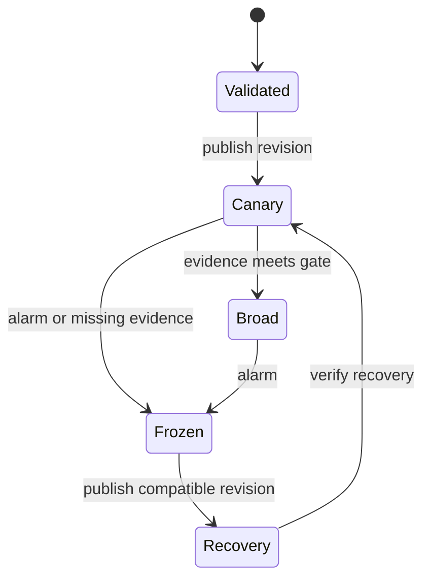

---
{
  "metadata_version": 1,
  "id": "tycho.page.9681d7dd04749125f5749d0c83f96d9b",
  "kind": "page",
  "parent_id": "tycho.chapter.5e4761e1a3e34c2f8023ec8ac4fa81d5",
  "canonical_path": "book/volumes/v08-delivery-deployment-and-recovery/c04-gitops-rollout-and-progressive-delivery/configuration-rollout.md",
  "title": "Dynamic configuration and feature flags",
  "topic_ids": [
    "software-delivery"
  ],
  "perspectives": [
    "architecture",
    "evaluation",
    "operations"
  ],
  "summary": "How can configuration change safely while different processes observe different versions?",
  "route_hints": {
    "questions": [
      "How can configuration change safely while different processes observe different versions?"
    ],
    "prerequisites": [],
    "related_ids": [
      "tycho.chapter.5e4761e1a3e34c2f8023ec8ac4fa81d5"
    ],
    "excludes": [
      "Original synthetic designs and proposed checks; no executed product experiment or independent acceptance."
    ],
    "keywords": [
      "dynamic",
      "configuration",
      "feature",
      "flags",
      "change",
      "safely",
      "while",
      "different",
      "processes",
      "observe",
      "versions"
    ]
  },
  "evidence_scope": {
    "source_ids": [
      "src.appconfig-rollout",
      "src.appconfig-validation"
    ],
    "claim_ids": [],
    "status": "source-linked",
    "notes": "Selected public evidence and limits are in the page ledger and dated inspection record. Scenarios, workloads and architecture decisions are original synthetic reasoning, not production observations."
  },
  "content_review": {
    "status": "self-checked",
    "reviewed_at": "2026-10-31",
    "reviewer": "Automated authoring agent",
    "proof_uri": null
  },
  "authored_at": "2026-10-20",
  "updated_at": "2026-10-31",
  "source_inspection_date": "2026-10-20",
  "content_verified_at": null
}
---

# Dynamic configuration and feature flags

**Owning question:** How can configuration change safely while different processes observe different versions?

> **Pattern atlas:**
> [Feature Flags / Feature Toggles](../../v11-pattern-atlas/c10-deployment-modernization/README.md#feature-flags-feature-toggles) — decision conditions and contraindications.

## A configuration change is a distributed transition

A feature flag selects behavior; a dynamic parameter changes an operating limit. Neither becomes simultaneous merely because its value sits outside a binary. Processes fetch at different times, disconnected workers retain old snapshots, and a rollback can encounter writes produced by the new behavior. Define the scope of consistency before choosing a configuration service.

This original design assumes an authoritative configuration publisher, authenticated readers, asynchronous snapshot delivery, and durable application data outside the configuration store. Every snapshot has a monotonically increasing revision, a payload digest, an activation policy and a minimum compatible binary version. A reader installs a complete snapshot atomically. It never assembles a request's limits from several revisions.

Separate three kinds of decision:

| Decision | Suitable propagation contract | Failure policy |
| --- | --- | --- |
| Optional interface behavior | Eventual refresh with a last-known-good snapshot | Use a documented local default |
| Concurrency or resource limit | Bounded staleness with a conservative ceiling | Stop expansion when the snapshot expires |
| Permission or irreversible action | Authoritative decision or explicit short-lived capability | Reject when authority cannot be established |

The last row cannot safely inherit the first row's convenient cache policy. A flag is also not a substitute for an authorization check.

**Feature-flag mechanism.** A flag decouples deployment from exposure by evaluating a
versioned value at request time, scoped by tenant, user or cohort, with a documented default
and kill switch. The flag service is not authoritative for permissions or irreversible
actions; those need their own decision path.

**Failure and recovery.** Stale snapshots, flag interactions, permanent flags and
unauthorized overrides are common. Audit changes, expire temporary flags, bound snapshot age
and keep a local default that fails safe. A canary or branch-by-abstraction may be preferable
when the flag would become a permanent configuration surface.

## Publish, observe, promote

The publisher validates schema and cross-field constraints, checks compatibility, records an immutable revision, and selects a small exposure cohort. Cohorts must be stable for the observation interval: hashing a tenant identifier is more useful than randomly changing the behavior on every request. Exposure percentage measures eligibility, not traffic or risk; a small cohort can contain the most expensive tenant.

Text alternative: validation precedes a canary; promotion requires evidence. An alarm freezes expansion, after which a compatible recovery revision must itself be observed. These are proposed lifecycle states, not a particular product API.

Record the revision actually used in metrics, logs and asynchronous work. A request pins its snapshot until completion; a long workflow explicitly chooses whether each step pins the original behavior or re-evaluates current policy. That choice must survive retries. Do not serialize every flag into every job if the job only needs one stable semantic decision.

## Worked example: changing a catalogue parser

Assume an invented service changes its accepted manifest format from A to A-or-B. Readers first deploy support for both formats. Revision 41 then enables B writes for one stable tenant cohort; revision 42 increases exposure after a full observation window. Every produced record carries its format version, independent of the flag revision.

At revision 42, parse failures increase. Publishing revision 43 disables new B writes. Revision 43 deliberately has a higher revision than 42 even though its behavior resembles 40. A client that rejects older revisions can therefore accept the recovery. Existing B records still require a compatible reader. Removing B support from the binary during recovery would strand those records.

A counterexample is a boolean that switches both writers and readers at once. A stale reader cannot parse a new record even if the percentage rollout appears healthy on the publisher. Another counterexample is a parameter pair updated independently: a request observes the new batch size but the old memory ceiling. Whole-snapshot installation prevents the mixed pair, but does not prove the pair is safe for all workloads.

## Failure and recovery contract

If publication succeeds but the publisher loses its response, retry using the publication identifier and compare the digest. If one process cannot refresh, report its observed revision and snapshot age; serving with an old value is a deliberate policy, not evidence of convergence. If telemetry is absent, pause promotion rather than interpreting no samples as success.

A failed publisher must not be on the critical request path for ordinary cached behavior. Conversely, isolating the publisher does not justify indefinite use of an expired security capability. Recovery can require draining jobs, retaining dual-format readers, or repairing data, in addition to changing a flag.

Operational gates should include error rate, latency, resource use, data correctness signals, cohort sample size, and the share of processes actually on the intended revision. A canary may miss a rare workload; retain an explicit exposure bound and a reversal plan even after its gate passes.

## Alternatives and decision reversal

Static configuration tied to a binary reduces the number of independent version combinations and is preferable for infrequent structural changes. A dynamic control plane pays for faster response with propagation, compatibility and audit complexity. Per-request authoritative reads simplify freshness reasoning but introduce a latency and availability dependency. A small set of versioned snapshots is often easier to reason about than many independently mutable flags.

Reconsider the design when refresh delay exceeds the decision's validity window, flag interactions multiply, or recovery repeatedly requires manual data repair. Remove a flag after its rollout ends; otherwise the configuration space becomes an untested permanent interface.

## Proposed acceptance checks and evidence limits

Exercise a stale process, a missing telemetry stream, a duplicate publication, an incompatible binary, and a rollback after durable B writes. The oracle requires whole-snapshot reads, nondecreasing accepted revisions, no unsupported record format, and no promotion without its evidence gate. Bound snapshot age separately for each decision class. These are proposed checks and have not been executed here.

[Deploying configuration](https://docs.aws.amazon.com/appconfig/latest/userguide/appconfig-deploying.html) documents staged configuration deployment and rollback controls for that product. [Configuration validators](https://docs.aws.amazon.com/appconfig/latest/userguide/appconfig-creating-configuration-and-profile-validators.html) documents validation hooks and their scope. They support separating validation from monitored rollout; they do not establish that this synthetic application's data transition is reversible. Snapshot pinning, revision 41–43 and the manifest example are original design reasoning.
## Navigation

- Parent chapter: [GitOps, rollout and progressive delivery](README.md).
- Related decision: [Safe rollout and recovery](../../../delivery/safe-rollout-and-recovery.md).
- Pattern atlas: [Feature Toggles](../../v11-pattern-atlas/c10-deployment-modernization/README.md#feature-flags-feature-toggles).

## Bounded pattern ownership notes

### Feature Flags-Feature Toggles

**Mechanism — runtime evaluation separates exposure from deployment (Tycho summary,
source-bound).** A runtime, versioned value scoped by tenant, user or cohort separates
exposure from deployment, with a default and kill switch. OpenFeature defines an evaluation
API that "allows for the evaluation of feature flag values, independent of any flag control
plane or vendor." Microsoft describes feature management as "a software-development practice
that decouples feature release from code deployment and enables quick changes to feature
availability on demand." AWS AppConfig deploys feature flags as versioned configuration data;
when it starts a deployment it "Caches a copy of the data so it is ready to be retrieved by
your application. This cached copy is called the deployed data." Tycho's reading: the flag
service owns the runtime decision, not the release artifact; the evaluation path needs a
stable flag key, an evaluation context, a version, a default and an observable reason.

**Invariant — evaluation is not authorization, and every decision has an age and an
audit trail (Tycho rule, source-bound).** Flags never replace an authorization check. A flag
may gate a feature, but it never grants a permission, approves an irreversible action or
substitutes for an authorization decision; when authority cannot be established, the protected
action fails closed. Microsoft places authorization of configuration requests in a separate
control: "Azure App Configuration supports authorization of requests to App Configuration
stores using Microsoft Entra ID", and "With Microsoft Entra ID, you can leverage Azure
role-based access control (Azure RBAC) to grant permissions to security principals, which can
be user principals, managed identities, or service principals."
OpenFeature exposes staleness as a provider state: `STALE` means "The provider's cached state
is no longer valid and may not be up-to-date with the source of truth", and the reason means
"The resolved value is non-authoritative or possibly out of date". LaunchDarkly keeps an
audit trail: "LaunchDarkly keeps a running log of changes made to feature flags and other
resources in each environment", and its detailed change entry lists "the member that made the
change" and "a diff of the changes". Tycho's rule: record the flag key, version, scope,
default, reason and snapshot age with each evaluation; make every override attributable to a
member and a diff; bound snapshot age; and handle a stale or error decision through the
failure contract, never as current authority.

**Failure and recovery — fail to the safe branch, keep a kill switch, and recover by
version (Tycho runbook, source-bound).** Tycho's rule: on evaluation failure the default must
be the safe branch, not a silent enable. OpenFeature requires that client operations "MUST NOT throw
exceptions, or otherwise abnormally terminate" and that "Flag evaluation calls must always
return the default value in the event of abnormal execution." A type mismatch is "considered
abnormal execution, and the supplied default value should be returned"; with no provider the
API "simply returns the supplied default flag value." Microsoft's .NET feature manager treats
the absence of a matching filter as disabled: "If no feature filter indicates that the feature
should be enabled, it's considered disabled." LaunchDarkly returns "the provided fallback
value with the ERROR evaluation reason" when its SDK is offline, and describes kill switch
flags as "permanent safety mechanisms" that "turn off non-core functionality or third-party
tools in an emergency." AWS AppConfig states that "If a distribution fails, then AWS AppConfig
rolls back the configuration." It also states that "if one or more alarms go into the alarm
state during a deployment, AWS AppConfig automatically rolls back your configuration data to
the previous version." Tycho's runbook: make the safe branch the default (disabled, deny or
no exposure); distinguish a provider error from a deliberate off state; expose and bound
snapshot age; alert on stale data; keep last-known-good only for non-authoritative decisions;
use an owned kill switch for emergency shutoff; and recover by publishing a higher, compatible
version and re-observing it. A binary rollback does not undo durable effects already produced
while the flag was on.

**Alternative — canary or branch by abstraction when the toggle becomes permanent
(Tycho choice rule, source-bound).** A canary or branch-by-abstraction is preferable when the
toggle would become permanent configuration. Microsoft lists "Percentage-based gradual
release" that exposes "a feature to a small percentage of traffic and increase it over time
(canary or staged rollout) to reduce risk". AWS AppConfig's deployment strategy "enables you
to slowly release changes to all targets or specific segments over minutes or hours", and its
bake time watches alarms and rolls back a failed deployment. LaunchDarkly separates temporary
from permanent flags: "Flags are either temporary or permanent. A temporary flag has a limited
lifespan. Once the flag has fulfilled its business purpose, remove it from the codebase." When
a release flag "will convert to a permanent flag, the definition of done should be when
the setting on the flag changes to indicate it is permanent." AWS Prescriptive Guidance
distinguishes the techniques: "The branch by abstraction pattern is often confused with
feature toggles", but "Branch by abstraction is a development technique and can be combined
with feature toggles to switch between the old and new implementation", and teams should
"remove any switching feature flag that you might have implemented." Tycho's choice rule: use
a canary when the residual risk is exposure of a deployment to a cohort; use branch by
abstraction when the real work is replacing an internal implementation behind a stable
interface; treat a permanent toggle as configuration with an owner, review cadence, audit
trail and removal date; and remove the toggle after the rollout because a permanent switch
otherwise becomes an untested interface.

**Source boundary.** Public documentation and articles, accessed 2026-10-31. No product was
deployed, no flag was evaluated and no canary, kill switch or rollback was executed. Quotes are
short excerpts; Markdown emphasis, link spacing and typography are normalized where noted.
New source ids and ledger records are added to the
shared register by this lane. Tycho-labelled sentences are synthesis, not source claims.

- OpenFeature specification, *Flag Evaluation API* and *Types and Data Structures*;
  canonical text SHA-256 `d724a522...` and `e2741a64...`; raw HTML SHA-256
  `01ca619d...` and `2a318b0d...`; records
  `read.openfeature-flag-evaluation.2026-10-31` and
  `read.openfeature-types.2026-10-31`. Living `current` documentation with no
  version selector.
- LaunchDarkly documentation, *Kill switch flags*, *Change history*, *Reducing technical
  debt from feature flags* and *Flag evaluation rules in server-side SDKs*; canonical text
  SHA-256 `3499a831...`, `1b35ea72...`, `c31b76fe...` and `2509b3e8...`; raw
  HTML SHA-256 `4217089d...`, `0cb35f78...`, `08ed1f57...` and `8e384341...`;
  records `read.launchdarkly-killswitch.2026-10-31`,
  `read.launchdarkly-change-history.2026-10-31`,
  `read.launchdarkly-technical-debt.2026-10-31` and
  `read.launchdarkly-flag-evaluation-rules.2026-10-31`.
- Microsoft Azure App Configuration, *Feature management overview*, *.NET feature
  management* and *Access Azure App Configuration using Microsoft Entra ID*; canonical text
  SHA-256 `7c503850...`, `882b33ac...` and `2859050b...`; raw HTML SHA-256
  `ff46be3a...`, `b5b8621c...` and `5ba34c3a...`; records
  `read.azure-feature-management-overview.2026-10-31`,
  `read.azure-feature-management-dotnet.2026-10-31` and
  `read.azure-appconfig-rbac.2026-10-31`.
- AWS AppConfig, *Deploying feature flags and configuration data*, *Working with deployment
  strategies* and *Deploying a configuration*; canonical text SHA-256 `07b1d0ee...`,
  `aa782c44...` and `ccfead7e...`; raw HTML SHA-256 `d6e54525...`,
  `c5a7eb77...` and `3eba9fa4...`; records
  `read.aws-appconfig-feature-flags.2026-10-31`,
  `read.aws-appconfig-deployment-strategies.2026-10-31` and
  `read.aws-appconfig-deploying.2026-10-31` under the existing
  `src.appconfig-rollout` source.
- Martin Fowler, *Feature Toggles (aka Feature Flags)*, retained record
  `read.batch5-fowler-feature-toggles.2026-10-21`; canonical text SHA-256
  `d4e1a56d...`; used for toggle categories and lifecycle, not the authorization,
  staleness or failure rules above.
- AWS Prescriptive Guidance, *Branch by abstraction pattern*, retained record
  `read.aws-branch.2026-10-29`; canonical text SHA-256 `618648d7...`; used for the
  branch-by-abstraction distinction and cleanup rule.

