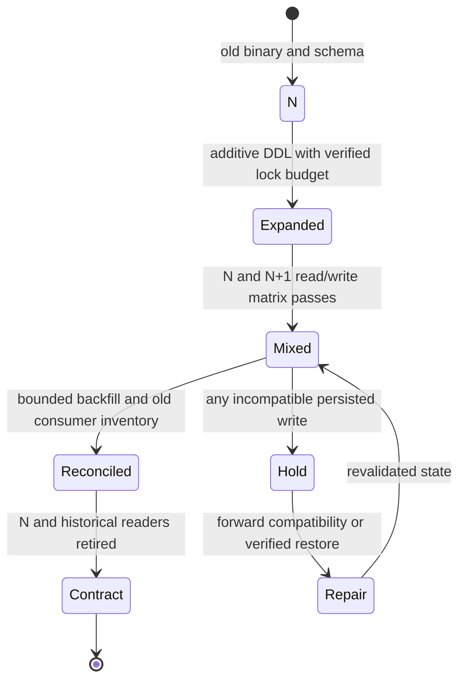

# Reader/writer compatibility and migration stages

**Owning question:** Which combinations must work during expansion, coexistence and contraction?

This page belongs to [V08/C05 — Backward-compatible database change](README.md). Use the integrated walkthrough for the surrounding decision; the sections below own this narrower mechanism and its limits.

<!-- tycho-question-source:tycho.page.77957bf0f2d44c4a9bc819fc5b3e1ddb:1 -->
## 1. Check the real combinations, including old readers

For two binary versions N and N+1 with old, expanded and contracted schema states:

| Running component / data state | Old state | Expanded transition state | Destructive new-only state |
|---|---|---|---|
| Old API N | Known baseline (still test under workload) | Must interpret new optional values and preserve existing writes | Often fails if required old field removed |
| New API N+1 | May require fallback decoder | Must read/write both old and new valid meanings | Target candidate, not safe while N active |
| Old background consumer | Can replay historical events | Must tolerate optional/mapped fields | May reject or silently misread new-only events |
| New consumer | Must still decode retained old events | Mixed-format tests required | New-only assumptions can break replay |
| Restore process | Needs version-compatible backups and readers | Must resolve historical state correctly | Old restore images may fail reading newer data |

An *additive field* may still be semantically incompatible: old code might deserialize a fixed projection, treat unknown enum values as errors, or misclassify absence as an allowed action.

<!-- /tycho-question-source -->

> **Pattern atlas:**
> [Expand-and-Contract](../../v11-pattern-atlas/c10-deployment-modernization/README.md#expand-and-contract) — decision conditions and contraindications.

<!-- tycho-question-source:tycho.page.77957bf0f2d44c4a9bc819fc5b3e1ddb:2 -->
## 2. Expand-migrate-contract includes a compatibility window

The public [Parallel Change method](https://martinfowler.com/bliki/ParallelChange.html) frames an interface expansion, client migration and eventual contract/removal. Applying that to database schemas requires versioned DB-specific locks and data invariants, not just a column rename.

**Original fictional change:** a tool-registration API replaces display_name with canonical_item_id. During coexistence, a temporary schema holds both. New writers must preserve enough old representation for old supported readers until a verified cutover. If an old row has no valid mapping, the new reader must say **unknown**, not invent an ID.

**Text alternative:** expand the representation, run a tested mixed-version phase, reconcile migrated data, and contract only after old readers are proven absent. Incompatible writes hold the rollout and may require forward repair rather than redeploying N. Nothing was actually deployed or migrated.

**Alternative.** A big-bang migration, a parallel run or a versioned API cutover may be
preferable when no mixed-version compatibility window is possible or the dataset is small
enough to migrate under a verified pause. Reverse the expand/contract choice when the
compatibility window and old-reader inventory cost exceed the migration risk.

<!-- /tycho-question-source -->

## Bounded pattern ownership notes

### Expand-and-Contract

**Mechanism — three phases over a compatibility window (Tycho summary, source-bound).**
Expand-and-contract is a rollout protocol, not a schema diagram: each phase must remain
compatible with readers still running the previous version, and the contract phase is
gated by observed reader absence. The protocol owns the compatibility window, the reader
inventory and the rollback or forward-repair decision. Fowler's Parallel Change article
describes it as "a pattern to implement backward-incompatible changes to an interface in
a safe manner, by breaking the change into three distinct phases: expand, migrate, and
contract." In the expand phase you "augment the interface to support both the old and the
new versions"; in
the migrate phase you "update all clients using the old version to the new version"; and
after that you "perform the contract phase to remove the old version and change the
interface so that it only supports the new version." AWS describes the same window for a
shared relational schema under blue/green deployment: "The schema is changed first,
before the blue/green code deployment" for additive changes, or "The schema is changed
last, after the blue/green code deployment" for deletive ones. The engine decides
whether a phase is metadata-only or a rewrite. PostgreSQL warns that "An ACCESS
EXCLUSIVE lock is acquired unless explicitly noted," and its explicit-locking page adds
that "Once acquired, a lock is normally held until the end of the transaction." MySQL's
online-DDL table marks adding a column as instant and metadata-only, while "Changing the
column data type is only supported with ALGORITHM=COPY." The phases are a deployment
protocol; the lock and rewrite profile is an engine fact.

**Invariant — every supported binary must read and write every committed row (Tycho
rule, source-bound).** New writers must preserve enough old representation for old
supported readers until a verified cutover. Fowler says "Existing clients will continue
to consume the old version, and the new changes can be introduced incrementally without
affecting them." AWS says "Database updates must be backward compatible, so the old
version of the application can still interact with the data," and requires that "your
application can tolerate the presence of additional fields in existing tables." Tycho's
invariant: during the whole window, every committed row must be readable by each
supported binary, and every write must be representable in both encodings; an additive
column is not automatically compatible if an old decoder rejects unknown values, a new
required field is written before old writers stop, or a backfill changes meaning. The
compatibility window needs an owner, a reader inventory and a measured cutover gate; a
matrix without real reader evidence is a guess. PostgreSQL's `DROP COLUMN` makes a
column "invisible to SQL operations" rather than removing it physically, so contraction
is a visibility change, not proof that old readers are gone; the reader inventory remains
the gate. MySQL's instant add/drop path removes the table copy, not the compatibility
obligation.

**Failure and recovery — hold the window, repair forward, contract only after proof
(Tycho runbook, source-bound mechanics).** Incompatible writes hold the rollout and may
require forward repair rather than redeploying N. AWS warns that a deletive approach
carries "an increased risk" because "failures in the schema modification process can
impact your production environment," and after removal "the earlier application version
is no longer operational"; a rollback therefore needs the blue environment's data to be
current. PostgreSQL exposes two concrete hazards: a volatile default on `ADD COLUMN`
"will cause the entire table and its indexes to be rewritten," and "The rewriting forms
of ALTER TABLE are not MVCC-safe" — after a rewrite, "the table will appear empty to
concurrent transactions" that hold an older snapshot. MySQL exposes a phase-cycle
budget: each instant add or drop creates a row version, "The maximum number of row
versions permitted is 64 (255 as of MySQL 9.1.0)," and when the limit is reached the
engine rejects further instant changes and recommends rebuilding with "COPY/INPLACE."
Tycho's recovery order: stop new-format writes or route them through the old writer;
keep the expanded representation; reconcile and validate the backfill; restore old-reader
service before any contract; and prefer a forward fix over dropping the old
representation. A `DROP COLUMN` or a destructive rewrite is not a rollback path.

**Alternative — explicit versioning, branch by abstraction, or engine-native online
DDL (Tycho choice rule, source-bound trade-offs).** A big-bang migration, a parallel run
or a versioned API cutover may be preferable when no mixed-version compatibility window
is possible or the dataset is small enough to migrate under a verified pause. Fowler
presents parallel change as "an alternative to using an explicit version in the exposed
API," and adds that with a large number of clients "using branch by abstraction is a
better strategy to narrow the surface of change." MySQL's instant and in-place
algorithms are an engine-native alternative for a single compatible change: they avoid a
table copy and permit concurrent DML, but a type change is COPY-only and "Concurrent DML
is not permitted." Use expand-and-contract when old and new readers must coexist and the
change cannot be made compatible in one DDL step; use direct or online migration when
the change is additive and the engine can complete it without blocking; use explicit
versioning or branch by abstraction when the caller population is large or the interface
cannot carry both meanings. Expand-and-contract is a fit when old and new readers must
coexist; reverse when the compatibility window, reader inventory and dual-write cost
exceed the migration risk.

**Source boundary.** Public sources accessed 2026-10-31; the retained AWS record is
reused byte-for-byte. These are documentation and articles, not benchmarks or executed
tests. Quotes are short excerpts. Markdown escapes, emphasis, curly quotes and
link-extraction spacing are normalized; Tycho-labelled sentences are synthesis, not
source claims. Records (proposed unless marked retained):

- Danilo Sato, "Parallel Change," martinfowler.com, published 2014-05-13; canonical
  text SHA-256
  `af2cd77b9048f39fdee984b371305ecc362f236d485a21ff02008a65787dfed7`; raw HTML
  SHA-256 `4d958f564dc7e44e12b4233202d20cdadd1e0ba30a9ccfc0517d1a568f6d8bcc`;
  source `src.fowler-parallel-change` and record
  `read.fowler-parallel-change.2026-10-31` proposed. The page is a living bliki
  article with no version selector; the digest pins the representation.
- AWS, "Best Practices for Managing Data Synchronization and Schema Changes," Blue/Green
  Deployments on AWS, marked historical reference; retained record
  `read.aws-blue-green-data.2026-10-30`; raw HTML SHA-256
  `07eaa6ff45ca86872f743c07deb17577761f1216e04a840de89ae9c5bfa99442` matches
  the record exactly. No new record is required.
- PostgreSQL 18.6, "ALTER TABLE" and "Explicit Locking"; canonical text SHA-256
  `2f8630304b6159e52681a0d9502a1d09b497da7ffb8918b86c0ebf4d76003924` and
  `defdd38bf3d5aeaa3174012e51c6e02c56cb76e1153fc21da8c5ffcb42646e23`; raw HTML
  SHA-256 `d9f4df96a79a07b39a58a6820c8ed5753d8dd80bd7b60bddb0f31525591f1a76` and
  `88b12e1ceb015e5cd9326e6b43a6f5b6160c3970f19416e5160522da611274cb`; records
  `read.postgresql-alter-table.2026-10-31` and
  `read.postgresql-explicit-locking.2026-10-31` proposed.
- MySQL 8.4 Reference Manual, "Online DDL Operations" and "ALTER TABLE"; canonical text
  SHA-256
  `6f7b0113f99388ab4a29f9016a05fedb46b86277174162fe4bc5cbca295de3de` and
  `d47cb8ed8933e515b8ec2771583aeea9916741840eb45704c2a5235a9c5d92f2`; raw HTML
  SHA-256 `aa0f53d803220d1745b029c1a75639281096982087d08bf9b6f32d342f42b6ae` and
  `942e4f1e5eee59463efa1a0a1d8276ef2579c228b3b3f99cb1b10acfe028f1e6`; records
  `read.mysql-online-ddl.2026-10-31` and `read.mysql-alter-table.2026-10-31`
  proposed. The representation is the Oracle-hosted manual copy because the
  dev.mysql.com URL returned HTTP 403 on 2026-10-31.

## Navigation, prerequisites and source scope

| Route | Destination |
|---|---|
| Parent and source ledger | [Chapter introduction and exact source rows](README.md#chapter-source-ledger) |
| Previous / prerequisite | [Read preceding context](mixed-version-database-compatibility-and-online-ddl.md) |
| Next | [Continue the reasoning](ddl-events.md) |
| Integrated question | [Original scenario and limits](mixed-version-database-compatibility-and-online-ddl.md) |

The source material keeps its original published/inferred/synthetic/unverified distinctions. Chapter-wide citations are shared reference context, not proof that every cited source supports every sentence on this page. Freshly inspected text is identified explicitly; absent dates and unknowns are retained.
