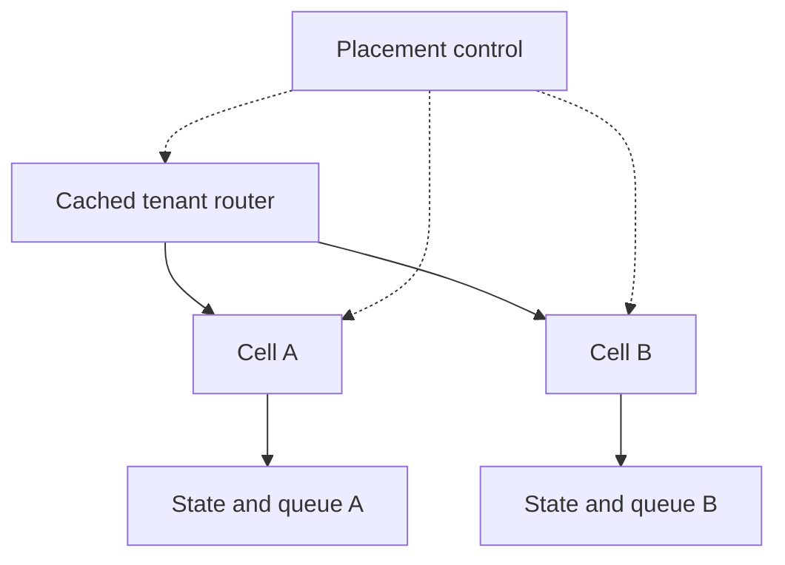

---
{
  "metadata_version": 1,
  "id": "tycho.page.1849584c8a3fadc9e06c8d2edead5789",
  "kind": "page",
  "parent_id": "tycho.chapter.9e35eb7b056f428093e36a2faf644a23",
  "canonical_path": "book/volumes/v08-delivery-deployment-and-recovery/c06-high-availability-and-failure-domain-placement/cells-shuffle-sharding.md",
  "title": "Cells and shuffle sharding",
  "topic_ids": [
    "deployment-architecture"
  ],
  "perspectives": [
    "architecture",
    "evaluation",
    "operations"
  ],
  "summary": "Which state, routing and rollout boundaries actually contain a tenant-triggered failure?",
  "route_hints": {
    "questions": [
      "Which state, routing and rollout boundaries actually contain a tenant-triggered failure?"
    ],
    "prerequisites": [],
    "related_ids": [
      "tycho.chapter.9e35eb7b056f428093e36a2faf644a23"
    ],
    "excludes": [
      "Original synthetic designs and proposed checks; no executed product experiment or independent acceptance."
    ],
    "keywords": [
      "cells",
      "shuffle",
      "sharding",
      "which",
      "state",
      "routing",
      "rollout",
      "boundaries",
      "actually",
      "contain",
      "tenant-triggered",
      "failure"
    ]
  },
  "evidence_scope": {
    "source_ids": [
      "src.cell-boundaries",
      "src.shuffle-shard-isolation"
    ],
    "claim_ids": [],
    "status": "source-linked",
    "notes": "Selected public evidence and limits are in the page ledger and dated inspection record. Scenarios, workloads and architecture decisions are original synthetic reasoning, not production observations."
  },
  "content_review": {
    "status": "self-checked",
    "reviewed_at": "2026-10-20",
    "reviewer": "Codex author; integration execution and independent acceptance pending",
    "proof_uri": null
  },
  "authored_at": "2026-10-20",
  "updated_at": "2026-10-20",
  "source_inspection_date": "2026-10-20",
  "content_verified_at": null
}
---

# Cells and shuffle sharding

**Owning question:** Which state, routing and rollout boundaries actually contain a tenant-triggered failure?

> **Pattern atlas:**
> [Cell-Based Architecture](../../v11-pattern-atlas/c09-scalability/README.md#cell-based-architecture) — decision conditions and contraindications.
> [Shuffle Sharding](../../v11-pattern-atlas/c09-scalability/README.md#shuffle-sharding) — decision conditions and contraindications.
> [Deployment Stamps](../../v11-pattern-atlas/c09-scalability/README.md#deployment-stamps) — decision conditions and contraindications.

## A cell is a boundary in the dependency graph

A cell serves a bounded population with its own capacity and failure domain. Merely naming a group of stateless workers a cell does not isolate a shared database, queue, cache or configuration publisher. Trace every dependency that a tenant can exhaust, corrupt or stall, and state which failures cross the boundary.

This original design assumes a request can be assigned to a tenant, tenant state has an authoritative home, and placement can be changed through a controlled migration. It uses a thin routing layer, per-cell serving resources, and a control plane for provisioning and migration. Existing placement remains usable when the control plane is unavailable.

| Boundary | Required isolation argument | Typical escape path |
| --- | --- | --- |
| Compute | Bounded queues, concurrency and work per request | A costly request consumes shared scheduler capacity |
| Durable state | Cell-owned partitions and connection budgets | All cells share one saturated write endpoint |
| Asynchronous work | Separate capacity or enforced reservations | One retry stream fills a shared queue |
| Rollout | Independent cohorts and staged promotion | One bad revision reaches all cells simultaneously |
| Routing | Cached placement and explicit epochs | Stale routing writes into both old and new homes |

“Independent” here means independent against specified failures. A shared regional network or identity dependency remains a common failure mode and needs its own declared behavior.

## Cells and shuffle shards solve different placement questions

A fixed cell gives a tenant a durable home and a clear population boundary. A shuffle shard selects a small subset from a worker pool, so different tenants overlap in only some of their eligible workers. It can reduce the population affected by one tenant exhausting its assigned subset. It does not, by itself, partition durable state or guarantee a fixed percentage of impact.

An original example assigns tenant A workers {1, 4}, tenant B {2, 5}, and tenant C {4, 6}. If A occupies both its workers, B has no direct worker overlap; C shares worker 4 but may still use 6. That last conclusion requires retry and dispatch behavior that can actually use 6, bounded queues, and no shared bottleneck underneath. If all workers await one shared database pool, the endpoint assignment proves little.

Do not assume assignments are statistically independent just because they use a hash. Capacity skew, placement constraints, correlated failure and retries all change overlap and impact. Measure or model the actual assignment algorithm and tenant workload.

Text alternative: a router uses cached tenant placement to reach one of two cells, each owning its state and queue. A separate placement control plane updates routing and cells. Shared dependencies omitted from this synthetic diagram must be audited separately; omission is not an isolation claim.

## Worked failure: poison request and migration

Suppose an invented transformation tenant repeatedly submits an input that causes exceptionally expensive parsing. Admission first enforces its request size and work budget; its cell then caps concurrency and queue length. Other tenants in that cell may still experience contention, which is part of the declared impact boundary. Requests must not automatically spill into every other cell when the first is full.

To move the tenant, create destination capacity, copy state to a checkpoint and transfer the final change stream. Fence source writes with a new placement epoch before enabling destination writes. A stale router receives a redirect or explicit retry signal; it cannot continue modifying the old home. The exact fencing mechanism depends on the state store and must itself survive a source-process crash.

If the migration coordinator fails after fencing but before destination activation, availability may pause. Recovery reads durable migration state and resumes the same transition. Allowing both homes to accept writes to hide this pause would introduce a separate multiwriter problem. A consistent ownership boundary is more valuable than an undocumented split.

## Failure and recovery policies

A cell outage needs reserved recovery capacity, a reconstructible durable state path, and a bounded reassignment rate. Moving every tenant immediately can exhaust survivors. Prefer a published degraded-service policy, paced recovery and protected capacity for unaffected tenants.

A control-plane outage freezes new placement changes while existing assignments remain usable within their validity rules. A compromised or semantically invalid configuration is different: caching cannot make it safe. A rollout therefore needs cohorts across cells, compatibility checks, and an abort path that does not simultaneously evict every tenant.

Restore data into an isolated destination and reconcile its ownership epoch before advertising it. Never restore a stale placement snapshot as authority over a newer migration.

## Cost and alternatives

Dedicated cells increase idle headroom and operational objects. Shuffle sharding can use a pool more efficiently but complicates placement, retry behavior and overlap analysis. A shared service with strong per-tenant admission may be sufficient when its common dependency risk is acceptable. A dedicated deployment per tenant provides a clearer boundary at a greater management cost.

Reverse the cell decision if partitioning state creates more risk than the specified shared failure, or if the smallest viable cell is too large for the tenant population. Reverse a shuffle-shard decision if workload skew makes eligible subsets unusable or users require a deterministic placement boundary that the assignment cannot provide.

## Proposed acceptance and evidence

Inject a poison input, saturated shared dependency, unavailable control plane, stale router, interrupted migration and failed recovery destination. The oracle checks that write ownership has one valid epoch, queue and connection budgets remain bounded, and unrelated cells retain their declared service envelope. Count shared failures explicitly rather than attributing every slowdown to the affected cell. No such fault test was executed here.

[Cell-based architecture fault isolation](https://docs.aws.amazon.com/wellarchitected/latest/reducing-scope-of-impact-with-cell-based-architecture/what-is-a-cell-based-architecture.html) describes bounded cells and routing/control responsibilities. [Shuffle sharding fault isolation](https://aws.amazon.com/blogs/architecture/shuffle-sharding-massive-and-magical-fault-isolation/) describes overlapping worker subsets and retry-dependent isolation. The worker sets, migration protocol and failure oracles above are original design examples; they do not inherit a numerical impact guarantee from either source.

## Bounded pattern ownership notes

These notes define the decision boundary for atlas cards whose mechanism is
not the main subject of this page. They are synthetic design guidance, not
measured evidence, and they do not create a new source claim.

### Deployment Stamps

A deployment stamp is an independently operated deployment unit used for scale, isolation
or locality. It needs a routing key, a state authority, a deployment and upgrade process
and a rule for shared global dependencies. Use it when stamps can fail or change
independently and the duplication cost is justified. Do not use it when a single
deployment meets the objective or when stamps still share an unowned global dependency.

The failure path is configuration drift or split state across stamps; version the stamp
definition, route by an explicit key and reconcile state at the authority. A cell-based
deployment is the alternative when isolation is the main goal and scale is secondary.

**Limits.** Stamp duplication, routing-key changes and global dependencies are costs; a stamp
without a data authority or upgrade owner becomes a snowflake.
## Bounded pattern ownership notes

### Cell-Based Architecture

A cell serves a bounded population with its own capacity and failure domain. A cell-based
architecture runs multiple copies of the serving stack, each with a routing key and a data partition,
so one cell's failure affects only its population.

The boundary is only real if every dependency is cell-scoped. A shared database, queue, cache,
control plane or configuration publisher can make all cells fail together; trace every dependency a
tenant can exhaust or corrupt and test the blast radius. Operations need per-cell capacity, routing,
evacuation and reassignment, plus a control plane that survives one cell's loss.

A single deployment with failure-domain isolation may be preferable when the population is small and
cell duplication cannot be justified. Cells are a fit when tenant isolation and bounded blast radius
matter enough to pay the placement, data-partition and control-plane cost.

### Shuffle Sharding

A shuffle shard selects a random subset of workers for each tenant, so different tenants overlap
in only some of their eligible workers. A failed worker affects every tenant whose subset includes
it; with shard size s from a pool of N, that is roughly s/N of tenants, not an unconditional
reduction versus a fixed shard.

Hash-based assignment alone does not prove statistical independence. A shared database pool can
dominate the worker assignment. Test the actual dependency
graph, the assignment stability across restarts, the shard size and the measured tenant overlap
under pool changes. Too few shards or an unstable assignment erodes the isolation benefit.

Containment after a failed worker requires reassigning affected tenants and rechecking the
shared dependency graph; replacing the worker alone can preserve the same overlap. Measure
recovery time and tenant impact, not only steady-state isolation.

A fixed cell anchors one tenant to a known home and population boundary. Shuffle sharding is
preferable when many tenants share a pool and measured overlap reduces correlated failure without
dedicating a cell to each one.

## Navigation

- Parent chapter: [High availability and failure-domain placement](README.md).
- [Integrated decision](availability-zones-placement-and-failure-domains.md).
- Pattern atlas: [Shuffle Sharding](../../v11-pattern-atlas/c09-scalability/README.md).
