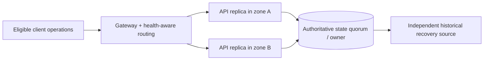

# Shared dependencies and replica placement

**Owning question:** Which dependency sets remain common despite nominal zone diversity?

This page belongs to [V08/C06 — High availability and failure-domain placement](README.md). Use the integrated walkthrough for the surrounding decision; the sections below own this narrower mechanism and its limits.

<!-- tycho-question-source:tycho.page.6b3725950fad4c0db82417b3d0225d32:1 -->
## 1. Failure domains are dependency sets, not just geographical labels

Potentially shared elements include:
- host, disk, node pool, hypervisor or availability zone;
- network routes, ingress gateways, certificate/secret services;
- orchestration control plane, scheduler and artifact registry;
- database primary, storage quorum, coordination service or failover policy;
- common service identity, DNS, external API and global rate quota;
- regional power/connectivity and operator access to recovery tooling.

An availability design should state which faults it intends to survive **without violating state authority**. Placing web workers in different zones while retaining one unreplicated database does not satisfy a whole-journey zonal failure objective.

<!-- /tycho-question-source -->
<!-- tycho-question-source:tycho.page.6b3725950fad4c0db82417b3d0225d32:2 -->
## 2. Redundancy must be combined with correct traffic routing

Original fictional example: a public tool catalogue serves read-only descriptions and accepts reservations. The proposed design has two independently placed API replicas and an authoritative database cluster with documented quorum/replication behavior.

**Text alternative:** two API replicas in separate placement domains may improve tolerance of one compute zone failure, but both still depend on a correctly configured shared state authority and gateway. Backup is separately shown because replica redundancy is not equivalent to point-in-time recovery. This is a conceptual topology; no actual cluster was set up.

A **readiness probe** may help route traffic only to prepared pods, but a successful process-health check does not prove a transaction, identity or user contract is correct. A cluster may keep processes running when it cannot reach a quorum. Health conditions should include just enough dependency/readiness state for safe routing and not create self-amplifying restarts.

<!-- /tycho-question-source -->
<!-- tycho-question-source:tycho.page.6b3725950fad4c0db82417b3d0225d32:3 -->
## 3. Kubernetes placement as an illustrative mechanism

[Kubernetes Pod Topology Spread Constraints](https://kubernetes.io/docs/concepts/scheduling-eviction/topology-spread-constraints/) use labels and policy to influence or require distribution across domains such as nodes or zones. Policy choices like DoNotSchedule and ScheduleAnyway differ: one may leave replicas pending when constraints are unmet; the other may permit uneven placement.

Their enforcement is not an all-times guarantee that replicas always remain balanced after later node removal, and placement itself does not provide database consistency or regional data recovery.

| Choice | Can improve | Must verify |
|---|---|---|
| Spread replicas across nodes | Host-loss tolerance | Shared node/pool storage/network boundaries |
| Spread across zones | Zonal compute availability | Gateway and authoritative data can survive zone failure |
| Prefer placement but permit skew | Scheduling flexibility | Real placement may violate intended availability |
| Require eligible placement | Stronger scheduling constraint | Insufficient capacity can leave work unscheduled |
| Run active replicas in separate regions | Geographic reach and possible independent failure domains | State coordination, routing consistency, latency and conflict policy |

**Caveat:** pod scheduling options are *one* product implementation. They should not determine the architecture of a non-Kubernetes workload without considering its actual runtime placement controls.

<!-- /tycho-question-source -->

## Navigation, prerequisites and source scope

| Route | Destination |
|---|---|
| Parent and source ledger | [Chapter introduction and exact source rows](README.md#chapter-source-ledger) |
| Previous / prerequisite | [Read preceding context](availability-zones-placement-and-failure-domains.md) |
| Next | [Continue the reasoning](authority-availability.md) |
| Integrated question | [Original scenario and limits](availability-zones-placement-and-failure-domains.md) |

The source material keeps its original published/inferred/synthetic/unverified distinctions. Chapter-wide citations are shared reference context, not proof that every cited source supports every sentence on this page. Freshly inspected text is identified explicitly; absent dates and unknowns are retained.
