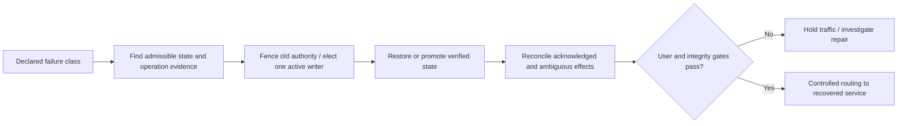

# Recovery state machines, fencing and failback

**Owning question:** Which steps prevent two writers and demonstrate recovered user journeys?

This page belongs to [V08/C07 — Multi-region recovery and data reconciliation](README.md). Use the integrated walkthrough for the surrounding decision; the sections below own this narrower mechanism and its limits.

<!-- tycho-question-source:tycho.page.2f6602f8e20b4f80a22e0ef85a6d1765:3 -->
## 3. Original synthetic recovery scenario

A fictional tool-booking system runs in region A with a recoverable copy in region B. A network partition disconnects A while clients still send requests. The recovery team cannot tell whether the last booking reply was lost before or after durable commit.

A safe conceptual recovery sequence:
1. Declare the failure scope and stop blindly creating new authority.
2. Collect last known durable state and accepted operation identities from available evidence.
3. Authorize **one** active writer and fence or isolate any old writer capable of returning.
4. Select a recoverable database state and record its revision/timeline.
5. Reconcile accepted/rejected/unknown operation IDs with any externally committed effects.
6. Verify authorization, exclusive reservations, idempotent retries and current client contract.
7. Cut traffic, monitor user-correct outcomes and preserve an abort/forward-repair plan.
8. Publish the actual measured recovery interval and actual known loss, not just the desired target.

**Text alternative:** first establish the failure and authority boundaries, then promote or restore a valid state while preventing split-brain. Reconcile previous acknowledged and unknown effects and verify a real user journey before routing traffic. This is not an executed recovery exercise.

### Worked recovery dilemma: the missing acknowledgment and two possible primaries

**Original fictional history:** region A accepts operation K42, commits booking R7 locally and loses network reachability before the caller receives a response. Region B's asynchronous replica has applied an earlier position but not necessarily R7. A new request reaches B while A may still be alive. This is **not evidence of a particular database's implemented failover**; it illustrates an authority boundary.

| State | What an operator actually knows | Safe gate |
|---|---|---|
| A unreachable from control plane | Region or network partition; A may still accept writes | Do **not** declare A dead solely because a heartbeat is missing |
| B considered for promotion | Its replay point, committed operation IDs and lag can be inspected | Verify A is fenced/isolated against new writes before granting B write authority |
| B promoted | B may not contain acknowledged or ambiguous A operations | Identify the chosen recovery point and its **actual** RPO consequence |
| Caller retries K42 | R7 may exist only in A's unreachable history | Treat K42 as unresolved until durable reconciliation; never create a conflicting booking merely because B lacks it |
| A returns | A may have divergent, even previously acknowledged writes | Quarantine old authority; reconcile under one selected source of truth before returning traffic |

**Critical distinction:** *fencing old writes* and *recovering historical acknowledged effects* are separate conditions. Fencing prevents future split-brain; it cannot retroactively make B contain the missing commit. A zero-loss promise would require a suitable acknowledgment/replication protocol with explicit behavior under region partitions and the corresponding availability trade-off. Backups protect against corruption/deletion but cannot by themselves replace a live fencing decision.

**Failback.** Returning traffic to A is a new migration, not the inverse of failover.
Quarantine A, reconcile any divergent writes under one selected authority, verify user
journeys, then reintroduce A as a replica or standby before considering promotion. A
failback that merely points DNS back can resurrect stale writes and split authority.

**Alternative.** Stay on the promoted region and rebuild the old region as a standby when
failback risk exceeds its benefit. Active-active operation requires conflict-free data
ownership and is not a safe default for one authoritative invariant. Reverse the failback
choice when reconciliation evidence is incomplete or the old region cannot be fenced.

**Negative counterexample:** an automated failover sees three missed heartbeats and instantly promotes B, while isolated A continues authorizing bookings. Both sides can now accept the same exclusive resource. A green health probe for each region is compatible with a broken global invariant.

**Proposed drill, not performed:** commit a named operation immediately before partition, record the last durable replication location at both regions, sever controller connectivity while maintaining a client path to A, then require deterministic old-writer fencing, ledger reconciliation and user-level outcome checks before exposing B. Measure RTO from impact to *correct* user capability; measure RPO against the declared acknowledged-operation boundary. If fencing or historical-state evidence is unavailable, **hold writes** rather than claim successful recovery. The [PostgreSQL PITR owner](../../v05-data-models-engines-and-lifecycle/c07-replication-backups-and-restore-drills/backup-restore-pitr-and-recovery-drills.md) covers database restore internals; this chapter owns region-level authority and business correctness.

<!-- /tycho-question-source -->

> **Pattern atlas:**
> [Failover / Failback](../../v11-pattern-atlas/c07-resilience/README.md#failover--failback) — decision conditions and contraindications.

<!-- tycho-question-source:tycho.page.2f6602f8e20b4f80a22e0ef85a6d1765:5 -->
## 5. Recovery is a state machine with abort conditions

A robust runbook includes:
- trigger and initial triage;
- evidence of old-writer fencing;
- exact recovery source and validated backup/replica timeline;
- proof that required secrets, artifacts, schema versions and access policies exist;
- controlled promotion steps and user-level synthetic/admitted checks;
- actual timestamped RTO/RPO observation;
- treatment of delayed messages, replay, read-projection rebuild and reconciliation;
- explicit no-go and stop/abort conditions;
- return-to-normal/repair of the original region without creating a second writer.

[Recovery automation best practice](https://docs.aws.amazon.com/wellarchitected/latest/reliability-pillar/rel_planning_for_recovery_auto_recovery.html) explicitly emphasizes mechanisms to stop unsafe automated recovery. An automation that cannot be halted while it risks corrupting state is not a reliable DR strategy.

<!-- /tycho-question-source -->
<!-- tycho-question-source:tycho.page.2f6602f8e20b4f80a22e0ef85a6d1765:6 -->
## 6. Falsifiable drill protocol

A safe isolated drill should create known accepted operations, checkpoint their IDs, simulate one declared failure, restore or promote state, and compare actual business outcomes. It should also inject:
- region link partition with old primary returning late;
- missing replica data and delayed WAL;
- corrupted historical state copied to standby;
- lost client acknowledgment after commit;
- an old message redelivered after promotion;
- credential/artifact unavailability;
- incomplete recovery configuration;
- operational rollback attempted after incompatible writes.

No such drills were performed in this chapter. A green health endpoint or replica process alone does not prove a recovered booking journey and restored authoritative truth.

<!-- /tycho-question-source -->

## Navigation, prerequisites and source scope

| Route | Destination |
|---|---|
| Parent and source ledger | [Chapter introduction and exact source rows](README.md#chapter-source-ledger) |
| Previous / prerequisite | [Read preceding context](objectives-strategies.md) |
| Next | [Continue the reasoning](README.md) |
| Integrated question | [Original scenario and limits](disaster-recovery-and-recovery-objectives.md) |

The source material keeps its original published/inferred/synthetic/unverified distinctions. Chapter-wide citations are shared reference context, not proof that every cited source supports every sentence on this page. Freshly inspected text is identified explicitly; absent dates and unknowns are retained.

## Bounded pattern ownership notes

### Failover-Failback

**Mechanism.** Failover moves authority from region A to a surviving region B under an
explicit decision; failback is a second migration from B back to A, not the inverse
operation. PostgreSQL defines the database step: "If the primary server fails then the
standby server should begin failover procedures", and promotion of a log-shipping standby
runs `pg_ctl promote` or `pg_promote()`. Route 53 defines the traffic step: active-passive
failover keeps a secondary "on standby in case all the primary resources become
unavailable", and "When the primary resource is unhealthy, Route 53 responds to DNS queries
using the secondary record." **Tycho reading:** health-checked DNS moves clients; it does
not move data authority, replication position or accepted operation history.

**Invariant.** Quarantine A, reconcile any divergent writes under one selected authority,
verify user journeys, then reintroduce A as a replica or standby before considering
promotion. PostgreSQL says that when the old primary restarts "you must have a mechanism
for informing the old primary that it is no longer the primary"; STONITH is "necessary to
avoid situations where both systems think they are the primary, which will lead to
confusion and ultimately data loss." Azure Site Recovery requires the source VM to be shut
down before failback and synchronization to be complete before the operation. **Tycho
rule:** record an authority epoch, fencing evidence and a reconciled operation ledger
before routing; a green health check is not fencing.

**Failure and recovery.** A failback that merely points DNS back can resurrect stale
writes and split authority. Route 53 documents that active-passive selection follows
health status, and its weighted variant warns that the setup "can make your web
application or website unreliable" when the last healthy resource cannot absorb the load.
PostgreSQL records the consequence of two primaries as "confusion and ultimately data
loss". Azure Site Recovery warns that "If the source VM is powered on then it fails and
thus fails the failback operation." Google SRE describes offline disaster recovery tools
that compute a "checkpoint state that is equivalent to cleanly stopping the service" and
says that if the offline constraints "must be broken, it’s much harder to show confidence
that the associated tool implementation will work at any time on short notice." **Tycho
runbook:** keep the old writer fenced, reconcile accepted and unknown operations, verify a
real user journey, and record the achieved RPO/RTO and any loss before declaring recovery.

**Alternative.** Stay on the promoted region and rebuild the old region as a standby when
failback risk exceeds its benefit. PostgreSQL says "To return to normal operation, a
standby server must be recreated, either on the former primary system when it comes up, or
on a third, possibly new, system"; `pg_rewind` can shorten that rebuild. Azure Site
Recovery's reprotect step "sends initial data to the target location, and then replicates
delta information for the VMs to the target". **Tycho choice rule:** failback is a new
migration, not a rollback; if fencing or reconciliation evidence is incomplete, keep
serving from the promoted region and rebuild the old region as a standby instead.

**Limits.** Retention, replication lag and application consistency determine the actual
recovery point; an untested failback is a hypothesis. Record the authority owner, the
fencing evidence, the reconciliation result and the last drill date.

**Bound source limits.** Five public units were inspected on 2026-10-31: AWS Route 53,
*Active-active and active-passive failover*; Azure Site Recovery, *Run a failover from
on-premises to Azure* and *Tutorial: Fail back Azure VM to the primary region*; PostgreSQL
17, *26.3. Failover*; and Google SRE, *Testing for Reliability*, section *Testing
Disaster*. The exact units are
<https://docs.aws.amazon.com/Route53/latest/DeveloperGuide/dns-failover-types.html>,
<https://learn.microsoft.com/en-us/azure/site-recovery/site-recovery-failover>,
<https://learn.microsoft.com/en-us/azure/site-recovery/azure-to-azure-tutorial-failback>,
<https://www.postgresql.org/docs/17/warm-standby-failover.html> and
<https://sre.google/sre-book/testing-reliability/>. Proposed records:
`read.aws-route53-failover.2026-10-31`, `read.azure-asr-failover.2026-10-31`,
`read.azure-asr-failback.2026-10-31`, `read.pg-failover.2026-10-31` and
`read.sre-testing-disaster.2026-10-31`; `src.aws-route53` and `src.azure-site-recovery`
are proposed pending registration. They are documentation and a book chapter, not
benchmarks or production observations. The PostgreSQL page has no Last-Modified header
or ETag; the AWS and Azure pages carry Last-Modified timestamps. No database, DNS change,
failover, failback or disaster exercise was run. The authority-epoch rule, reconciliation
order, user-journey gate and choice rule remain Tycho guidance.
