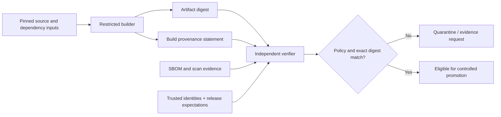

# Artifact subjects, provenance and component inventories

**Owning question:** What does each evidence object describe and what does it omit?

This page belongs to [V08/C02 — Supply chain and release verification](README.md). Use the integrated walkthrough for the surrounding decision; the sections below own this narrower mechanism and its limits.

<!-- tycho-question-source:tycho.page.38bb8a14ebb54866a7004080318b47e1:1 -->
## 1. Distinguish evidence objects and subjects

| Evidence object | What it can describe | What it cannot establish alone |
|---|---|---|
| Source commit/revision | Versioned authoring input | Whether the same bytes produced the deployed artifact |
| Artifact digest | Exact bytes/identity of built object under selected digest algorithm | Their intended source, quality or deployment permission |
| Build provenance | Builder identity, build process and materials/parameters within declared scope | Runtime correctness or complete dependency/vulnerability freedom |
| Signature / attestation envelope | Cryptographic link between a statement and an authenticated key/identity | Whether the signer was authorized or its statement true |
| SBOM | Identified components/relationships/licenses according to format and generator coverage | Absence of undiscovered dependencies or exploitable behavior |
| Vulnerability/security report | Scanner observations at a point in time with known inputs/databases | Complete and eternal absence of defects |
| Policy verification record | Exact checks and applicable source/builder/target requirements that passed | Future runtime success after configuration/data changes |
| Runtime admission result | An authorized target accepted a verified artifact under a declared policy | That a user-visible invariant is preserved under real load |

The artifact is the **subject**, not a mutable tag. A signed attestation bound to digest A is not evidence for digest B even if both share an image name. Treat documentation-derived source identity, runtime deployment identity and release approval identity as separate checks.

<!-- /tycho-question-source -->
<!-- tycho-question-source:tycho.page.38bb8a14ebb54866a7004080318b47e1:2 -->
## 2. SLSA 1.2: levels and provenance have explicit scopes

[SLSA specification 1.2](https://slsa.dev/spec/v1.2/) distinguishes **Build** and **Source** tracks. The [Build Track Basics](https://slsa.dev/spec/v1.2/build-track-basics) describe progression from Build L1, where provenance exists, to Build L2, where a hosted build platform generates signed provenance, and Build L3, where platform hardening provides stronger resistance to build-time tampering. A versioned level is not automatically attained because one artifact has an attestation.

The [SLSA verification guide](https://slsa.dev/spec/v1.2/verifying-artifacts) describes policy-based checking of the expected builder identity, provenance signature, build type and parameters, among other requirements. Consumer verification must know what it expects: accepting any validly signed statement is not a meaningful supply-chain policy.

**Text alternative:** a restricted builder produces a content-addressed artifact and a provenance statement. A separate verifier binds the artifact digest, attestation and SBOM to expected builder/source/identity policies. Failure blocks promotion; passing allows *candidate eligibility*, not automatic proof of operational safety.

There are at least three distinct questions: **Was this built from the intended inputs?** **Did an allowed builder produce it under an acceptable process?** **Does it satisfy the target's release constraints?** They cannot safely be collapsed into one Boolean called “signed”.

<!-- /tycho-question-source -->
<!-- tycho-question-source:tycho.page.38bb8a14ebb54866a7004080318b47e1:3 -->
## 3. SBOM completeness and dependency identity

[SPDX specifications](https://spdx.dev/use/specifications/) identify SPDX 3.0 as the current published format, while [CycloneDX specification overview](https://cyclonedx.org/specification/overview/) describes BOM objects and recognized serialization/version conventions. Both formats support software component descriptions, but no format creates perfect inventory coverage without a capable generator and suitable input visibility.

A generated SBOM should disclose:

- artifact identifier and target digest; generation timestamp and producing tool/version;
- scope: build-time, runtime, transitive, platform/system packages, generated code and bundled binaries;
- component names, identifiers, versions, hashes where available, dependency edges and unresolved identities;
- license/source information as available, rather than assumed defaults;
- known omissions and nested/image-layer or dynamically loaded dependencies;
- relationship to the exact release artifact, not merely to the source tree.

**Original synthetic error:** an application is scanned at source checkout and shows no problematic direct dependencies. Its container image includes an obsolete operating-system package copied into a runtime layer after scanning. A source-only SBOM cannot establish the runtime image's full component set. The correct next action is to inspect the actual released image/digest and disclose coverage of each scanner rather than report “no vulnerabilities”.

Likewise, a dependency name without exact identity is insufficient for reliable exposure analysis. Component aliases, forks, vendored source and unavailable package metadata create uncertainty; preserve it as a verification task.

<!-- /tycho-question-source -->

## Navigation, prerequisites and source scope

| Route | Destination |
|---|---|
| Parent and source ledger | [Chapter introduction and exact source rows](README.md#chapter-source-ledger) |
| Previous / prerequisite | [Read preceding context](sbom-attestation-and-release-verification.md) |
| Next | [Continue the reasoning](promotion-authorization.md) |
| Integrated question | [Original scenario and limits](sbom-attestation-and-release-verification.md) |

The source material keeps its original published/inferred/synthetic/unverified distinctions. Chapter-wide citations are shared reference context, not proof that every cited source supports every sentence on this page. Freshly inspected text is identified explicitly; absent dates and unknowns are retained.
