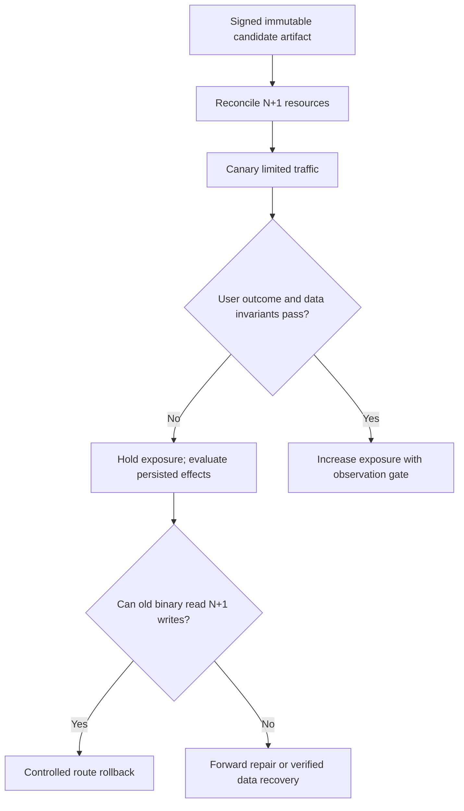

# Canary acceptance and shared-state damage

**Owning question:** How can a small rollout create effects that a binary rollback cannot undo?

This page belongs to [V08/C04 — GitOps, rollout and progressive delivery](README.md). Use the integrated walkthrough for the surrounding decision; the sections below own this narrower mechanism and its limits.

<!-- tycho-question-source:tycho.page.b938ff1a06264492a425f2eff555ae7d:3 -->
## 3. Original fictional canary failure

A hypothetical registration application adds a new durable state field. Candidate N+1 handles only five percent of user requests, but commits state that old N cannot interpret. The canary's own requests succeed, while old N instances later fail reading those same records.

**Text alternative:** a rollout controller introduces a candidate to some requests. Failure can trigger a stop, but route rollback is safe only when old binaries can handle persisted state; otherwise repair/recovery is needed. This diagram represents a proposed gate, not an executed rollout.

Even a very small canary can alter shared schema or deliver an irreversible external effect. A metric-based analysis cannot repair those effects after an unsafe write has already committed.

### Worked decision: five-percent canary with a shared write schema

A fictional service is currently running release N in three zones. Release N+1 adds a required `reservation_state = CONFIRMED_V2` value. Old release N does not recognize that value. Even if N+1 receives only five percent of traffic, it writes the same authoritative database accessed by N. The **exposure percentage does not bound the fraction of old-version readers that can encounter the new state**.

| Phase | Required operating invariant | Negative observation and next action |
|---|---|---|
| P0 — Compatibility preparation | N can read every value that N+1 is allowed to write, or N+1 must not write new-only values yet | If old-reader compatibility fails, reject the canary before exposure |
| P1 — Deployment without behavior activation | Artifact digest and configuration are pinned; feature remains disabled | A healthy pod label is not sufficient promotion evidence |
| P2 — Small cohort | Both candidate and baseline use the same authorized tenant/operation/long-tail acceptance checks | Missing rare tenant operations means measurement is incomplete, not green |
| P3 — Partial failure | Candidate error or cross-version invariant break freezes promotion | First fence new-only writes, then decide routing rollback versus forward repair |
| P4 — Promotion | Every remaining old consumer and delayed message version is inventoried | Old binary still reading incompatible persisted state blocks release completion |
| P5 — Retire | No-return change is separately authorized with recovery evidence | A replica rollback is not evidence of safe schema restoration |

The minimal safe option may be **retain the old write format** while rolling out N+1 readers and collecting compatibility evidence. Only then allow a new writer behind an explicit gate. If N+1 has already emitted a state that N cannot read, changing Kubernetes deployment replicas back to N could *increase* failures. The correct recovery is a version-compatible forward repair or verified data restoration, under the authority policy of the data owner; the rollout controller alone cannot decide it.

For this synthetic rollout, an actionable go/no-go record includes offered traffic by cohort, exact N/N+1 binary mix, new-state write count, domain-result failures, reconciliation lag, deadline and the named approver of irreversible changes. A falsification experiment would deliberately let a N+1 canary commit one incompatible record and verify that automatic rollback is **refused** until the repair path is proven. This scenario is an **unexecuted proposed test**, not a claim about an Argo Rollouts or Kubernetes deployment. The [schema/compatibility chapter](../c05/mixed-version-database-compatibility-and-online-ddl.md) owns reader-writer combination checks, not this release controller.

<!-- /tycho-question-source -->
<!-- tycho-question-source:tycho.page.b938ff1a06264492a425f2eff555ae7d:5 -->
## 5. Deciding which exposure mode fits

- **Rolling** may be suitable for additive stateless changes where compatible version overlap is proven.
- **Blue/green** can reduce some deployment cutover risk if states and client contracts remain compatible, at higher resource cost.
- **Canary** can make uncertainty observable in a limited sample, but must expose enough relevant workload to discriminate errors.
- **Recreate** may be acceptable under a negotiated downtime if no mixed binaries are permitted, but background consumers can still be active.
- **Feature-controlled release** can decouple dormant implementation deployment from functionality, but toggling a feature off does not undo existing persisted state.

Selecting a style is a decision about the change's **risk envelope**, not only a traffic-routing preference.

<!-- /tycho-question-source -->
<!-- tycho-question-source:tycho.page.b938ff1a06264492a425f2eff555ae7d:6 -->
## 6. Proposed negative experiments

A test fixture (not run) should inject:
- N+1 writes that N cannot read;
- canary traffic too small to include rare authorized operations;
- readiness green but user state invalid;
- controller restarted mid-promotion;
- interrupted rollout with terminating old pods still consuming resources;
- old event consumer replay after new release;
- feature flag off after irreversible side effect;
- rollback command when the old schema is missing.

Report exact deployed revision, observed old/new mix, correct business outcomes, time budgets and any unrepairable effects. Do not report “rollback succeeded” if only replica labels reverted.

<!-- /tycho-question-source -->

## Navigation, prerequisites and source scope

| Route | Destination |
|---|---|
| Parent and source ledger | [Chapter introduction and exact source rows](README.md#chapter-source-ledger) |
| Previous / prerequisite | [Read preceding context](desired-state-exposure.md) |
| Next | [Continue the reasoning](README.md) |
| Integrated question | [Original scenario and limits](gitops-canary-and-progressive-rollout.md) |

The source material keeps its original published/inferred/synthetic/unverified distinctions. Chapter-wide citations are shared reference context, not proof that every cited source supports every sentence on this page. Freshly inspected text is identified explicitly; absent dates and unknowns are retained.
