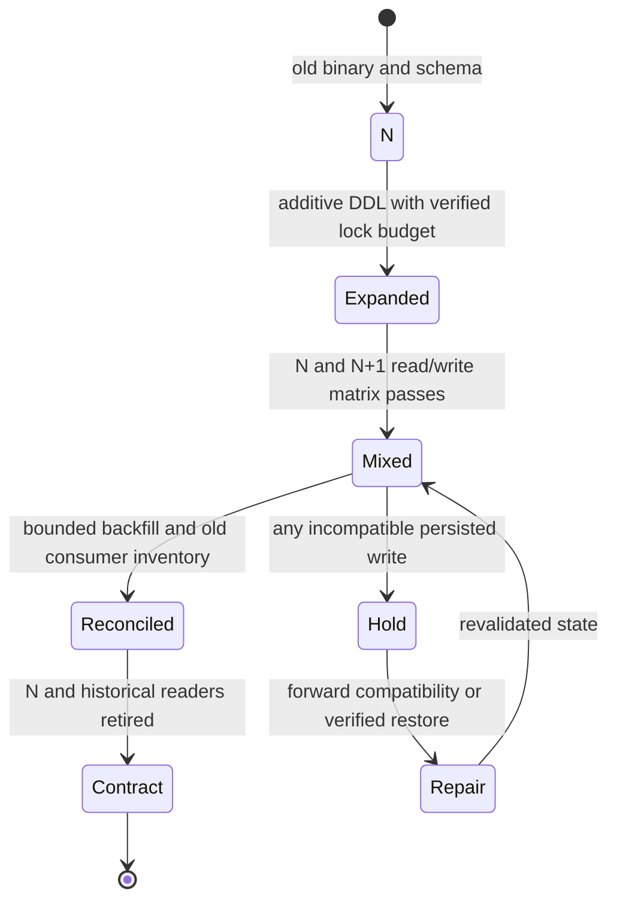

# Reader/writer compatibility and migration stages

**Owning question:** Which combinations must work during expansion, coexistence and contraction?

This page belongs to [V08/C05 — Backward-compatible database change](README.md). Use the integrated walkthrough for the surrounding decision; the sections below own this narrower mechanism and its limits.

<!-- tycho-question-source:tycho.page.77957bf0f2d44c4a9bc819fc5b3e1ddb:1 -->
## 1. Check the real combinations, including old readers

For two binary versions N and N+1 with old, expanded and contracted schema states:

| Running component / data state | Old state | Expanded transition state | Destructive new-only state |
|---|---|---|---|
| Old API N | Known baseline (still test under workload) | Must interpret new optional values and preserve existing writes | Often fails if required old field removed |
| New API N+1 | May require fallback decoder | Must read/write both old and new valid meanings | Target candidate, not safe while N active |
| Old background consumer | Can replay historical events | Must tolerate optional/mapped fields | May reject or silently misread new-only events |
| New consumer | Must still decode retained old events | Mixed-format tests required | New-only assumptions can break replay |
| Restore process | Needs version-compatible backups and readers | Must resolve historical state correctly | Old restore images may fail reading newer data |

An *additive field* may still be semantically incompatible: old code might deserialize a fixed projection, treat unknown enum values as errors, or misclassify absence as an allowed action.

<!-- /tycho-question-source -->
<!-- tycho-question-source:tycho.page.77957bf0f2d44c4a9bc819fc5b3e1ddb:2 -->
## 2. Expand-migrate-contract includes a compatibility window

The public [Parallel Change method](https://martinfowler.com/bliki/ParallelChange.html) frames an interface expansion, client migration and eventual contract/removal. Applying that to database schemas requires versioned DB-specific locks and data invariants, not just a column rename.

**Original fictional change:** a tool-registration API replaces display_name with canonical_item_id. During coexistence, a temporary schema holds both. New writers must preserve enough old representation for old supported readers until a verified cutover. If an old row has no valid mapping, the new reader must say **unknown**, not invent an ID.

**Text alternative:** expand the representation, run a tested mixed-version phase, reconcile migrated data, and contract only after old readers are proven absent. Incompatible writes hold the rollout and may require forward repair rather than redeploying N. Nothing was actually deployed or migrated.

<!-- /tycho-question-source -->

## Navigation, prerequisites and source scope

| Route | Destination |
|---|---|
| Parent and source ledger | [Chapter introduction and exact source rows](README.md#chapter-source-ledger) |
| Previous / prerequisite | [Read preceding context](mixed-version-database-compatibility-and-online-ddl.md) |
| Next | [Continue the reasoning](ddl-events.md) |
| Integrated question | [Original scenario and limits](mixed-version-database-compatibility-and-online-ddl.md) |

The source material keeps its original published/inferred/synthetic/unverified distinctions. Chapter-wide citations are shared reference context, not proof that every cited source supports every sentence on this page. Freshly inspected text is identified explicitly; absent dates and unknowns are retained.
