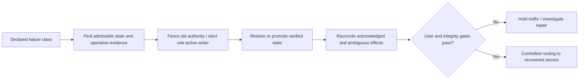

# Disaster recovery: measured RTO, RPO, fencing and state reconciliation

> **Tycho V08/C07 book manuscript**, 2026-10-19. Versioned PostgreSQL 17 PITR and public Well-Architected recovery-strategy guidance were reviewed. The failure chronology, tables and proposed drills are original fictional material. No failover, region loss, backup restore, replication test or independent human review was executed. Earlier [regional/DR research](../../../deployment/multi-region-disaster-recovery-contracts.md) is preserved.

## Purpose and mission

Disaster recovery is not “run a copy somewhere else.” Its engineering deliverable is the ability to **restore a correct user-visible capability** after a specified disruptive failure within owner-approved loss and time budgets.

A regional failover can recover a process and still fail its business obligations: an asynchronous secondary may lack a recently accepted write, old clients may repeat an operation, and two primaries may accept divergent state. Recovery requires an explicit **failure class, authority transfer, acceptable data loss, reconciliation and verified restart of user journeys**.

[Availability placement](../c06/availability-zones-placement-and-failure-domains.md) owns topology and zonal isolation. [PostgreSQL backup/PITR](../../v05/c07/backup-restore-pitr-and-recovery-drills.md) owns concrete source backup mechanics.

## 1. Define objectives by meaningful clocks and outcomes

- **RTO:** the permitted interval from a named disruption/impact start marker until a specified user journey returns *correct usable service*. Starting the clock after human detection hides part of the outage.
- **RPO:** the permitted age/loss of committed business state for a named failure class, at the chosen acknowledgment boundary.
- **Integrity gate:** what user-visible invariants must hold after recovery (e.g., one accepted allocation for one exclusive tool/time interval).
- **Recovery authority:** who may promote state, fence the old writer, cut traffic and authorize restored operations.
- **Evidence record:** what exact drill revision, event chronology, source data snapshot and observed results support the RTO/RPO claim.

These are *requirements* until an appropriate drill measures outcomes. An intended RPO=0 is not evidence the implementation can acknowledge writes with no possible loss under the declared region failure.

## 2. Replication is not historical recovery

Consider three distinct incidents:
1. **One instance lost:** another valid replica may take over with correct membership/fencing.
2. **Entire region lost:** recover in an independent failure domain, maybe from replicas or retained backups depending on actual loss.
3. **Bad deletion or data corruption:** live replicas may faithfully copy the bad transaction; a historical restore point and business-effect reconciliation are needed.

The [PostgreSQL 17 PITR documentation](https://www.postgresql.org/docs/17/continuous-archiving.html) describes base backups plus appropriate WAL coverage and warns that archive lag increases data-loss risk. Merely storing periodic SQL dumps is not equivalent to physical base backup plus WAL replay.

## 3. Original synthetic recovery scenario

A fictional tool-booking system runs in region A with a recoverable copy in region B. A network partition disconnects A while clients still send requests. The recovery team cannot tell whether the last booking reply was lost before or after durable commit.

A safe conceptual recovery sequence:
1. Declare the failure scope and stop blindly creating new authority.
2. Collect last known durable state and accepted operation identities from available evidence.
3. Authorize **one** active writer and fence or isolate any old writer capable of returning.
4. Select a recoverable database state and record its revision/timeline.
5. Reconcile accepted/rejected/unknown operation IDs with any externally committed effects.
6. Verify authorization, exclusive reservations, idempotent retries and current client contract.
7. Cut traffic, monitor user-correct outcomes and preserve an abort/forward-repair plan.
8. Publish the actual measured recovery interval and actual known loss, not just the desired target.

**Text alternative:** first establish the failure and authority boundaries, then promote or restore a valid state while preventing split-brain. Reconcile previous acknowledged and unknown effects and verify a real user journey before routing traffic. This is not an executed recovery exercise.

### Worked recovery dilemma: the missing acknowledgment and two possible primaries

**Original fictional history:** region A accepts operation K42, commits booking R7 locally and loses network reachability before the caller receives a response. Region B's asynchronous replica has applied an earlier position but not necessarily R7. A new request reaches B while A may still be alive. This is **not evidence of a particular database's implemented failover**; it illustrates an authority boundary.

| State | What an operator actually knows | Safe gate |
|---|---|---|
| A unreachable from control plane | Region or network partition; A may still accept writes | Do **not** declare A dead solely because a heartbeat is missing |
| B considered for promotion | Its replay point, committed operation IDs and lag can be inspected | Verify A is fenced/isolated against new writes before granting B write authority |
| B promoted | B may not contain acknowledged or ambiguous A operations | Identify the chosen recovery point and its **actual** RPO consequence |
| Caller retries K42 | R7 may exist only in A's unreachable history | Treat K42 as unresolved until durable reconciliation; never create a conflicting booking merely because B lacks it |
| A returns | A may have divergent, even previously acknowledged writes | Quarantine old authority; reconcile under one selected source of truth before returning traffic |

**Critical distinction:** *fencing old writes* and *recovering historical acknowledged effects* are separate conditions. Fencing prevents future split-brain; it cannot retroactively make B contain the missing commit. A zero-loss promise would require a suitable acknowledgment/replication protocol with explicit behavior under region partitions and the corresponding availability trade-off. Backups protect against corruption/deletion but cannot by themselves replace a live fencing decision.

**Negative counterexample:** an automated failover sees three missed heartbeats and instantly promotes B, while isolated A continues authorizing bookings. Both sides can now accept the same exclusive resource. A green health probe for each region is compatible with a broken global invariant.

**Proposed drill, not performed:** commit a named operation immediately before partition, record the last durable replication location at both regions, sever controller connectivity while maintaining a client path to A, then require deterministic old-writer fencing, ledger reconciliation and user-level outcome checks before exposing B. Measure RTO from impact to *correct* user capability; measure RPO against the declared acknowledged-operation boundary. If fencing or historical-state evidence is unavailable, **hold writes** rather than claim successful recovery. The [PostgreSQL PITR owner](../../v05/c07/backup-restore-pitr-and-recovery-drills.md) covers database restore internals; this chapter owns region-level authority and business correctness.

## 4. Strategy alternatives have different costs and risks

| Strategy | Potential benefit | Needed proof |
|---|---|---|
| Backup and restore | Economical protected historical state where delay is acceptable | Accessible valid backups, keys/config, data integrity, actual restoration time |
| Pilot-light minimal recovery | Some minimal components/state are prepared | Cold capacity and dependent services become ready within required time |
| Warm standby | Faster restore than fully cold provision for some cases | Replica lag, cutover/fencing, sufficient warm capacity |
| Active/active | Both locations may serve useful work concurrently | Cross-region authority/consistency, conflict handling and higher cost |

The [Well-Architected DR strategies](https://docs.aws.amazon.com/wellarchitected/latest/framework/rel_planning_for_recovery_disaster_recovery.html) describe these families and implementation constraints, not numerical promises for this fictional system. A supposedly active/active design that independently allocates the same exclusive resource in two disconnected regions may violate correctness, even though both regions serve requests.

## 5. Recovery is a state machine with abort conditions

A robust runbook includes:
- trigger and initial triage;
- evidence of old-writer fencing;
- exact recovery source and validated backup/replica timeline;
- proof that required secrets, artifacts, schema versions and access policies exist;
- controlled promotion steps and user-level synthetic/admitted checks;
- actual timestamped RTO/RPO observation;
- treatment of delayed messages, replay, read-projection rebuild and reconciliation;
- explicit no-go and stop/abort conditions;
- return-to-normal/repair of the original region without creating a second writer.

[Recovery automation best practice](https://docs.aws.amazon.com/wellarchitected/latest/reliability-pillar/rel_planning_for_recovery_auto_recovery.html) explicitly emphasizes mechanisms to stop unsafe automated recovery. An automation that cannot be halted while it risks corrupting state is not a reliable DR strategy.

## 6. Falsifiable drill protocol

A safe isolated drill should create known accepted operations, checkpoint their IDs, simulate one declared failure, restore or promote state, and compare actual business outcomes. It should also inject:
- region link partition with old primary returning late;
- missing replica data and delayed WAL;
- corrupted historical state copied to standby;
- lost client acknowledgment after commit;
- an old message redelivered after promotion;
- credential/artifact unavailability;
- incomplete recovery configuration;
- operational rollback attempted after incompatible writes.

No such drills were performed in this chapter. A green health endpoint or replica process alone does not prove a recovered booking journey and restored authoritative truth.

## 7. Public evidence ledger and limits

| Source | Narrow support | Not established |
|---|---|---|
| [AWS Well-Architected DR strategies](https://docs.aws.amazon.com/wellarchitected/latest/framework/rel_planning_for_recovery_disaster_recovery.html) | Strategy families, recovery goals, operational costs and failure handling | Measured RTO/RPO for the synthetic service |
| [AWS automated recovery guidance](https://docs.aws.amazon.com/wellarchitected/latest/reliability-pillar/rel_planning_for_recovery_auto_recovery.html) | Automation constraints and stop mechanism | Executed and safe DR automation |
| [PostgreSQL 17 PITR](https://www.postgresql.org/docs/17/continuous-archiving.html) | Base/WAL recovery and limitations | One actually restorable archived dataset |
| [Tycho earlier combined DR research](../../../deployment/multi-region-disaster-recovery-contracts.md) | Historical topical scenarios | Fully accepted independent source claims |

All services, failures, roles and diagrams are original inventions. No real incident or recovery operation occurred.

**Navigation:** proposed **V08/C07** via [deployment landing](../../../deployment/README.md) and [book outline](../../../PROPOSED-STRUCTURE.md). Read [placement](../c06/availability-zones-placement-and-failure-domains.md), [backup and recovery drills](../../v05/c07/backup-restore-pitr-and-recovery-drills.md), [safe release recovery](../../../delivery/safe-rollout-and-recovery.md).

## Applied M9 evidence: what transfers and what does not

These examples connect the chapter's conditional mechanism to published experiences or synthetic decision exercises. A historical company report is **first-party, time-scoped evidence**, not a controlled Tycho benchmark; an M9 decision playbook is **original synthetic analysis**, not a company decision.

**Case lens — [Netflix — Chaos Kong regional simulation](../../../cases/netflix-chaos-kong-regional-failover.md)**. **Relevant mechanism or architectural contrast:** Application-level regional fault simulation can expose cross-service failover dependencies and missing readiness. **Not established by this report/playbook:** Chaos Kong does not simulate provider-wide physical outage or prove universal multi-region data integrity.

**Transfer test:** before applying the lesson to another legacy system, identify the exact workload, source date, relevant runtime/protocol versions, state authority, failure/recovery gate and the new observation that would reverse the choice. Follow the case's public evidence ledger rather than treating its link as independent proof.

<!-- tycho-edition-navigation -->

## Edition navigation and evidence scope

| Route | Destination |
|---|---|
| Parent chapter | [Question, conclusions and reading route](README.md) |
| Parent volume | [Volume synthesis](../README.md) |
| Book | [Authoritative contents](../../../README.md) |
| Source versions and access scope | [Registered sources](../../../../sources/README.md) and the exact page-local citation ledger above |

The original manuscript was accepted under #213 at the recorded baseline. Earlier draft/review labels describe historical authoring events. Source access, versions, unexecuted experiments and nonclaims retain their original scope; assembly does not assert a new source read or benchmark. The chapter landing adds editorial synthesis and navigation.
