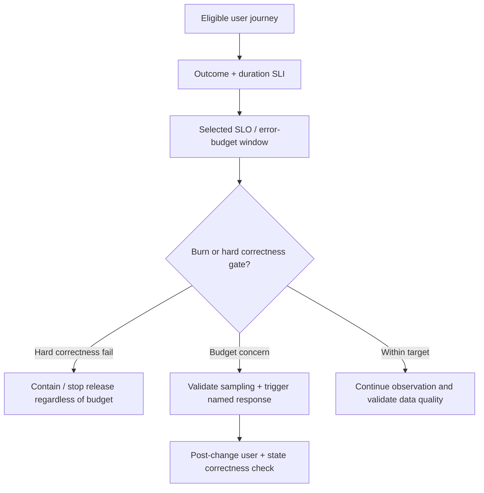

# Error-budget decisions and revisions

**Owning question:** What action should a budget trigger and when should the objective be reconsidered?

This page belongs to [V09/C01 — SLIs, SLOs and error budgets](README.md). Use the integrated walkthrough for the surrounding decision; the sections below own this narrower mechanism and its limits.

<!-- tycho-question-source:tycho.page.c987c475cc5340bcb967f4b6f963b295:4 -->
## 4. Burn rate and alerts are actions, not decorations

An error-budget burn rate compares observed bad-event consumption with the budget's expected consumption rate. A fast burn may need immediate intervention, but short windows can be noisy and long windows slow to detect severe faults.

The [Google SRE Workbook on alerting based on SLOs](https://sre.google/workbook/alerting-on-slos/) describes alert design around error-budget burn rates and time windows. This method does not imply universal thresholds, especially for services with intermittent traffic or where one incorrect operation is intolerable.

| Signal | Useful operational decision | Trap |
|---|---|---|
| Fast error-budget burn | Investigate impact and consider protecting capacity/halting rollout | Alert threshold selected without enough valid event samples |
| Sustained slow burn | Review problem history and release/quality trade-offs | Ignoring long-term harm because there is no loud incident |
| High p99 for one journey | Trace critical-path, queue and dependency wait | Inferring whole-product failure from one selected operation |
| Zero observed errors at idle time | Insufficient demand to validate reliability | Reporting “100% available” with no eligible operations |
| High CPU or pool occupancy | Supporting diagnosis and capacity control | Substituting resource usage for user correctness |
| Trace sampling dropped | Telemetry gap and reduced debugging confidence | Treating missing spans as proof no failures occurred |

<!-- /tycho-question-source -->

> **Pattern atlas:**
> [Synthetic Monitoring](../../v11-pattern-atlas/c11-security-operations/README.md#synthetic-monitoring) — decision conditions and contraindications.

<!-- tycho-question-source:tycho.page.c987c475cc5340bcb967f4b6f963b295:5 -->
## 5. An original synthetic error-budget decision

A hypothetical project owner set a 99.9% good-event target for a defined booking operation during a month. A release increases timeouts, and an operator proposes an automatic rollout pause.

A safe rule would:
1. Check that the event population is correct and the target window sufficiently sampled.
2. Compare logical operation outcomes, not simply network attempts.
3. Stop rollout if a mandatory correctness gate fails, **even with budget remaining**.
4. Use confirmed burn and impact to decide between mitigation, investigation or reversible rollback.
5. Verify that any recovery restores correct booked state rather than merely reducing HTTP errors.
6. Record the signal, source/alert version, decision and follow-up owner.

The action thresholds remain hypothetical. No PromQL query, SLO policy or alert was executed for this chapter.

**Text alternative:** a user journey produces an indicator, compared with a stated objective. A correctness failure always triggers its own mitigation; a budget alert must account for the event sample and leads to a verified response, not a purely cosmetic dashboard change.

<!-- /tycho-question-source -->
<!-- tycho-question-source:tycho.page.c987c475cc5340bcb967f4b6f963b295:6 -->
## 6. SLOs need revision and contradiction handling

An old SLO may cease to represent user experience if a new API version changes which outcomes count as good, if retries are introduced or if the monitoring boundary shifts. Keep the numerator, denominator, units, target, data-source revision and effective date together.

A release can legitimately improve average response time while degrading the worst users. An unrelated region may hide under aggregate metrics; disaggregate by meaningful route/workload where needed without creating dangerous high-cardinality labels or data leakage. The [metrics ingestion/storage chapter](../c02-metrics-ingestion-cardinality-and-time-series-storage/metric-pipelines-cardinality-and-retention.md) owns the telemetry cost and cardinality mechanics.

<!-- /tycho-question-source -->

## Navigation, prerequisites and source scope

| Route | Destination |
|---|---|
| Parent and source ledger | [Chapter introduction and exact source rows](README.md#chapter-source-ledger) |
| Previous / prerequisite | [Read preceding context](sli-population.md) |
| Next | [Continue the reasoning](README.md) |
| Integrated question | [Original scenario and limits](service-level-indicators-objectives-and-alerts.md) |

The source material keeps its original published/inferred/synthetic/unverified distinctions. Chapter-wide citations are shared reference context, not proof that every cited source supports every sentence on this page. Freshly inspected text is identified explicitly; absent dates and unknowns are retained.

## Bounded pattern ownership notes

These notes define the decision boundary for atlas cards whose mechanism is
not the main subject of this page. They are synthetic design guidance, not
measured evidence, and they do not create a new source claim.

### Synthetic Monitoring

Synthetic monitoring exercises a representative user journey from outside the service. It
needs a safe identity, a journey definition, location and frequency choices and a rule
that separates probe failure from product failure. Use it when internal metrics cannot
observe an external dependency, DNS, TLS or end-to-end contract. Do not use shallow
endpoint pings as evidence for a complete journey.

The failure path is a probe that cannot authenticate or that tests only a trivial path;
rotate credentials, cover the critical journey and triage probe noise separately. Real-
user monitoring is the alternative when actual traffic provides enough coverage without
synthetic load.
