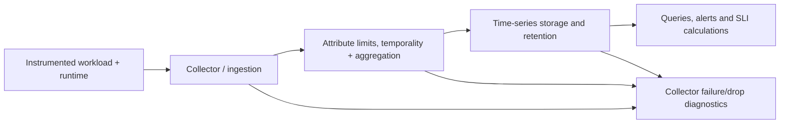

# Metric transport, types and temporality

**Owning question:** Which reset and aggregation semantics survive collection and storage?

This page belongs to [V09/C02 — Metrics ingestion, cardinality and time-series storage](README.md). Use the integrated walkthrough for the surrounding decision; the sections below own this narrower mechanism and its limits.

<!-- tycho-question-source:tycho.page.61b76bbbef8b42de8cc8603a5bc9bf53:1 -->
## 1. Separate measurement generation from retrieval

A generic telemetry pipeline may include:

- Application instrumentation and runtime sampling, where measurements originate with defined identity and units.
- Collector/agent scraping or push collection, subject to scrape schedule, authentication and resource limits.
- Metric processing: safe label attributes, filtering, aggregation, temporality conversion and batching.
- Time-series backend: ingestion, indexing, durable retention, query and compaction/downsampling.
- Alert and dashboard queries against admitted time windows and stored samples.
- Independent data-quality monitoring of missing, late or duplicated telemetry.

**Text alternative:** measurements pass from emitters through collection, filtering and aggregation into bounded time-series storage. Data quality, errors and missing samples must be monitored at collection, transformation and storage. This is a proposed architecture sketch, not a deployed observability stack.

<!-- /tycho-question-source -->
<!-- tycho-question-source:tycho.page.61b76bbbef8b42de8cc8603a5bc9bf53:2 -->
## 2. Measurement types and aggregation limitations

The [OpenTelemetry Metrics Data Model](https://opentelemetry.io/docs/specs/otel/metrics/data-model/) defines sums, gauges, histograms and exponential histograms, attribute identity, timestamps and delta/cumulative aggregation temporality. [Prometheus metric types](https://prometheus.io/docs/concepts/metric_types/) describes counters, gauges, classic/native histograms and summaries, together with version-sensitive behavior. These representations are **not interchangeable without conditions**.

| Type or transform | Suitable purpose | Failure to avoid |
|---|---|---|
| Cumulative monotonic counter | Count attempts, good/bad events or bytes over intervals | Using raw counter delta across reset without reset-aware processing |
| Gauge | Current concurrent work, cache size, memory or queue depth | Treating a snapshot as a count of completed events |
| Histogram | Bucket distribution of durations/size; estimable quantiles under known boundaries | Averaging service p99 quantiles across replicas as though they were samples |
| Summary with quantiles | Local streaming approximate quantiles for a window | Combining incompatible per-instance quantiles as one global quantile |
| Delta sum/histogram | Observations for a bounded interval | Dropping interval start/end times and double-counting on replay |
| Cumulative sum/histogram | Accumulation since a start timestamp | Misreading process restart as a negative business event |

**Critical distinction:** a system's log of individual booking outcomes can establish logical identity; a metric counter alone may double-count retries. A metric stream may show something failed but does not prove the event's authorized business meaning or provide an authoritative audit trail.

<!-- /tycho-question-source -->
<!-- tycho-question-source:tycho.page.61b76bbbef8b42de8cc8603a5bc9bf53:3 -->
## 3. Temporality, restarts and data correctness

OpenTelemetry distinguishes **delta** data points representing bounded non-overlapping intervals from **cumulative** points that include measurements since a start timestamp. For cumulative streams, restart or stream reset changes the start time; collectors must not infer a permanent counter decrease as a legitimate negative operation. Converting temporalities requires careful handling of overlapping time ranges, missing intervals and multiple writers.

A series name, numeric value and timestamp are not enough to interpret it. Include unit, resource scope, metric kind, attribute identity, aggregation temporality and proper start/end semantics where applicable.

The [OpenTelemetry metrics model](https://opentelemetry.io/docs/specs/otel/metrics/data-model/) explicitly discusses delta/cumulative conversion and corresponding reliability/memory trade-offs; not every arbitrary collector extension is guaranteed to preserve semantics. An architecture must test the actual pipeline under restart, duplication, dropped export and mixed-version instrumentation.

<!-- /tycho-question-source -->

## Navigation, prerequisites and source scope

| Route | Destination |
|---|---|
| Parent and source ledger | [Chapter introduction and exact source rows](README.md#chapter-source-ledger) |
| Previous / prerequisite | [Read preceding context](metric-pipelines-cardinality-and-retention.md) |
| Next | [Continue the reasoning](cardinality-retention.md) |
| Integrated question | [Original scenario and limits](metric-pipelines-cardinality-and-retention.md) |

The source material keeps its original published/inferred/synthetic/unverified distinctions. Chapter-wide citations are shared reference context, not proof that every cited source supports every sentence on this page. Freshly inspected text is identified explicitly; absent dates and unknowns are retained.
