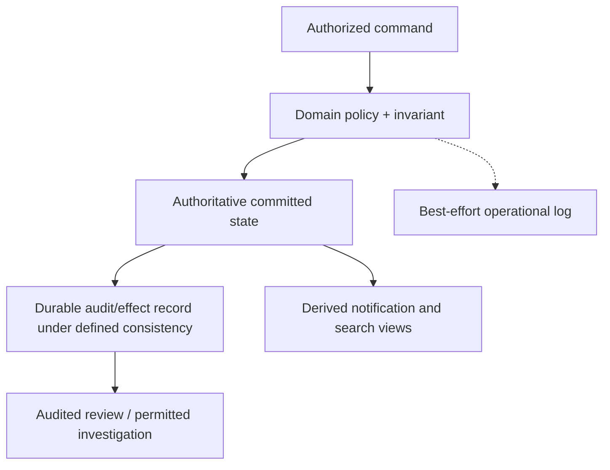

# Logs, authoritative audit and lineage

**Owning question:** Which question is answered by each kind of record?

This page belongs to [V09/C04 — Logging, audit and lineage](README.md). Use the integrated walkthrough for the surrounding decision; the sections below own this narrower mechanism and its limits.

<!-- tycho-question-source:tycho.page.436c2b22dc9e47acaaca7d18fadb511c:1 -->
## 1. Separate semantics before selecting storage

| Evidence type | Primary question | Essential property | Failure or misuse |
|---|---|---|---|
| Operational log | What did this runtime report, and why? | Timestamp, level, context, safe attributes | Log drop interpreted as no event |
| Trace/span | Which instrumented work was causally correlated? | Trace/span identity, sampling/export scope | Trace regarded as every business write |
| Business audit | Who was authorized to change what authoritative state, and what committed? | Durable event/effect identity and integrity policy | Asynchronous log missing after commit |
| Dataset lineage | Which job/run consumed or produced which dataset or partition? | Source/target dataset identity and run/version | A reported dependency treated as data correctness |
| Compliance retention | How long and who can access evidence? | Policy, legal/contract owner, deletion and access scope | Raw secrets indefinitely retained |

The [OpenTelemetry Logs Data Model](https://opentelemetry.io/docs/specs/otel/logs/data-model/) documents timestamps, observed timestamps, trace identifiers, severity, resources, scope and attributes. This is a **structured telemetry model**, not a guarantee that every application log event was recorded atomically with its corresponding business transaction.

<!-- /tycho-question-source -->
<!-- tycho-question-source:tycho.page.436c2b22dc9e47acaaca7d18fadb511c:2 -->
## 2. An original fictional reservation audit

A fictional public equipment library allows members to reserve shared devices. A successful booking should have one authoritative reservation identity, and a cancellation should identify the reservation and authorization decision.

An operational log such as "reservation requested" may be emitted before the database transaction commits. It is valuable diagnostic context, but it is **not evidence of accepted state**. Likewise, a log sink may be unavailable while an authorized operation commits successfully.

An **illustrative domain audit record** might contain a stable effect ID, actor/role reference within authorized access, tenant or resource scope, operation type, target state revision, commit time and an integrity mechanism. Which sensitive fields are admissible, how long they remain and whether they are immutable require actual policy decisions; they cannot be invented by a reference book.

**Text alternative:** a business command passes an authorization and correctness gate. The domain commits authoritative state with a defined audit/effect consistency boundary; separately emitted operational logs may be dropped. Derived notifications and indexes do not automatically replace domain audit evidence.

This design requires a **real implementation of atomicity/consistency** to claim the audit reflects committed state. A diagram doesn't guarantee a transactional outbox or audit record is written atomically with another database.

<!-- /tycho-question-source -->
<!-- tycho-question-source:tycho.page.436c2b22dc9e47acaaca7d18fadb511c:3 -->
## 3. OpenLineage records data-flow relationships, not business approval

[OpenLineage's core specification](https://github.com/OpenLineage/OpenLineage/blob/main/spec/OpenLineage.md) describes Jobs, Runs, input/output Datasets and extensible Facets. Runs represent executions of jobs; data-flow metadata relates those executions to datasets and their change over time.

The [OpenLineage job lineage facet](https://openlineage.io/docs/spec/facets/job-facets/lineage/) can model explicit flow relationships without inferring that each input contributes to every output. This matters in multi-output processing: naïvely creating all possible input/output edges misrepresents the data provenance.

**Synthetic example:** one job reads public catalogue descriptions and device booking status to produce a public listing; a second output aggregates only anonymized usage counts. It would be false to infer that every booking attribute appears in the usage report merely because both outputs came from one job. Lineage should preserve actual mapping and processing semantics.

| Lineage element | Identity / question | Caution |
|---|---|---|
| Job | What transformation is intended? | One job definition has many runs and revisions |
| Run | Which execution occurred and what was observed? | A start event is not completion proof |
| Input dataset | Which version, partition or source was read? | A dataset name without revision can be ambiguous |
| Output dataset | Which artifact or materialized view was written? | Existence does not establish validity or freshness |
| Facet | Which versioned metadata enriches job/run/dataset? | Missing facet does not justify an invented property |

Tycho's separate source-to-claim provenance for its book is a general editorial concept; this chapter covers **data-lineage system design**, not implementation of a curated Tycho knowledge graph.

<!-- /tycho-question-source -->

## Navigation, prerequisites and source scope

| Route | Destination |
|---|---|
| Parent and source ledger | [Chapter introduction and exact source rows](README.md#chapter-source-ledger) |
| Previous / prerequisite | [Read preceding context](logs-audit-and-data-lineage.md) |
| Next | [Continue the reasoning](record-integrity.md) |
| Integrated question | [Original scenario and limits](logs-audit-and-data-lineage.md) |

The source material keeps its original published/inferred/synthetic/unverified distinctions. Chapter-wide citations are shared reference context, not proof that every cited source supports every sentence on this page. Freshly inspected text is identified explicitly; absent dates and unknowns are retained.
